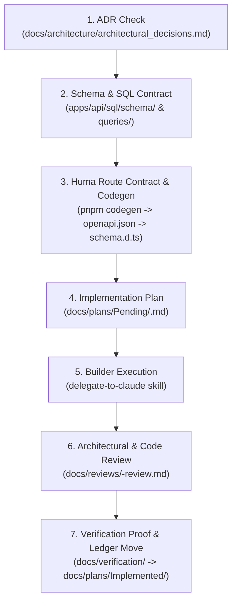

# Idep Project Guardrails & Engineering Rules

> **Scope:** Mandatory rules for all human engineers and AI agents (`Gemini` Architect/Reviewer and `Claude Code` Builder).  
> **Precedence:** Safety & Boundaries > Fail-Closed Governance & Invariants > Schema & Codegen Discipline > Ponytail Minimalism.  
> **Related Contracts:** [`AGENTS.md`](file:///home/xiscohonggono/projects/Idep/AGENTS.md) · [`architectural_decisions.md`](file:///home/xiscohonggono/projects/Idep/docs/architecture/architectural_decisions.md) · [`database_schema.md`](file:///home/xiscohonggono/projects/Idep/docs/architecture/database_schema.md) · [`database_staging_plan.md`](file:///home/xiscohonggono/projects/Idep/docs/architecture/database_staging_plan.md)

---

## 1. Clear "What Is Not Allowed" Rules (Hard Prohibitions)

Violating any rule in this table is an automatic `STATUS: REJECTED` during architectural or code review.

| Category | What Is Strictly NOT Allowed | Required Authoritative Alternative |
| :--- | :--- | :--- |
| **Service & Data Boundaries** | Querying or mutating PostgreSQL tables directly from `apps/web` via `@supabase/supabase-js` or client-side RLS. | Route all domain reads and mutations through `apps/api` (Go + Huma) over typed OpenAPI 3.1 endpoints. |
| **Type Contracts** | Hand-writing request/response DTO interfaces or API types inside `apps/web`. | Register Huma structs in `apps/api`, run `pnpm codegen`, and import generated types from [`apps/web/lib/api/schema.d.ts`](file:///home/xiscohonggono/projects/Idep/apps/web/lib/api/schema.d.ts). |
| **Database Access** | Writing raw inline SQL strings (`db.Query("SELECT ...")`, `fmt.Sprintf` SQL) inside Go handlers, services, or repositories. | Write pure SQL in `apps/api/sql/queries/*.sql` and compile type-safe Go methods via `sqlc generate`. |
| **Fail-Open Fallbacks** | Returning mock/placeholder data when the database is unreachable, a query fails, or authentication is invalid (e.g., the starter stub in `user_repo.go`). | Fail closed with an explicit typed Huma error (`401`, `403`, `404`, `409`, `422`, `503`). |
| **Live Chapter Mutation** | Updating or deleting an existing row in `chapter_versions` or modifying a live chapter bypassing the Maker–Checker proposal workflow (`E-03`, `C-04`). | Insert a new immutable `chapter_versions` row via Checker approval (`C-04`) or Checker rollback (`C-08`). |
| **Self-Approval (`C-06`)** | Allowing any user to claim (`C-02`), approve (`C-04`), or reject (`C-05`) a proposal they authored or co-authored. | Enforce `author_id <> checker_id` and contributor exclusion in UI, Go service layer, and PostgreSQL `CHECK` constraints. |
| **Reasonless Governance Actions** | Submitting an edit without `edit_summary` (`E-03`), requesting changes/rejecting without a reason (`C-05`), rolling back without a reason (`C-08`), or revoking a Checker without a reason (`C-10`). | Validate `char_length(btrim(reason)) > 0` in both Huma input schemas and PostgreSQL `CHECK` constraints. |
| **Silent Conflict Overwrites** | Publishing or submitting a proposal whose `base_version_id` no longer matches `chapters.current_version_id` (`E-09`). | Reject with `HTTP 409 Conflict` and require explicit diff resolution against the latest chapter version. |
| **Ungrounded AI Chat (`U-04`)** | Exposing free-form chat prompts, accepting selections `> 3` paragraphs, or accepting `selected_text` not present in the target `chapter_version`. | Verify verbatim substring match and `1 <= paragraph_count <= 3` before calling the LLM. |
| **Missing Analogy Limits (`U-07`)** | Returning an AI work-experience analogy without a populated *"Where this comparison falls short"* section (`analogy_limits_json`). | Enforce `jsonb_array_length(analogy_limits_json) >= 1` in both Go schema validation and PostgreSQL `CHECK` constraints. |
| **Hallucinated Links (`U-05`, `U-08`)** | Rendering AI-suggested term or prerequisite chapter links that do not resolve to an existing `published` chapter ID in PostgreSQL. | Validate and filter all LLM-returned chapter IDs/slugs against the live catalog before persisting or rendering. |
| **Retroactive Profile Mutation (`U-02`)** | Modifying or regenerating previously saved `ai_explanations` when a user updates or deletes their work experience in `U-02`. | Store `job_field_code` and `role_title_snapshot` immutably on each `ai_explanations` row at creation time. |
| **Punitive Off-Topic Grading (`U-10`)** | Grading empty, whitespace, or off-topic learner re-explanations as failed attempts. | Set `is_graded = FALSE` and return a guiding `hint_text` without penalizing the learner's attempt progression. |
| **Public Educator Proofs (`E-02`)** | Storing educator credential files in public buckets, returning permanent URLs, or exposing proofs to non-admin users. | Store in a private bucket; mint 5-minute signed URLs only for verified `admin` users while writing an `audit_events` entry. |

---

## 2. Fail-Closed Governance Checklist

Every API endpoint in `apps/api` must enforce the following sequence before executing domain logic:

1. **Authentication Verification:** Validate the Bearer JWT (or signed guest session cookie for `U-13` read endpoints). Reject missing, expired, or tampered tokens with `401 Unauthorized`.
2. **Active Role Verification:** Query active roles (`revoked_at IS NULL`) for role-gated routes:
   - `Editor` routes (`E-03`–`E-09`): Require active `editor` role with `guidelines_accepted_at IS NOT NULL`.
   - `Checker` routes (`C-01`–`C-08`): Require active `checker` role (re-verified inside the transaction on state-mutating calls so `C-10` revocation takes immediate effect).
   - `Admin` routes (`E-02` review, `C-09` approval, `C-10` revocation): Require active `admin` role.
3. **Ownership & Separation-of-Duty Checks:**
   - Drafts (`E-04`) are readable and editable only by `author_id`.
   - Proposals in `submitted` or `in_review` cannot be claimed or decided by `author_id` or any user in `proposal_contributors` (`C-06`).
   - Proposals locked as `in_review` by another Checker whose `claim_expires_at > NOW()` (`C-02`) cannot be decided by a different Checker.
4. **Transactional Audit Logging:** Any role change, educator proof view/decision, proposal publication, or chapter rollback must insert a corresponding row into `audit_events` inside the same database transaction.

---

## 3. Contract-First & Dual-Agent Execution Workflow

All feature work must strictly follow this seven-step sequence:

- **Role Separation (`GEMINI.md` & `CLAUDE.md`):**
  - **Architect & Reviewer (`Gemini`):** Authors ADRs, database contracts, and plans in `docs/plans/Pending/`, invokes `delegate-to-claude`, audits the resulting diff against `.agent/rules/project_guardrails.md`, writes reviews in `docs/reviews/`, and records verification proof in `docs/verification/`.
  - **Builder (`Claude Code`):** Implements the minimal code required by `docs/plans/Pending/<feature>.md`, runs `pnpm codegen`, `pnpm lint`, `pnpm test`, and `pnpm build`, and resolves all errors before returning.

---

## 4. Explicit Operational Constraints

- **Database Timeouts:**
  - OLTP query context timeout: `5s` (standard reads/writes).
  - Migration lock timeout: `3s`; migration statement timeout: `30s`.
- **AI Pipeline Timeouts & Quotas:**
  - LLM request timeout: `15s` hard ceiling (`context.WithTimeout`).
  - Highlight input bounds: `1 <= paragraph_count <= 3`, `15 <= char_length <= 3000`.
  - Schema repair retries: Maximum `1` retry on malformed JSON output before failing closed (`503`).
- **Pagination Bounds:**
  - Every list endpoint must enforce `1 <= limit <= 50` (default `20`). Unbounded list queries are prohibited.

---

## 5. Starter Template Technical Debt (Must Remove in Stage 0 / Phase 1)

Inspection of the initial repository scaffold identified three template artifacts that violate Idep's fail-closed and contract-first guardrails and **must be removed during Stage 0 / Phase 1**:

1. **Fail-Open Mock Fallback in [`apps/api/internal/repository/user_repo.go`](file:///home/xiscohonggono/projects/Idep/apps/api/internal/repository/user_repo.go#L41-L46):**
   - *Current issue:* Returns a hardcoded `"Demo User (sqlc + pgx layer)"` when `r.queries` is nil or `GetUserByID` returns an error.
   - *Required fix:* Return a typed domain error (`ErrNotFound` / `ErrDatabaseUnavailable`) and fail closed.
2. **Uncontracted Chi Route in [`apps/api/cmd/server/main.go`](file:///home/xiscohonggono/projects/Idep/apps/api/cmd/server/main.go#L69):**
   - *Current issue:* `router.Mount("/api/v1/users", userHandler)` uses a raw `http.Handler` instead of `huma.Register`, so `/api/v1/users/{id}` is missing from `apps/api/openapi.json` and `apps/web/lib/api/schema.d.ts`.
   - *Required fix:* Migrate all `/api/v1/*` endpoints to `huma.Register` operations so OpenAPI 3.1 codegen covers 100% of the API surface.
3. **Duplicate SQL File [`apps/api/internal/users.sql`](file:///home/xiscohonggono/projects/Idep/apps/api/internal/users.sql):**
   - *Current issue:* Duplicates `apps/api/sql/schema/001_users.sql` outside the `sqlc.yaml` configured directories (`sql/schema` and `sql/queries`).
   - *Required fix:* Delete `apps/api/internal/users.sql` and keep all SQL strictly under `apps/api/sql/`.

