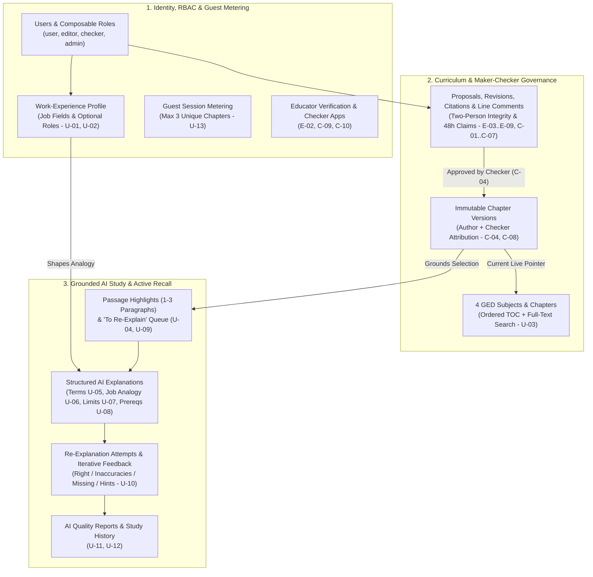

# Idep

**Idep** is a community-driven GED (General Educational Development) study platform that turns working adults' prior job experience into an unfair learning advantage.

Adults studying for the GED—whether to switch careers or qualify for a Bachelor's degree—typically juggle study sessions around work and family commitments. Instead of stopping at static Wikipedia-style notes across the four GED subjects, Idep pairs community-curated study chapters (governed by a **Maker–Checker** editorial workflow) with an **AI study sidebar** that explains highlighted passages using analogies from the learner's own work history, explicitly calls out where those analogies break down, links prerequisite topics, and tests comprehension by having the learner re-explain the concept in their own words.

---

## Architectural & Database Contract Suite

Idep is developed specification-first under a documentation-led onboarding model. Read these foundational contracts before writing or reviewing any feature code:

| Contract Document | Purpose & Scope |
| :--- | :--- |
| **[`README.md`](file:///home/xiscohonggono/projects/Idep/README.md)** | Project overview, business scope & non-goals, domain actors, user journeys, 33-story catalog, and developer onboarding. |
| **[`docs/architecture/architectural_decisions.md`](file:///home/xiscohonggono/projects/Idep/docs/architecture/architectural_decisions.md)** | Architecture Decision Records (ADRs 001–006): service ownership, security boundaries, composable RBAC, Maker–Checker state machine, grounded AI pipeline, privacy/retention, and reliability/failure modes. |
| **[`docs/architecture/database_schema.md`](file:///home/xiscohonggono/projects/Idep/docs/architecture/database_schema.md)** | Authoritative PostgreSQL DDL contract (22 tables across 4 domains), ER diagram, database-enforced invariants, access patterns, and indexing strategy. |
| **[`docs/architecture/database_staging_plan.md`](file:///home/xiscohonggono/projects/Idep/docs/architecture/database_staging_plan.md)** | Safe staged rollout plan (`Expand → Migrate → Verify → Contract`) across Stages 0–4, zero-downtime DDL rules, rollback playbooks, and verification gates. |
| **[`.agent/rules/project_guardrails.md`](file:///home/xiscohonggono/projects/Idep/.agent/rules/project_guardrails.md)** | Explicit *"What Is Not Allowed"* prohibitions, fail-closed governance checklist, operational constraints, and dual-agent workflow rules. |

---

## Start Here: Engineering Execution Order

All foundational and feature work follows a strict **ADRs → Schema → Rollout** sequence before feature UI or handler logic is written:

1. **Architecture Decision Records ([`docs/architecture/architectural_decisions.md`](file:///home/xiscohonggono/projects/Idep/docs/architecture/architectural_decisions.md))**
   Lock down cross-cutting architectural boundaries first:
   - **Identity, Multi-Role RBAC & Guest Metering**: Single accounts holding combinations of `User`, `Editor`, `Checker`, and `Admin` roles, plus 3-free-chapter guest tracking (`U-13`).
   - **Chapter Versioning & Maker–Checker State Machine**: Proposal lifecycle (`Draft` → `Submitted` → `In review` → `Changes requested` | `Published` | `Rejected`), two-person integrity (`C-06` self-approval block), 48-hour review claim expiry (`C-02`), and optimistic concurrency / merge conflict handling (`E-09`, `C-08`).
   - **AI Grounding & Structured Evaluation Pipeline**: Prompting, grounding constraints (strictly anchored to chapter text per `U-04`), structured output contracts for term definitions (`U-05`), step-by-step job-field analogies (`U-06`), analogy limits (`U-07`), prerequisite chapter resolution (`U-08`), and iterative re-explanation grading (`U-09`, `U-10`).
   - **Sensitive Document Handling**: Access controls, short-lived signed URLs, and post-decision purge schedule for licensed educator verification proofs (`E-02`).

2. **Database Schema & Type-Safe Contracts ([`docs/architecture/database_schema.md`](file:///home/xiscohonggono/projects/Idep/docs/architecture/database_schema.md) → `apps/api/sql/` → `pnpm codegen`)**
   Define PostgreSQL migrations and `sqlc` queries before implementing handlers or frontend components:
   - Core tables covering users, role assignments, user work-experience profiles, subjects, chapters, immutable chapter versions, edit/new-chapter proposals, citations, line comments, educator verification requests, checker applications/revocations, learner highlights/explanations, re-explanation attempts, quality reports, notifications, and audit events.
   - Register Huma (OpenAPI 3.1) contracts in `apps/api` and run `pnpm codegen` so `apps/web/lib/api/schema.d.ts` stays the single source of truth across the full stack.

3. **Phased Rollout ([`docs/architecture/database_staging_plan.md`](file:///home/xiscohonggono/projects/Idep/docs/architecture/database_staging_plan.md), [`docs/plans/`](file:///home/xiscohonggono/projects/Idep/docs/plans/) & [`docs/verification/`](file:///home/xiscohonggono/projects/Idep/docs/verification/))**
   Deliver the 33 user stories in priority order (**Must** for initial MVP release, **Should** for fast-follow, **Could** for post-MVP), tracking implementation plans in `docs/plans/Pending/` → `docs/plans/Implemented/` and validation evidence in `docs/verification/`.

---

## Business Scope & Non-Goals

| In-Scope Product Capabilities | Explicit Non-Goals (Out of Scope) |
| :--- | :--- |
| **4 Official GED Subject Curricula (`U-03`):** Mathematical Reasoning, Reasoning Through Language Arts, Science, and Social Studies with ordered chapters, headings, TOC, and keyword search. | **Official GED Exam Administration:** No test proctoring, official exam booking, or diploma issuance. |
| **3-Free-Chapter Guest Metering (`U-13`):** Unauthenticated visitors can read up to 3 distinct chapters for free (re-reading does not consume quota) before hitting a sign-up gate on the 4th chapter. | **Open-Ended AI Chatbots:** No unanchored conversational chat; every AI explanation requires a 1–3 paragraph highlight from a published chapter (`U-04`). |
| **Work-Experience Analogy & Active Recall Loop (`U-01`–`U-12`):** Step-by-step job-field analogies (`U-06`), mandatory analogy breakdown limits (`U-07`), prerequisite links (`U-08`), and formative re-explanation grading (`U-09`, `U-10`). | **Real-Time Multi-Cursor Co-Editing:** Concurrency is handled via optimistic version checking and explicit diff merging (`E-09`), not live WebSocket cursor sync. |
| **Maker–Checker Editorial Governance (`E-01`–`E-10`, `C-01`–`C-10`):** Community edit/new-chapter proposals, two-person review, 48h claim locks, side-by-side diffs, citations, and immutable version rollbacks. | **Direct Unreviewed Publishing or Numeric Test Scores:** No Editor, Checker, or Admin can overwrite a live chapter directly; `U-10` gives qualitative feedback rather than percentage grades. |

---

## Product Overview, Domain Model & Key Workflows

### Bounded Contexts & Domain Model



### Core Learning Loop (`U-01` – `U-13`)

1. **Work-Experience Onboarding (`U-01`, `U-02`)**: Learners select one or more job fields they have worked in (e.g., *F&B*, *Retail*, *Logistics*, *Healthcare*, *Construction*) and optional roles (e.g., *line cook*, *cashier*). If skipped, Idep falls back to everyday-life analogies and prompts the user to add work experience later.
2. **Subject & Chapter Navigation (`U-03`, `U-13`)**: Learners browse and search Wikipedia-style chapters across the four GED subjects:
   - **Mathematical Reasoning**
   - **Reasoning Through Language Arts**
   - **Science**
   - **Social Studies**
   *(Guests may read up to 3 distinct chapters for free; reopening a previously read chapter does not consume an additional slot).*
3. **Highlight-to-Explain Sidebar (`U-04` – `U-08`)**: Highlighting a sentence or passage (up to 3 paragraphs) opens a contextual sidebar anchored to the current chapter's content:
   - **Plain-Language Term Definitions (`U-05`)**: Extracts unfamiliar technical terms (e.g., *chlorophyll*, *glucose*) with 1–2 sentence plain definitions and deep links to dedicated chapters.
   - **Work-Experience Analogy (`U-06`)**: Maps the concept step-by-step onto a workflow from the learner's selected job field (e.g., mapping photosynthesis onto a *Customer → Server → Kitchen → Dish Served* F&B workflow), labeling each analogy element with the exact subject term it stands for. Learners can switch job fields or request another analogy from the same field.
   - **Where This Comparison Falls Short (`U-07`)**: Explicitly lists at least one boundary where the work analogy stops being accurate, paired with the plain-language correction so learners do not carry misconceptions into the GED exam.
   - **Master These First (`U-08`)**: Identifies foundational prerequisite topics the passage relies on and links directly to their chapter pages.
4. **Active Recall & AI Feedback (`U-09` – `U-12`)**:
   - **Re-explain in Your Own Words (`U-09`)**: Immediately after each explanation, the sidebar prompts the learner to explain the concept back in their own words (or save it to a *"To re-explain"* queue when short on time).
   - **Targeted Evaluation (`U-10`)**: The AI evaluates the learner's response—confirming what they got right, correcting each inaccuracy, and explaining missing details plainly. Empty or off-topic answers receive a hint without being graded; retries track improvements across attempts.
   - **Study History & Quality Reporting (`U-11`, `U-12`)**: Learners review past highlights, explanations, answers, and feedback grouped by subject, and can flag inaccurate AI explanations or feedback for review.

### Roles & Maker–Checker Governance

One account can hold multiple roles simultaneously:

| Role | Who They Are | What They Do on Idep |
| :--- | :--- | :--- |
| **Guest** | Unauthenticated visitor exploring Idep | Browses the 4 GED subjects, searches chapters, and reads up to 3 unique chapters for free (`U-13`). Prompted to sign up/log in on the 4th chapter or when invoking the AI explanation sidebar (`U-04`). |
| **User** | An adult studying for the GED (typically working while studying) | Reads unlimited chapters, configures work-experience job fields (`U-01`, `U-02`), highlights passages for grounded AI analogies (`U-04`–`U-08`), re-explains concepts (`U-09`, `U-10`), reviews study history (`U-11`), and reports flawed AI outputs (`U-12`). |
| **Editor** *(Maker)* | Any registered member who opts in and accepts the editing guidelines (`E-01`); may optionally verify credentials as a licensed secondary or higher educator (`E-02`) | Proposes edits to existing chapter pages (`E-03`) or proposes new chapters (`E-06`) using formatting tools, previews, private drafts (`E-04`), citations (`E-05`), and mandatory edit summaries. Never modifies live pages directly. |
| **Checker** *(Checker)* | A community member who applies (`C-09`) and is approved by Idep admins (role is revocable by admins with a logged reason per `C-10`) | Claims proposals with a 48h lease (`C-02`), reviews Editors' submitted proposals via side-by-side diffs (`C-03`) and line comments (`C-07`), requests changes or rejects with mandatory reasons (`C-05`), approves and publishes changes to live chapter pages (`C-04`), and rolls back published versions (`C-08`). Cannot claim or approve their own (or co-authored) proposals (`C-06`). |
| **Admin** *(Verifier)* | Authorized platform administrator (`[ASSUMPTION-A1]`) | Reviews educator credential proofs (`E-02`) via audited short-lived signed URLs, approves or rejects Checker applications (`C-09`), and revokes Checker status with mandatory logged reasons (`C-10`). |

---

## User Story Catalog (33 Stories)

Stories use **MoSCoW** prioritization: **Must** (required for first release / MVP: 21 stories), **Should** (important fast-follow: 11 stories), and **Could** (nice to have: 1 story).

### User Stories (`U-01` – `U-13`)

| ID | Priority | Story Title | Summary & Key Acceptance Criteria |
| :--- | :---: | :--- | :--- |
| **U-01** | **Must** | Set up my work experience at sign-up | Choose one or more job fields (e.g., F&B, Retail, Logistics, Healthcare, Construction) and optional roles at sign-up; fall back to everyday-life analogies if skipped. |
| **U-02** | **Should** | Update my work experience | Add, remove, or reorder saved job fields in profile; applies to future explanations without altering previously saved explanations. |
| **U-03** | **Must** | Browse subjects and chapters | Browse the 4 GED subjects and ordered chapters (with headings and TOC) and search across chapters by keyword. |
| **U-04** | **Must** | Highlight text to open the explanation sidebar | Select up to 3 paragraphs and tap "Explain" to open the sidebar with quoted text; prompt to narrow selection if too long; require login for guests; keep explanations grounded in the chapter content. |
| **U-05** | **Must** | Get unfamiliar terms defined | Extract technical terms from the highlighted selection with 1–2 sentence plain-word definitions and links to corresponding chapter pages. |
| **U-06** | **Must** | Get an analogy from my work experience | Map the concept step-by-step to the user's job field with explicit science/subject labels; allow switching job fields or tapping "Try another analogy". |
| **U-07** | **Must** | See where the analogy falls short | Display a *"Where this comparison falls short"* section listing at least one limit followed by the accurate plain-word explanation. |
| **U-08** | **Must** | Know what to master first | Display a *"Master these first"* list linking prerequisite topics to their respective chapter pages. |
| **U-09** | **Must** | Re-explain the idea in my own words | Prompt the user to re-explain the concept after each explanation, or tap *"Skip for now"* to save to a *"To re-explain"* queue. |
| **U-10** | **Must** | Get feedback on my re-explanation | Evaluate the user's answer (what is right, inaccuracies with corrections, missing details); compare improvements on retry; give a hint without grading if empty or off-topic. |
| **U-11** | **Should** | Review my study history | View past highlights, explanations, answers, and feedback newest-first, grouped by subject, linking back to the source passage. |
| **U-12** | **Should** | Report a wrong AI explanation | Flag an inaccurate AI explanation or evaluation with a reason; log the passage, AI output, and reason with user confirmation. |
| **U-13** | **Must** | Read free chapters as a guest | Allow unauthenticated guests to read up to 3 unique chapters with a remaining-count banner; re-reading an opened chapter does not consume quota; gate the 4th chapter behind sign-up/login. |

### Editor Stories (`E-01` – `E-10`)

| ID | Priority | Story Title | Summary & Key Acceptance Criteria |
| :--- | :---: | :--- | :--- |
| **E-01** | **Must** | Become an Editor | Enable Editor access in account settings after accepting editing guidelines; reveals "Edit" on chapters and adds the Editor role to profile. |
| **E-02** | **Should** | Prove I am a licensed educator | Submit educator proof (license/staff ID, institution, subject taught) visible only to verifiers; awards a *"Verified Educator"* badge on profile and proposals upon approval, or allows resubmission with feedback on rejection. |
| **E-03** | **Must** | Propose an edit to a chapter page | Edit a chapter with formatting tools, preview, and a mandatory edit summary; enters the review queue as `Submitted` while the live page remains unchanged. |
| **E-04** | **Should** | Save a draft | Save unfinished edits (explicitly or on page exit) as private drafts under *"My drafts"*. |
| **E-05** | **Should** | Cite sources for my changes | Attach numbered source citations to added/modified facts, visible on the page and in the Checker review view. |
| **E-06** | **Should** | Propose a new chapter | Submit a new chapter (title, chapter list position, content) under a subject; queued as *"New chapter"* and hidden from learners until approved. |
| **E-07** | **Must** | Track my proposals and get notified | View proposal statuses (`Draft`, `Submitted`, `In review`, `Changes requested`, `Published`, `Rejected`) in *"My proposals"* and receive in-app (plus optional email) notifications on status changes. |
| **E-08** | **Must** | Revise after changes are requested | Revise and resubmit proposals marked `Changes requested`, preserving Checker comments and full version history. |
| **E-09** | **Should** | Handle newer edits to the same page | Detect when a newer chapter version is published while editing, display diffs, and require merging before submission. |
| **E-10** | **Could** | Show my contribution history | Display a public profile with published edit counts, edited subjects, and links to each published change. |

### Checker Stories (`C-01` – `C-10`)

| ID | Priority | Story Title | Summary & Key Acceptance Criteria |
| :--- | :---: | :--- | :--- |
| **C-01** | **Must** | See a review queue | View submitted proposals ordered oldest-first (showing chapter, Editor name, Verified Educator badge, edit summary, submission date) with filters for subject, chapter, and proposal type. |
| **C-02** | **Should** | Claim a proposal before reviewing | Lock an unclaimed proposal as `In review` under the Checker's name; automatically release the claim back to the queue if undecided after 48 hours. |
| **C-03** | **Must** | See exactly what changed | Inspect a side-by-side diff comparing the live chapter and proposed version (insertions in green, deletions in red) alongside the edit summary and citations. |
| **C-04** | **Must** | Approve and publish a proposal | Publish conflict-free proposals to the live chapter page, recording a new version attributed to both Editor and Checker with timestamp, and notify the Editor. |
| **C-05** | **Must** | Request changes or reject, with a reason | Require a non-empty reason when choosing *"Request changes"* or *"Reject"*; update status and notify the Editor with the reason. |
| **C-06** | **Must** | Be blocked from approving my own edits | Enforce Maker–Checker separation: label self-authored or co-authored proposals as *"Your proposal"* and disable claim/approve actions for that user. |
| **C-07** | **Should** | Comment on specific lines | Attach inline review comments to specific lines in a proposal so the Editor sees them in context when revising. |
| **C-08** | **Should** | Roll back a published change | Restore an earlier chapter version from version history with a mandatory reason, creating a new live version and notifying the original Editor and Checker. |
| **C-09** | **Must** | Apply to become a Checker | Submit a Checker application specifying target subjects and background; admins review alongside profile, Verified Educator badge, and contribution history to approve or reject with a reason. |
| **C-10** | **Must** | Be told if my Checker status is revoked | If an admin revokes Checker status with a reason, immediately revoke queue access, release any claimed proposals back to the queue, notify the user, and preserve attribution on previously approved versions. |

---

## Rollout Roadmap

### Phase 1: Foundation, Identity & Reader MVP (`Must` — Migration Stages 0 & 1)
- Account registration, authentication, and work-experience onboarding (`U-01`).
- Four GED subjects, ordered chapter directory, Wikipedia-style chapter reader (headings + TOC), and keyword search (`U-03`).
- Guest 3-chapter metering with remaining-counter and sign-up gate on the 4th chapter (`U-13`).

### Phase 2: Maker–Checker Editorial Loop (`Must` — Migration Stage 2)
- Editor opt-in with guideline acceptance (`E-01`) and chapter edit proposal submission with mandatory edit summaries (`E-03`).
- Checker application and admin approval/revocation workflows (`C-09`, `C-10`).
- Checker review queue (`C-01`), side-by-side diff viewer (`C-03`), self-approval guard (`C-06`), approve-and-publish versioning (`C-04`), request-changes/reject with reason (`C-05`), Editor proposal tracking/notifications (`E-07`), and Editor revision loop (`E-08`).

### Phase 3: AI Work-Analogy & Active Recall Sidebar (`Must` — Migration Stage 3)
- Text selection handler (up to 3 paragraphs) and explanation sidebar grounded in chapter text (`U-04`).
- Plain-language term extraction with chapter cross-links (`U-05`), step-by-step work-experience analogy generation with field switching and regeneration (`U-06`), analogy boundary explanations (`U-07`), and prerequisite chapter recommendations (`U-08`).
- Active recall re-explanation prompt with *"To re-explain"* queue (`U-09`) and structured AI evaluation with retry tracking and off-topic hints (`U-10`).

### Phase 4: Fast-Follow Enhancements (`Should` & `Could` — Migration Stage 4)
- **Learner Enhancements**: Work-experience profile management (`U-02`), study history ledger (`U-11`), and wrong-AI-explanation reporting (`U-12`).
- **Editorial & Governance Enhancements**: Licensed educator verification (`E-02`), private drafts (`E-04`), numbered source citations (`E-05`), new chapter proposals (`E-06`), concurrent edit conflict merging (`E-09`), 48-hour proposal claiming (`C-02`), inline line comments (`C-07`), version rollbacks (`C-08`), and public Editor contribution profiles (`E-10`).

---

## Operating Context & Repository Structure

Idep is built in a Turborepo + `pnpm` monorepo coupling a Next.js (App Router) web application with a Go 1.24 HTTP microservice.

```text
.
├── .agent/
│   └── rules/
│       └── project_guardrails.md           # Hard prohibitions, fail-closed checklist & operational limits
├── .agents/
│   └── skills/                             # Agent workflow skills (delegate-to-claude, migration, ponytail, etc.)
├── apps/
│   ├── api/                                # Go 1.24 HTTP backend (Chi + Huma OpenAPI 3.1 + sqlc + pgx/v5)
│   │   ├── cmd/server/                     # Service entrypoint & --export-openapi exporter
│   │   ├── internal/                       # Domain packages, services, Huma handlers, middleware, and sqlc db
│   │   ├── sql/
│   │   │   ├── schema/                     # Staged PostgreSQL DDL migrations (001..008)
│   │   │   └── queries/                    # Compiled sqlc query files (*.sql)
│   │   ├── sqlc.yaml                       # sqlc compiler configuration
│   │   └── openapi.json                    # Generated OpenAPI 3.1 contract
│   └── web/                                # Next.js (App Router) frontend (React 19, Tailwind CSS, Vitest)
│       └── lib/api/schema.d.ts             # Auto-generated TypeScript types from apps/api/openapi.json
├── packages/                               # Shared UI components (@repo/ui), ESLint, and TypeScript configs
├── docs/
│   ├── architecture/
│   │   ├── architectural_decisions.md      # ADRs (ADR-001 through ADR-006)
│   │   ├── database_schema.md              # PostgreSQL schema contract & access patterns
│   │   └── database_staging_plan.md        # Staged migration & rollback plan (Stages 0–4)
│   ├── plans/                              # Implementation ledger (Pending/ and Implemented/)
│   ├── reviews/                            # Architectural and code review artifacts
│   └── verification/                       # Test logs, rollout checks, and validation evidence
├── AGENTS.md                               # Global & repository engineering instructions
├── GEMINI.md                               # Architect & Reviewer role configuration
├── CLAUDE.md                               # Builder role configuration
└── README.md                               # Project overview & onboarding entry point
```

---

## Documentation-Led Onboarding Guide

### 1. Required Reading Order for New Engineers & Agents
1. Read this [`README.md`](file:///home/xiscohonggono/projects/Idep/README.md) for product domain and user story scope.
2. Read [`docs/architecture/architectural_decisions.md`](file:///home/xiscohonggono/projects/Idep/docs/architecture/architectural_decisions.md) and [`.agent/rules/project_guardrails.md`](file:///home/xiscohonggono/projects/Idep/.agent/rules/project_guardrails.md) to internalize security boundaries, fail-closed governance, and *"What Is Not Allowed"* rules.
3. Inspect [`docs/architecture/database_schema.md`](file:///home/xiscohonggono/projects/Idep/docs/architecture/database_schema.md) and [`docs/architecture/database_staging_plan.md`](file:///home/xiscohonggono/projects/Idep/docs/architecture/database_staging_plan.md) before touching `apps/api/sql/`.
4. Check [`docs/plans/Pending/`](file:///home/xiscohonggono/projects/Idep/docs/plans/Pending/) and [`docs/plans/Implemented/`](file:///home/xiscohonggono/projects/Idep/docs/plans/Implemented/) to see current delivery state.

### 2. Core Commands

| Command | Description |
| :--- | :--- |
| `pnpm dev` | Runs the Next.js frontend (`apps/web`) and Go API (`apps/api`) concurrently via Turborepo. |
| `pnpm codegen` | Compiles SQL queries via `sqlc`, exports `apps/api/openapi.json` from Go Huma structs, and generates `apps/web/lib/api/schema.d.ts`. **Run after any SQL or API contract change.** |
| `pnpm build` | Builds the Next.js production bundle and compiles the Go binary. |
| `pnpm lint` | Runs repository-wide linting across frontend and backend workspaces. |
| `pnpm test` | Runs Vitest suites across frontend workspaces and Go unit/integration tests in `apps/api`. |

### 3. Engineering Guardrails Summary

1. **End-to-End Type Safety**: Never hand-write API response types in `apps/web`. Define routes with Huma structs in `apps/api`, run `pnpm codegen`, and import generated types from `@/lib/api/schema`.
2. **Compiled SQL Only**: Do not embed raw inline SQL strings in Go handlers. Author SQL in `apps/api/sql/queries/*.sql` and compile with `sqlc`.
3. **Fail-Closed Governance**: Never return mock fallback data on DB/auth errors, never permit self-approval (`C-06`), and never mutate live `chapter_versions` in place.
4. **Dual-Agent & Ledger Discipline**: Draft implementation plans in [`docs/plans/Pending/`](file:///home/xiscohonggono/projects/Idep/docs/plans/Pending/), record code reviews in [`docs/reviews/`](file:///home/xiscohonggono/projects/Idep/docs/reviews/), log verification proof in [`docs/verification/`](file:///home/xiscohonggono/projects/Idep/docs/verification/), and move completed plans to [`docs/plans/Implemented/`](file:///home/xiscohonggono/projects/Idep/docs/plans/Implemented/).
