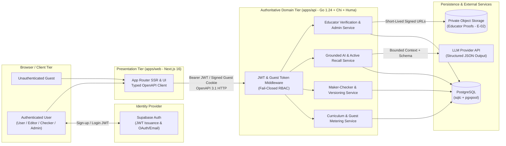
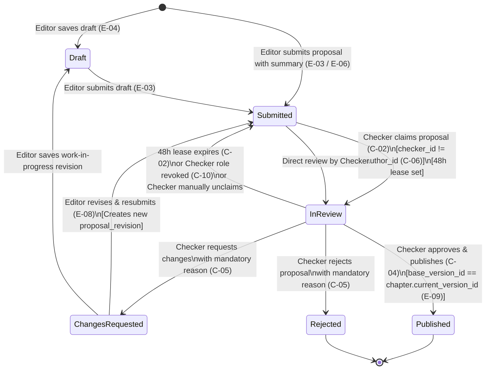
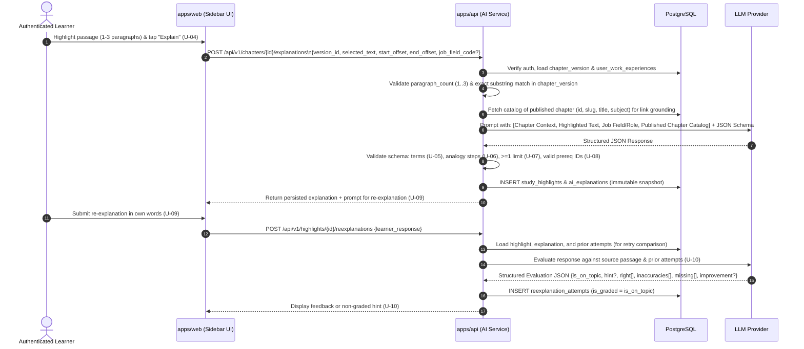

# Architectural Decision Records (ADRs)

> **Status:** Accepted (Foundational Contract)  
> **Scope:** Idep MVP (`Must`) & Fast-Follow (`Should` / `Could`) across all 33 User Stories (`U-01`–`U-13`, `E-01`–`E-10`, `C-01`–`C-10`)  
> **Related Contracts:** [`database_schema.md`](file:///home/xiscohonggono/projects/Idep/docs/architecture/database_schema.md) · [`database_staging_plan.md`](file:///home/xiscohonggono/projects/Idep/docs/architecture/database_staging_plan.md) · [`project_guardrails.md`](file:///home/xiscohonggono/projects/Idep/.agent/rules/project_guardrails.md)

---

## 1. Architectural Principles & Governance Posture

Idep is governed by seven non-negotiable engineering principles:

1. **ADR-First Design:** No database migration, API contract, or UI workflow is implemented until its cross-cutting architectural boundaries and invariants are recorded here.
2. **Schema-First Thinking:** Domain invariants (two-person integrity, version immutability, paragraph bounds, non-empty governance reasons) are enforced in PostgreSQL constraints and compiled via `sqlc`, then projected through Huma (OpenAPI 3.1) into TypeScript (`apps/web/lib/api/schema.d.ts`).
3. **Staged Migration Safety:** Every schema evolution follows an **Expand → Migrate → Verify → Contract** lifecycle with explicit rollback paths and zero-downtime lock discipline.
4. **Privacy by Design:** Learner work profiles, study history, and educator verification credentials obey strict data minimization, purpose limitation, isolated storage, and defined retention windows.
5. **Explicit Operational Constraints:** Every external call, database query, and user input has bounded size, concurrency, and timeout budgets.
6. **Fail-Closed Governance:** Authentication failures, missing role grants, expired review locks, base-version conflicts, and malformed AI outputs must reject the operation safely rather than falling back to permissive or unverified state.
7. **Documentation-Led Onboarding:** Repository documentation is the authoritative specification for both human engineers and autonomous coding agents.

---

## 2. Business Scope & Explicit Non-Goals

### 2.1 In-Scope Capabilities
- **Curated GED Curriculum Reader (`U-03`, `U-13`):** Structured study chapters across the four GED subjects (*Mathematical Reasoning*, *Reasoning Through Language Arts*, *Science*, *Social Studies*) with headings, Table of Contents (TOC), keyword search, and 3-free-chapter metering for unauthenticated guests.
- **Work-Experience-Grounded AI Study Sidebar (`U-01`, `U-02`, `U-04`–`U-08`):** Contextual explanations anchored strictly to a learner-highlighted passage (1–3 paragraphs), producing plain-language term definitions, step-by-step analogies mapped to the learner's prior job fields (or everyday life if skipped), explicit analogy breakdown limits (*"Where this comparison falls short"*), and prerequisite chapter links (*"Master these first"*).
- **Active Recall & Iterative Evaluation (`U-09`–`U-12`):** Prompting learners to re-explain concepts in their own words (or queue for later), evaluating accuracy/inaccuracies/missing details without numerical test scores, tracking improvements across retries, and allowing users to report flawed AI outputs.
- **Maker–Checker Editorial & Trust Governance (`E-01`–`E-10`, `C-01`–`C-10`):** Community-proposed chapter edits and new chapters (`Editor` role), optional licensed educator credential verification (`Verified Educator` badge), two-person review and publication (`Checker` role), 48-hour claim leases, optimistic concurrency conflict resolution, version rollbacks, and admin-managed Checker approval/revocation.

### 2.2 Explicit Non-Goals (Out of Scope)
- **Official GED Testing or Certification:** Idep is a study platform; it does not administer official GED exams, issue diplomas, or integrate with state testing registries.
- **Open-Ended AI Chatbots:** Learners cannot engage in free-form, unanchored conversational chat with the AI. Every AI generation is bound to a specific highlighted passage (`<= 3` paragraphs) from a published chapter version (`U-04`).
- **Real-Time Collaborative Editing:** Multiple Editors do not co-edit a live cursor document simultaneously. Concurrent edits to the same chapter are handled asynchronously via base-version conflict detection and explicit diff merging before submission (`E-09`).
- **Direct Live Content Mutation:** Neither Editors, Checkers, nor Admins may overwrite a live chapter in place. All content updates—including rollbacks (`C-08`)—must create a new immutable `chapter_versions` record.
- **Numeric Grading or Pass/Fail Scoring on Re-Explanations:** `U-10` provides qualitative formative feedback (what was right, specific corrections, missing details, or an ungraded hint if off-topic/empty), never percentage grades or punitive scores.
- **Automated Third-Party License Verification:** Educator credentials (`E-02`) are reviewed by authorized human verifiers (`Admin`), not scraped from external state licensing databases.

---

## 3. System Topology, Security Boundaries & Service Ownership (ADR-001)

### 3.1 Context & Problem
The monorepo contains a Next.js 16 frontend (`apps/web`), a Go 1.24 HTTP API (`apps/api`), Supabase client libraries (`@supabase/ssr`), and PostgreSQL (`pgx/v5` + `sqlc`). Without strict boundary ownership, business rules (such as Maker–Checker separation or guest metering) risk being split between frontend Supabase calls and backend Go handlers.

### 3.2 Decision
`apps/api` is the **sole authoritative domain, governance, storage-signing, and AI orchestration boundary**. `apps/web` acts strictly as the presentation and session-forwarding tier.

### 3.3 Service Ownership Matrix

| Component | Owned Responsibilities | Explicitly Forbidden |
| :--- | :--- | :--- |
| **`apps/web`** (Next.js) | UI rendering, text selection anchoring (`U-04`), side-by-side diff display (`C-03`, `E-09`), Supabase Auth session management, forwarding JWT/guest cookies to `apps/api`. | Direct PostgreSQL queries via `@supabase/supabase-js`, direct LLM API calls, direct object storage bucket reads for `E-02`, hand-written API DTO types. |
| **`apps/api`** (Go) | JWT verification, multi-role RBAC enforcement, guest quota metering (`U-13`), Maker–Checker state machine, optimistic concurrency checks, LLM prompt construction & schema validation, private storage signed URL generation, audit logging. | Inline SQL outside `apps/api/sql/queries/*.sql`, fail-open mock responses when DB or auth fails, uncontracted domain endpoints outside Huma. |
| **Supabase Auth** | User credential verification, JWT signing, password reset / email verification flows. | Storing mutable RBAC state in client-editable `user_metadata` claims. |
| **PostgreSQL** | Relational integrity, foreign keys, `CHECK` constraints (e.g., `author_id <> checker_id`), full-text search (`tsvector`), transactional locking. | Business orchestration via complex opaque stored procedures when Go + `sqlc` transactions suffice. |

---

## 4. Identity, Composable Multi-Role RBAC & Guest Metering (ADR-002)

### 4.1 Context & Problem
A single account on Idep can simultaneously act as a Learner (`User`), propose chapter edits (`Editor`), review other editors' proposals (`Checker`), and administer verification queues (`Admin`). Additionally, unauthenticated guests must be permitted to read up to 3 distinct chapters for free (`U-13`), where re-reading an already-opened chapter does not consume additional quota, and opening a 4th chapter gates behind sign-up/login.

### 4.2 Decision: Composable Database-Backed Roles
1. **Role Set:** Every authenticated user receives the base `user` role upon onboarding. Additional roles (`editor`, `checker`, `admin`) are stored as separate rows in `user_roles` with grant/revocation metadata.
2. **Authoritative Role Lookup:** On each authenticated request to `apps/api`, middleware validates the Supabase JWT signature and resolves active roles (`WHERE user_id = $1 AND revoked_at IS NULL`) from PostgreSQL (or a short-TTL server cache invalidated immediately on role change). Client-supplied role headers or mutable JWT `user_metadata` claims are never trusted.
3. **Instant Checker Revocation (`C-10`):** When an `admin` revokes a user's `checker` role:
   - Within a single database transaction, `user_roles.revoked_at`, `revoked_by`, and `revocation_reason` (mandatory non-empty) are recorded.
   - All proposals currently locked as `in_review` by that user (`claimed_by = $user_id`) are atomically reset to `submitted` (`claimed_by = NULL`, `claimed_at = NULL`, `claim_expires_at = NULL`).
   - A high-priority notification (`notifications`) and an immutable `audit_events` record are written.
   - Historical `chapter_versions.checker_id` references remain intact for audit attribution.

### 4.3 Decision: Guest 3-Chapter Metering (`U-13`)
1. **Identification:** When an unauthenticated visitor requests a chapter, `apps/api` inspects an `HTTPOnly`, `Secure`, `SameSite=Lax` HMAC-signed cookie (`idep_guest_session`) containing a server-issued `guest_session_id` (UUID). If absent, `apps/api` mints a new session row in `guest_sessions`.
2. **Idempotent Chapter Tracking:**
   - Reading chapter `C` executes an `UPSERT` into `guest_chapter_reads (guest_session_id, chapter_id)`.
   - If `C` is already in the guest's set of opened chapters, the read succeeds immediately (`remaining = 3 - count`) without consuming a new slot.
   - If `C` is not in the set and `COUNT(chapter_id) < 3`, `C` is inserted and the chapter content is returned alongside `remaining_free_chapters` (`2`, `1`, or `0`).
   - If `C` is not in the set and `COUNT(chapter_id) >= 3`, `apps/api` fails closed with `HTTP 403 Forbidden` (error code `GUEST_CHAPTER_LIMIT_REACHED`), returning chapter metadata (title/subject) only and instructing `apps/web` to render the sign-up/login gate.
3. **Abuse Defense:** `[ASSUMPTION]` To deter trivial cookie-clearing bypasses without invading privacy, `guest_sessions` stores a salted daily-rotating SHA-256 hash of `(IP prefix + User-Agent)` for rate-limiting new guest session creation per IP window, never storing raw IP addresses.

### 4.4 Consent & Opt-In / Opt-Out Governance

| Capability | Story ID | Consent / Opt-In Rule | Opt-Out / Revocation Behavior |
| :--- | :---: | :--- | :--- |
| **Work Experience Profile** | `U-01`, `U-02` | Optional at sign-up (`Skip for now` allowed). Explicit selection of job fields and optional role titles. | User can remove or reorder fields anytime in Profile (`U-02`). Removal stops future use of that job field but **never mutates or deletes** previously generated explanations (`U-11`). |
| **Editor Role Activation** | `E-01` | Explicit opt-in in Account Settings requiring checkbox acceptance of Editing Guidelines (`guidelines_accepted_at` logged). | User may stop editing at any time; published revisions remain attributed under CC/platform terms (`E-10`). |
| **Educator Credential Proof** | `E-02` | Strictly optional opt-in for Editors who want the *Verified Educator* badge. Consent notice states proofs are visible only to authorized verifiers (`Admin`). | User may withdraw a pending verification request; raw credential files are purged after verification decision + retention window. |
| **Checker Role Application** | `C-09`, `C-10` | Explicit application by user, approved by `Admin`. | User may step down or have status revoked by `Admin` (`C-10`), immediately releasing active review claims. |
| **Status Notifications** | `E-07` | In-app workflow notifications are transactional for active Editors/Checkers; email notifications require explicit opt-in toggle (`email_notifications_enabled`). | User can toggle email notifications off at any time in account settings without affecting in-app status tracking. |

---

## 5. Chapter Versioning & Maker–Checker State Machine (ADR-003)

### 5.1 Context & Problem
Study materials must remain reliable for GED exam preparation while being community-editable. No single Editor may publish unreviewed content (`E-03`), no Checker may approve their own or co-authored work (`C-06`), abandoned reviews must not stall the queue indefinitely (`C-02`), concurrent edits must not silently overwrite each other (`E-09`), and defective publications must be reversible with full auditability (`C-08`).

### 5.2 Decision: Immutable Version Graph & Proposal Lifecycle

### 5.3 Core Maker–Checker Invariants
1. **Immutable `chapter_versions` (`C-04`, `C-08`):**
   - `chapter_versions` rows are strictly append-only (`INSERT` only; `UPDATE` and `DELETE` are blocked by database trigger and omitted from `sqlc` queries).
   - Approving a proposal (`C-04`) inserts a new row into `chapter_versions` with `version_number = prev_version + 1`, `author_id = proposal.author_id`, `checker_id = current_checker_id`, and updates `chapters.current_version_id` in the same serializable/row-locked transaction (`SELECT ... FOR UPDATE` on `chapters`).
2. **Two-Person Integrity (`C-06`):**
   - Enforced at three layers:
     1. **UI Layer (`apps/web`):** Proposals where `author_id == current_user.id` (or user is listed in `proposal_contributors`) display a *"Your proposal"* badge with *Claim* and *Approve* buttons disabled.
     2. **Service Layer (`apps/api`):** Claim (`C-02`) and Decision (`C-04`, `C-05`) handlers verify `proposal.author_id != caller.id` and `caller.id NOT IN (proposal_contributors)`.
     3. **Database Layer (`PostgreSQL`):** `CHECK (claimed_by IS NULL OR claimed_by <> author_id)` on `proposals` and `CHECK (author_id <> checker_id)` on `chapter_versions`.
3. **48-Hour Claim Lease (`C-02`):**
   - Claiming a proposal sets `status = 'in_review'`, `claimed_by = $checker_id`, `claimed_at = NOW()`, and `claim_expires_at = NOW() + INTERVAL '48 hours'`.
   - **Dual Enforcement (Lazy + Sweep):**
     - *Lazy Evaluation:* Queue queries (`C-01`) and claim mutations treat any row with `status = 'in_review' AND claim_expires_at < NOW()` as unclaimed/reclaimable.
     - *Background Sweep:* An in-process Go ticker (every 5 minutes) transitions expired `in_review` rows back to `submitted` and clears `claimed_by`, recording an audit event.
4. **Optimistic Concurrency & Conflict Resolution (`E-09`, `C-04`):**
   - Every edit proposal records `base_version_id` (the `chapters.current_version_id` when the Editor began editing).
   - If another proposal is published first, advancing `chapters.current_version_id` to `V_new`:
     - Any attempt by an Editor to submit or a Checker to publish a proposal where `base_version_id != chapters.current_version_id` fails closed with `HTTP 409 Conflict` (`CHAPTER_VERSION_CONFLICT`), returning both `base_version`, `current_version`, and `proposed_content`.
     - The Editor must review the three-way / side-by-side diff (`E-09`), resolve conflicts into a new `proposal_revisions` snapshot anchored to `base_version_id = V_new`, and resubmit.
5. **Rollbacks as Forward Versions (`C-08`):**
   - Rolling back from `V_5` to `V_3` does **not** delete `V_4` or `V_5`. Instead, the Checker supplies a mandatory non-empty `rollback_reason`, creating `V_6` whose content and citations clone `V_3`, with `rollback_from_version_id = V_3.id` and `rollback_reason` stored on `V_6`, notifying the Editor and Checker of `V_5`.

---

## 6. Grounded AI Explanation & Active Recall Pipeline (ADR-004)

### 6.1 Context & Problem
Learners rely on the AI study sidebar (`U-04`–`U-10`) to translate abstract GED concepts into familiar workplace workflows without introducing exam-breaking misconceptions or hallucinated chapter links.

### 6.2 Decision: Grounded Context Assembly & Structured Schema Validation

### 6.3 Pipeline Guardrails
1. **Input Selection Validation (`U-04`):**
   - Unauthenticated guests receive `401 Unauthorized` prompting login.
   - `selected_text` must be between `15` and `3,000` characters `[ASSUMPTION]` and span `1` to `3` paragraphs (`\n\n` delimiters). Selections exceeding 3 paragraphs are rejected with `422 Unprocessable Entity` (`SELECTION_TOO_LONG`) instructing the learner to narrow their highlight.
   - `selected_text` must exist verbatim within the target `chapter_versions.content_markdown` to prevent prompt-injection via fabricated passage payloads.
2. **Closed-World Link Resolution (`U-05`, `U-08`):**
   - The prompt receives the authoritative list of published `(chapter_id, slug, title)` records.
   - After LLM generation, `apps/api` strips or unlinks any term chapter link (`U-05`) or prerequisite chapter ID (`U-08`) that does not resolve to an actually published chapter in PostgreSQL.
3. **Mandatory Analogy Breakdown (`U-07`):**
   - The structured output validator rejects any LLM response where `analogy_limits` is empty or missing a corresponding `accurate_explanation`. If validation fails once, `apps/api` retries once with a repair prompt, then fails closed (`503 AI_GENERATION_UNAVAILABLE`).
4. **Work Experience Snapshot Immutability (`U-01`, `U-02`, `U-06`):**
   - Each `ai_explanations` row stores the exact `job_field_code` and `role_title` used at generation time (or `is_everyday_fallback = true` if the user skipped `U-01`). Subsequent updates to `user_work_experiences` (`U-02`) affect only new requests.
5. **Non-Punitive Active Recall Grading (`U-09`, `U-10`):**
   - If the learner's response is whitespace-only, gibberish, or classified by the evaluator as off-topic (`is_graded = false`), `apps/api` returns a guiding hint without generating failure critiques, and the attempt is excluded from graded retry progression.

---

## 7. Data Privacy, Retention & Sensitive Document Isolation (ADR-005)

### 7.1 Sensitive Educator Credentials (`E-02`)
1. **Zero Public Access:** Proof documents (teaching licenses, staff IDs) uploaded for `E-02` are stored in a dedicated private object storage prefix with public access disabled at the bucket policy level.
2. **Verifier-Only Access with Audit Trail:**
   - Only accounts holding an active `admin` role may view pending verification proofs.
   - Viewing a proof requires calling `POST /api/v1/admin/educator-verifications/{id}/view-url`, which atomically writes an `audit_events` row (`event_type = 'educator_proof.viewed'`) and returns a signed URL expiring in **300 seconds (5 minutes)** with `Cache-Control: no-store`.
3. **Post-Decision Document Purge:**
   - Once an educator verification request is `approved` or `rejected`, the raw document object is scheduled for automated deletion `[ASSUMPTION: 30 days after decision]`, setting `educator_verifications.document_purged_at = NOW()` while retaining the structured verification decision metadata (`status`, `reviewed_by`, `reviewed_at`).

### 7.2 Data Classification & Retention Schedule

| Data Category | Tables | Classification | Retention & Deletion Policy |
| :--- | :--- | :---: | :--- |
| **Account Identity** | `users`, `user_roles` | Confidential (PII) | Retained while account is active. On account deletion request, `email` and `display_name` are scrubbed/anonymized within `[ASSUMPTION: 30 days]`; `users.deleted_at` is set. |
| **Educator Credential Files** | Object Storage + `educator_verifications` | Restricted / High Sensitivity | Raw file purged `[ASSUMPTION: 30 days]` after admin decision (or immediately upon user withdrawal). Structured badge status retained while user is an Editor. |
| **Learner Work Profile & Study History** | `user_work_experiences`, `study_highlights`, `ai_explanations`, `reexplanation_attempts` | Private User Data | Retained for user's study history (`U-11`); deleted or cascaded upon account deletion. Individual job fields removable immediately (`U-02`). |
| **AI Quality Reports** | `ai_quality_reports` | Internal Operational | Retained for `[ASSUMPTION: 1 year]` for prompt/content quality auditing; detached from `user_id` upon account deletion. |
| **Private Editor Drafts** | `proposals` (`status = 'draft'`) | Private User Data | Deletable by author anytime; abandoned drafts auto-purged after `[ASSUMPTION: 180 days]` of inactivity. |
| **Published Chapters & Editorial Provenance** | `chapters`, `chapter_versions`, `proposals` (submitted/published/rejected) | Public / Integrity Ledger | Retained indefinitely to preserve Maker–Checker auditability (`C-04`, `C-06`, `C-08`, `E-10`). Deleted users appear as `"Former Contributor (<short-hash>)"`. |
| **Guest Metering Ledger** | `guest_sessions`, `guest_chapter_reads` | Ephemeral Pseudonymous | Purged automatically after `[ASSUMPTION: 90 days]` of inactivity or upon conversion to a registered account. |
| **Security & Governance Audit Logs** | `audit_events` | Immutable Compliance Log | Retained for `[ASSUMPTION: 2 years]`; append-only. |

---

## 8. Reliability, Failure Modes & Operational Traceability (ADR-006)

### 8.1 Failure Mode & Degradation Matrix

| Failure Scenario | Affected Stories | Fail-Closed / Degradation Behavior | Recovery & Observability |
| :--- | :---: | :--- | :--- |
| **LLM Provider Timeout or 5xx** | `U-04`–`U-10` | `apps/api` enforces a hard `15s` context timeout. Fails closed with `503 Service Unavailable` (`AI_TEMPORARILY_UNAVAILABLE`); never saves partial/unvalidated explanations. Chapter reading (`U-03`) and editing (`E-03`) remain 100% unaffected. | Structured error log with `request_id`, `model_identifier`, latency; user can retry highlight or save highlight to *"To re-explain"* queue. |
| **LLM Output Violates JSON Schema / Missing Analogy Limit (`U-07`)** | `U-05`–`U-08` | Reject malformed payload; execute at most 1 automatic schema-repair retry within timeout budget. If still invalid, return `503` and increment schema-validation failure metric. | Log validation error path (without logging learner PII). |
| **PostgreSQL Connection Failure / Pool Exhaustion** | All | `apps/api` fails closed with `503` (never returns mock/hardcoded user data). Readiness probe (`/health/ready`) returns `503` to remove instance from load balancer. | `pgxpool` max conns, acquire timeout (`3s`), statement timeout (`10s` OLTP / `30s` migrations). |
| **Concurrent Publish Race on Same Chapter** | `C-04`, `E-09` | Transaction acquires row lock (`SELECT id, current_version_id FROM chapters WHERE id = $1 FOR UPDATE`). Second transaction detects `base_version_id != current_version_id`, aborts commit, and returns `409 Conflict`. | Editor notified to merge against new `current_version_id` (`E-09`). |
| **Checker Abandons Claimed Proposal** | `C-02` | Claim automatically expires at `claimed_at + 48 hours`; proposal becomes claimable by other Checkers immediately upon expiry timestamp. | Background sweep logs `proposal.claim_expired` in `audit_events`. |
| **Admin Revokes Checker While Checker Is Submitting Decision** | `C-10`, `C-04` | Decision transaction checks `EXISTS (SELECT 1 FROM user_roles WHERE user_id = $1 AND role = 'checker' AND revoked_at IS NULL)` inside the transaction. Fails closed with `403 Forbidden`. | Atomic revocation releases claims and logs `role.revoked`. |
| **Object Storage Unavailable During Educator Proof Upload** | `E-02` | `educator_verifications` row is not created (or marked failed) until upload confirmation completes; returns `503`. | Presigned upload TTL `10m`; orphan cleanup job. |

### 8.2 Operational Traceability & Auditability
1. **Request Correlation:** Every HTTP request entering `apps/api` receives a `X-Request-ID` (UUIDv4), propagated through `context.Context`, structured JSON logs, Huma error responses, and `audit_events.request_id`.
2. **Append-Only Governance Ledger (`audit_events`):** Every state transition affecting roles (`E-01`, `C-09`, `C-10`), sensitive document access (`E-02`), proposal lifecycle (`E-03`, `C-02`, `C-04`, `C-05`), and chapter rollbacks (`C-08`) writes a row to `audit_events` within the same database transaction as the state change.

---

## 9. Explicit Assumptions & Open Questions

> [!IMPORTANT]
> In accordance with project governance, no unstated requirements have been silently invented. All architectural assumptions made to complete this contract are marked `[ASSUMPTION]` below and paired with open questions for stakeholder confirmation.

### 9.1 Marked Assumptions
- **`[ASSUMPTION-A1]` Admin / Verifier Bootstrap Role:** Because stories `C-09`, `C-10`, and `E-02` require an "admin" or "verifier" to approve/revoke Checkers and review educator proofs, an `admin` role is included in `user_roles` alongside `user`, `editor`, and `checker`.
- **`[ASSUMPTION-A2]` Selection Length Bounds (`U-04`):** "Up to 3 paragraphs" is enforced as `1 <= paragraph_count <= 3` and `15 <= char_length <= 3000` characters to bound LLM token cost and latency.
- **`[ASSUMPTION-A3]` Chapter Content Format:** Chapters and proposals store body content as sanitized GitHub-Flavored Markdown (`content_markdown`), from which headings/TOC (`U-03`) and line-by-line diffs (`C-03`, `C-07`, `E-09`) are deterministically derived.
- **`[ASSUMPTION-A4]` Sensitive Document Retention (`E-02`):** Raw educator credential uploads are purged 30 days after an approval/rejection decision to minimize PII breach surface, keeping only the verification status and audit record.
- **`[ASSUMPTION-A5]` Single-Author Proposals in MVP:** While `C-06` mentions "authored or co-authored", MVP proposals have a primary `author_id` plus an optional `proposal_contributors` join table (populated when another Editor's draft/merge is incorporated) so `C-06` blocks all contributors from approving.

### 9.2 Open Questions Remaining for Confirmation
1. **Q1 — LLM Provider & Model Selection (`U-04`–`U-10`):** Which LLM provider and model tier (e.g., Gemini 2.5 Flash / Claude Haiku / OpenAI GPT-4o-mini) should `apps/api` target for the explanation and active-recall evaluation pipelines, and what is the per-user daily rate limit?
2. **Q2 — Educator Credential File Formats & Storage Provider (`E-02`):** Should `E-02` require file uploads (PDF/JPEG/PNG up to 5 MB) stored in Supabase Storage (private bucket) / S3, or is text-only credential metadata (license number + institution URL) sufficient for initial Phase 4 rollout?
3. **Q3 — Email Delivery Provider (`E-07`, `C-10`):** Which transactional email service (e.g., Resend, AWS SES, Postmark, or deferred in-app-only for MVP) should back the optional email notifications in `E-07`?
4. **Q4 — Co-Authorship Mechanics (`C-06`):** Under what exact workflow does a proposal become "co-authored" (e.g., when a second Editor takes over an abandoned `changes_requested` proposal, or explicit co-author tagging)?
5. **Q5 — Initial Curriculum Seeding (`U-03`):** How will the initial baseline chapters across the 4 GED subjects be seeded prior to community Editor contributions (seed migration vs. admin CLI import)?

