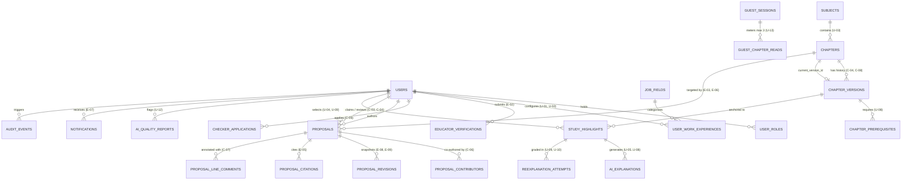

# Database Schema & Persistence Contract

> **Status:** Accepted (Schema-First Contract)  
> **Engine:** PostgreSQL 16+ · **Driver:** `jackc/pgx/v5` · **Compiler:** `sqlc` (`apps/api/sqlc.yaml`)  
> **Related Contracts:** [`architectural_decisions.md`](file:///home/xiscohonggono/projects/Idep/docs/architecture/architectural_decisions.md) · [`database_staging_plan.md`](file:///home/xiscohonggono/projects/Idep/docs/architecture/database_staging_plan.md) · [`project_guardrails.md`](file:///home/xiscohonggono/projects/Idep/.agent/rules/project_guardrails.md)

---

## 1. Schema-First Design Principles

1. **Database-Enforced Domain Invariants:** Critical business rules—such as Maker–Checker two-person separation (`author_id <> checker_id` in `C-06`), non-empty rejection/rollback reasons (`C-05`, `C-08`, `C-10`), and highlight paragraph bounds (`1 <= paragraph_count <= 3` in `U-04`)—are enforced directly via PostgreSQL `CHECK` constraints, `UNIQUE` partial indexes, and immutability triggers, never solely in application memory.
2. **Append-Only Provenance Ledgers:** `chapter_versions`, `proposal_revisions`, and `audit_events` are strictly immutable once inserted. Rollbacks (`C-08`) append a new version referencing the restored snapshot rather than mutating or deleting history.
3. **Compiled SQL Only (`sqlc`):** All queries reside in `apps/api/sql/queries/*.sql` and compile against `apps/api/sql/schema/*.sql` into `apps/api/internal/repository/db/`. Inline SQL strings in Go handlers or repositories are prohibited.
4. **Timestamps & Identifiers:** Every table uses `UUID` primary keys (`gen_random_uuid()`, compatible with Supabase `auth.users.id`) and `TIMESTAMPTZ` (`TIMESTAMP WITH TIME ZONE`) in UTC.

---

## 2. Entity-Relationship Diagram



---

## 3. Authoritative PostgreSQL DDL Contract

### 3.1 Domain 1: Identity, RBAC, Onboarding & Guest Metering (`U-01`, `U-02`, `U-13`, `E-01`, `E-02`, `C-09`, `C-10`)

```sql
-- 1. Core Users Table (synchronized with Supabase auth.users id)
CREATE TABLE users (
    id UUID PRIMARY KEY DEFAULT gen_random_uuid(),
    email TEXT NOT NULL UNIQUE,
    display_name TEXT NOT NULL CHECK (char_length(btrim(display_name)) BETWEEN 1 AND 100),
    onboarding_completed_at TIMESTAMPTZ,
    email_notifications_enabled BOOLEAN NOT NULL DEFAULT FALSE,
    is_verified_educator BOOLEAN NOT NULL DEFAULT FALSE,
    deleted_at TIMESTAMPTZ,
    created_at TIMESTAMPTZ NOT NULL DEFAULT NOW(),
    updated_at TIMESTAMPTZ NOT NULL DEFAULT NOW()
);

-- 2. Composable Multi-Role Grants & Revocations (E-01, C-09, C-10)
CREATE TABLE user_roles (
    id UUID PRIMARY KEY DEFAULT gen_random_uuid(),
    user_id UUID NOT NULL REFERENCES users(id) ON DELETE CASCADE,
    role TEXT NOT NULL CHECK (role IN ('user', 'editor', 'checker', 'admin')),
    guidelines_accepted_at TIMESTAMPTZ,
    granted_by UUID REFERENCES users(id) ON DELETE SET NULL,
    granted_at TIMESTAMPTZ NOT NULL DEFAULT NOW(),
    revoked_by UUID REFERENCES users(id) ON DELETE SET NULL,
    revoked_at TIMESTAMPTZ,
    revocation_reason TEXT,
    CONSTRAINT chk_editor_guidelines CHECK (
        role <> 'editor' OR guidelines_accepted_at IS NOT NULL
    ),
    CONSTRAINT chk_revocation_reason CHECK (
        revoked_at IS NULL OR (revocation_reason IS NOT NULL AND char_length(btrim(revocation_reason)) > 0)
    )
);

-- Enforce at most one active grant per (user_id, role)
CREATE UNIQUE INDEX idx_user_roles_active_unique
    ON user_roles (user_id, role)
    WHERE revoked_at IS NULL;

-- 3. Canonical Job Field Catalog (U-01, U-02, U-06)
CREATE TABLE job_fields (
    code TEXT PRIMARY KEY CHECK (code ~ '^[a-z0-9_]+$'),
    name TEXT NOT NULL UNIQUE,
    description TEXT NOT NULL,
    example_roles TEXT[] NOT NULL DEFAULT '{}',
    display_order SMALLINT NOT NULL UNIQUE,
    is_active BOOLEAN NOT NULL DEFAULT TRUE,
    created_at TIMESTAMPTZ NOT NULL DEFAULT NOW()
);

-- 4. Learner Work-Experience Profile (U-01, U-02)
CREATE TABLE user_work_experiences (
    id UUID PRIMARY KEY DEFAULT gen_random_uuid(),
    user_id UUID NOT NULL REFERENCES users(id) ON DELETE CASCADE,
    job_field_code TEXT NOT NULL REFERENCES job_fields(code) ON DELETE RESTRICT,
    role_title TEXT CHECK (role_title IS NULL OR char_length(btrim(role_title)) BETWEEN 1 AND 80),
    priority_order SMALLINT NOT NULL CHECK (priority_order >= 0),
    created_at TIMESTAMPTZ NOT NULL DEFAULT NOW(),
    updated_at TIMESTAMPTZ NOT NULL DEFAULT NOW(),
    UNIQUE (user_id, job_field_code)
);

CREATE INDEX idx_user_work_experiences_user_priority
    ON user_work_experiences (user_id, priority_order ASC);

-- 5. Guest Session & 3-Free-Chapter Metering (U-13)
CREATE TABLE guest_sessions (
    id UUID PRIMARY KEY DEFAULT gen_random_uuid(),
    fingerprint_hash TEXT NOT NULL,
    converted_user_id UUID REFERENCES users(id) ON DELETE SET NULL,
    created_at TIMESTAMPTZ NOT NULL DEFAULT NOW(),
    last_seen_at TIMESTAMPTZ NOT NULL DEFAULT NOW()
);

CREATE TABLE guest_chapter_reads (
    guest_session_id UUID NOT NULL REFERENCES guest_sessions(id) ON DELETE CASCADE,
    chapter_id UUID NOT NULL, -- FK added after chapters table creation
    first_read_at TIMESTAMPTZ NOT NULL DEFAULT NOW(),
    last_read_at TIMESTAMPTZ NOT NULL DEFAULT NOW(),
    PRIMARY KEY (guest_session_id, chapter_id)
);

-- 6. Licensed Educator Verification Requests (E-02)
CREATE TABLE educator_verifications (
    id UUID PRIMARY KEY DEFAULT gen_random_uuid(),
    user_id UUID NOT NULL REFERENCES users(id) ON DELETE CASCADE,
    institution_name TEXT NOT NULL CHECK (char_length(btrim(institution_name)) > 0),
    subject_taught TEXT NOT NULL CHECK (char_length(btrim(subject_taught)) > 0),
    credential_reference TEXT NOT NULL CHECK (char_length(btrim(credential_reference)) > 0),
    document_storage_key TEXT, -- Private bucket object key; NULL after purge
    status TEXT NOT NULL DEFAULT 'pending' CHECK (status IN ('pending', 'approved', 'rejected', 'withdrawn')),
    reviewed_by UUID REFERENCES users(id) ON DELETE SET NULL,
    reviewed_at TIMESTAMPTZ,
    decision_reason TEXT,
    document_purged_at TIMESTAMPTZ,
    created_at TIMESTAMPTZ NOT NULL DEFAULT NOW(),
    CONSTRAINT chk_educator_rejection_reason CHECK (
        status <> 'rejected' OR (decision_reason IS NOT NULL AND char_length(btrim(decision_reason)) > 0)
    ),
    CONSTRAINT chk_educator_self_review CHECK (
        reviewed_by IS NULL OR reviewed_by <> user_id
    )
);

CREATE INDEX idx_educator_verifications_pending
    ON educator_verifications (created_at ASC)
    WHERE status = 'pending';

-- 7. Checker Role Applications (C-09)
CREATE TABLE checker_applications (
    id UUID PRIMARY KEY DEFAULT gen_random_uuid(),
    user_id UUID NOT NULL REFERENCES users(id) ON DELETE CASCADE,
    target_subject_slugs TEXT[] NOT NULL CHECK (cardinality(target_subject_slugs) > 0),
    background_statement TEXT NOT NULL CHECK (char_length(btrim(background_statement)) >= 20),
    status TEXT NOT NULL DEFAULT 'pending' CHECK (status IN ('pending', 'approved', 'rejected')),
    reviewed_by UUID REFERENCES users(id) ON DELETE SET NULL,
    reviewed_at TIMESTAMPTZ,
    decision_reason TEXT,
    created_at TIMESTAMPTZ NOT NULL DEFAULT NOW(),
    CONSTRAINT chk_checker_app_reason CHECK (
        status = 'pending' OR (decision_reason IS NOT NULL AND char_length(btrim(decision_reason)) > 0)
    ),
    CONSTRAINT chk_checker_app_self_review CHECK (
        reviewed_by IS NULL OR reviewed_by <> user_id
    )
);
```

---

### 3.2 Domain 2: Subjects, Chapters & Immutable Versions (`U-03`, `U-08`, `E-06`, `C-04`, `C-06`, `C-08`)

```sql
-- 8. Four Official GED Subjects (U-03)
CREATE TABLE subjects (
    id UUID PRIMARY KEY DEFAULT gen_random_uuid(),
    slug TEXT NOT NULL UNIQUE CHECK (slug IN (
        'mathematical-reasoning',
        'reasoning-through-language-arts',
        'science',
        'social-studies'
    )),
    title TEXT NOT NULL UNIQUE,
    description TEXT NOT NULL,
    display_order SMALLINT NOT NULL UNIQUE CHECK (display_order BETWEEN 1 AND 4),
    created_at TIMESTAMPTZ NOT NULL DEFAULT NOW()
);

-- 9. Chapters Directory (U-03, E-06)
CREATE TABLE chapters (
    id UUID PRIMARY KEY DEFAULT gen_random_uuid(),
    subject_id UUID NOT NULL REFERENCES subjects(id) ON DELETE RESTRICT,
    slug TEXT NOT NULL,
    title TEXT NOT NULL CHECK (char_length(btrim(title)) BETWEEN 3 AND 200),
    display_order INT NOT NULL CHECK (display_order > 0),
    status TEXT NOT NULL DEFAULT 'pending_initial_publish'
        CHECK (status IN ('pending_initial_publish', 'published', 'archived')),
    current_version_id UUID, -- Circular FK to chapter_versions(id) added via ALTER TABLE
    search_tsv TSVECTOR,
    created_at TIMESTAMPTZ NOT NULL DEFAULT NOW(),
    updated_at TIMESTAMPTZ NOT NULL DEFAULT NOW(),
    UNIQUE (subject_id, slug)
);

CREATE INDEX idx_chapters_subject_order
    ON chapters (subject_id, display_order ASC)
    WHERE status = 'published';

CREATE INDEX idx_chapters_search_tsv
    ON chapters USING GIN (search_tsv)
    WHERE status = 'published';

-- 10. Immutable Chapter Versions (C-04, C-06, C-08, E-10)
CREATE TABLE chapter_versions (
    id UUID PRIMARY KEY DEFAULT gen_random_uuid(),
    chapter_id UUID NOT NULL REFERENCES chapters(id) ON DELETE RESTRICT,
    version_number INT NOT NULL CHECK (version_number > 0),
    title TEXT NOT NULL CHECK (char_length(btrim(title)) BETWEEN 3 AND 200),
    content_markdown TEXT NOT NULL CHECK (char_length(btrim(content_markdown)) > 0),
    toc_json JSONB NOT NULL DEFAULT '[]'::jsonb,
    edit_summary TEXT NOT NULL CHECK (char_length(btrim(edit_summary)) > 0),
    author_id UUID NOT NULL REFERENCES users(id) ON DELETE RESTRICT,
    checker_id UUID NOT NULL REFERENCES users(id) ON DELETE RESTRICT,
    source_proposal_id UUID, -- FK to proposals(id)
    rollback_from_version_id UUID REFERENCES chapter_versions(id) ON DELETE RESTRICT,
    rollback_reason TEXT,
    created_at TIMESTAMPTZ NOT NULL DEFAULT NOW(),
    UNIQUE (chapter_id, version_number),
    -- Two-Person Integrity (C-06): Author and Checker must never be the same account
    CONSTRAINT chk_two_person_integrity CHECK (author_id <> checker_id),
    -- Rollback Provenance (C-08): Rollback requires a non-empty reason
    CONSTRAINT chk_rollback_reason CHECK (
        rollback_from_version_id IS NULL
        OR (rollback_reason IS NOT NULL AND char_length(btrim(rollback_reason)) > 0)
    )
);

ALTER TABLE chapters
    ADD CONSTRAINT fk_chapters_current_version
    FOREIGN KEY (current_version_id) REFERENCES chapter_versions(id) ON DELETE RESTRICT;

ALTER TABLE guest_chapter_reads
    ADD CONSTRAINT fk_guest_reads_chapter
    FOREIGN KEY (chapter_id) REFERENCES chapters(id) ON DELETE CASCADE;

-- 11. Curated Chapter Prerequisites (U-08)
CREATE TABLE chapter_prerequisites (
    chapter_version_id UUID NOT NULL REFERENCES chapter_versions(id) ON DELETE CASCADE,
    prerequisite_chapter_id UUID NOT NULL REFERENCES chapters(id) ON DELETE CASCADE,
    display_order SMALLINT NOT NULL DEFAULT 0,
    PRIMARY KEY (chapter_version_id, prerequisite_chapter_id)
);
```

---

### 3.3 Domain 3: Maker–Checker Proposals, Citations & Line Comments (`E-03`–`E-09`, `C-01`–`C-07`)

```sql
-- 12. Editorial Proposals (E-03, E-04, E-06, E-07, E-08, E-09, C-01..C-06)
CREATE TABLE proposals (
    id UUID PRIMARY KEY DEFAULT gen_random_uuid(),
    proposal_type TEXT NOT NULL CHECK (proposal_type IN ('edit_chapter', 'new_chapter')),
    subject_id UUID NOT NULL REFERENCES subjects(id) ON DELETE RESTRICT,
    chapter_id UUID REFERENCES chapters(id) ON DELETE RESTRICT,
    base_version_id UUID REFERENCES chapter_versions(id) ON DELETE RESTRICT,
    proposed_title TEXT NOT NULL CHECK (char_length(btrim(proposed_title)) BETWEEN 3 AND 200),
    proposed_slug TEXT NOT NULL,
    proposed_display_order INT NOT NULL CHECK (proposed_display_order > 0),
    proposed_content_markdown TEXT NOT NULL,
    edit_summary TEXT NOT NULL DEFAULT '',
    author_id UUID NOT NULL REFERENCES users(id) ON DELETE RESTRICT,
    status TEXT NOT NULL DEFAULT 'draft' CHECK (status IN (
        'draft',
        'submitted',
        'in_review',
        'changes_requested',
        'published',
        'rejected'
    )),
    claimed_by UUID REFERENCES users(id) ON DELETE SET NULL,
    claimed_at TIMESTAMPTZ,
    claim_expires_at TIMESTAMPTZ,
    reviewed_by UUID REFERENCES users(id) ON DELETE SET NULL,
    reviewed_at TIMESTAMPTZ,
    review_decision_reason TEXT,
    submitted_at TIMESTAMPTZ,
    published_version_id UUID REFERENCES chapter_versions(id) ON DELETE RESTRICT,
    created_at TIMESTAMPTZ NOT NULL DEFAULT NOW(),
    updated_at TIMESTAMPTZ NOT NULL DEFAULT NOW(),
    -- Edit proposals must reference an existing chapter & base_version_id
    CONSTRAINT chk_proposal_target CHECK (
        (proposal_type = 'edit_chapter' AND chapter_id IS NOT NULL AND base_version_id IS NOT NULL)
        OR (proposal_type = 'new_chapter')
    ),
    -- Non-draft proposals require a non-empty edit summary (E-03)
    CONSTRAINT chk_submitted_summary CHECK (
        status = 'draft' OR char_length(btrim(edit_summary)) > 0
    ),
    -- Two-Person Integrity on Claim & Review (C-06)
    CONSTRAINT chk_no_self_claim CHECK (claimed_by IS NULL OR claimed_by <> author_id),
    CONSTRAINT chk_no_self_review CHECK (reviewed_by IS NULL OR reviewed_by <> author_id),
    -- Mandatory reason on Request Changes or Reject (C-05)
    CONSTRAINT chk_decision_reason CHECK (
        status NOT IN ('changes_requested', 'rejected')
        OR (review_decision_reason IS NOT NULL AND char_length(btrim(review_decision_reason)) > 0)
    )
);

ALTER TABLE chapter_versions
    ADD CONSTRAINT fk_chapter_versions_proposal
    FOREIGN KEY (source_proposal_id) REFERENCES proposals(id) ON DELETE RESTRICT;

-- FIFO Review Queue Index (C-01: oldest-first by subject, chapter, proposal_type)
CREATE INDEX idx_proposals_review_queue
    ON proposals (submitted_at ASC, subject_id, proposal_type)
    WHERE status IN ('submitted', 'in_review');

-- Expired 48h Claim Sweep Index (C-02)
CREATE INDEX idx_proposals_expired_claims
    ON proposals (claim_expires_at ASC)
    WHERE status = 'in_review' AND claim_expires_at IS NOT NULL;

-- Editor "My Proposals" & "My Drafts" Index (E-04, E-07)
CREATE INDEX idx_proposals_author_status
    ON proposals (author_id, status, updated_at DESC);

-- 13. Proposal Contributors / Co-Authors (C-06 co-author self-approval guard)
CREATE TABLE proposal_contributors (
    proposal_id UUID NOT NULL REFERENCES proposals(id) ON DELETE CASCADE,
    user_id UUID NOT NULL REFERENCES users(id) ON DELETE RESTRICT,
    added_at TIMESTAMPTZ NOT NULL DEFAULT NOW(),
    PRIMARY KEY (proposal_id, user_id)
);

-- 14. Immutable Proposal Revision Snapshots (E-08, E-09)
CREATE TABLE proposal_revisions (
    id UUID PRIMARY KEY DEFAULT gen_random_uuid(),
    proposal_id UUID NOT NULL REFERENCES proposals(id) ON DELETE CASCADE,
    revision_number INT NOT NULL CHECK (revision_number > 0),
    base_version_id UUID REFERENCES chapter_versions(id) ON DELETE RESTRICT,
    title TEXT NOT NULL,
    content_markdown TEXT NOT NULL,
    edit_summary TEXT NOT NULL,
    created_by UUID NOT NULL REFERENCES users(id) ON DELETE RESTRICT,
    created_at TIMESTAMPTZ NOT NULL DEFAULT NOW(),
    UNIQUE (proposal_id, revision_number)
);

-- 15. Numbered Source Citations (E-05)
CREATE TABLE proposal_citations (
    id UUID PRIMARY KEY DEFAULT gen_random_uuid(),
    proposal_id UUID NOT NULL REFERENCES proposals(id) ON DELETE CASCADE,
    chapter_version_id UUID REFERENCES chapter_versions(id) ON DELETE SET NULL,
    citation_number SMALLINT NOT NULL CHECK (citation_number > 0),
    source_title TEXT NOT NULL CHECK (char_length(btrim(source_title)) > 0),
    source_url TEXT CHECK (source_url IS NULL OR source_url ~ '^https?://'),
    source_locator TEXT, -- e.g. page number, section, DOI
    anchor_quote TEXT,
    created_at TIMESTAMPTZ NOT NULL DEFAULT NOW(),
    UNIQUE (proposal_id, citation_number)
);

-- 16. Inline Line-Specific Review Comments (C-07)
CREATE TABLE proposal_line_comments (
    id UUID PRIMARY KEY DEFAULT gen_random_uuid(),
    proposal_id UUID NOT NULL REFERENCES proposals(id) ON DELETE CASCADE,
    proposal_revision_id UUID NOT NULL REFERENCES proposal_revisions(id) ON DELETE CASCADE,
    author_id UUID NOT NULL REFERENCES users(id) ON DELETE RESTRICT,
    line_number INT NOT NULL CHECK (line_number > 0),
    comment_body TEXT NOT NULL CHECK (char_length(btrim(comment_body)) > 0),
    resolved_at TIMESTAMPTZ,
    created_at TIMESTAMPTZ NOT NULL DEFAULT NOW()
);

CREATE INDEX idx_proposal_line_comments_lookup
    ON proposal_line_comments (proposal_id, proposal_revision_id, line_number ASC);
```

---

### 3.4 Domain 4: AI Study Sidebar, Active Recall, Quality Flags, Notifications & Audit (`U-04`–`U-12`, `E-07`)

```sql
-- 17. Learner Text Highlights & "To Re-Explain" Queue State (U-04, U-09, U-11)
CREATE TABLE study_highlights (
    id UUID PRIMARY KEY DEFAULT gen_random_uuid(),
    user_id UUID NOT NULL REFERENCES users(id) ON DELETE CASCADE,
    subject_id UUID NOT NULL REFERENCES subjects(id) ON DELETE RESTRICT,
    chapter_id UUID NOT NULL REFERENCES chapters(id) ON DELETE RESTRICT,
    chapter_version_id UUID NOT NULL REFERENCES chapter_versions(id) ON DELETE RESTRICT,
    selected_text TEXT NOT NULL CHECK (char_length(btrim(selected_text)) BETWEEN 15 AND 3000),
    paragraph_count SMALLINT NOT NULL CHECK (paragraph_count BETWEEN 1 AND 3),
    start_offset INT NOT NULL CHECK (start_offset >= 0),
    end_offset INT NOT NULL CHECK (end_offset > start_offset),
    reexplain_status TEXT NOT NULL DEFAULT 'pending'
        CHECK (reexplain_status IN ('pending', 'queued', 'completed')),
    created_at TIMESTAMPTZ NOT NULL DEFAULT NOW(),
    updated_at TIMESTAMPTZ NOT NULL DEFAULT NOW()
);

-- Study History grouped by Subject, newest-first (U-11) & "To re-explain" queue (U-09)
CREATE INDEX idx_study_highlights_user_subject_history
    ON study_highlights (user_id, subject_id, created_at DESC);

CREATE INDEX idx_study_highlights_reexplain_queue
    ON study_highlights (user_id, created_at DESC)
    WHERE reexplain_status = 'queued';

-- 18. Grounded AI Explanations (U-05, U-06, U-07, U-08)
-- Immutable snapshot: updating user_work_experiences (U-02) never mutates existing rows
CREATE TABLE ai_explanations (
    id UUID PRIMARY KEY DEFAULT gen_random_uuid(),
    highlight_id UUID NOT NULL REFERENCES study_highlights(id) ON DELETE CASCADE,
    user_id UUID NOT NULL REFERENCES users(id) ON DELETE CASCADE,
    job_field_code TEXT REFERENCES job_fields(code) ON DELETE SET NULL,
    role_title_snapshot TEXT,
    is_everyday_fallback BOOLEAN NOT NULL DEFAULT FALSE,
    -- U-05: [{ "term": "chlorophyll", "definition": "...", "linked_chapter_id": "..." }]
    terms_json JSONB NOT NULL DEFAULT '[]'::jsonb,
    -- U-06: [{ "step_number": 1, "work_element": "...", "subject_term": "...", "explanation": "..." }]
    analogy_steps_json JSONB NOT NULL,
    -- U-07: [{ "analogy_limit": "...", "accurate_explanation": "..." }] (Must have >= 1 element)
    analogy_limits_json JSONB NOT NULL CHECK (jsonb_typeof(analogy_limits_json) = 'array' AND jsonb_array_length(analogy_limits_json) >= 1),
    -- U-08: [{ "chapter_id": "...", "slug": "...", "title": "...", "reason": "..." }]
    prerequisites_json JSONB NOT NULL DEFAULT '[]'::jsonb,
    model_identifier TEXT NOT NULL,
    prompt_version TEXT NOT NULL,
    created_at TIMESTAMPTZ NOT NULL DEFAULT NOW(),
    CONSTRAINT chk_work_field_or_fallback CHECK (
        (is_everyday_fallback = TRUE AND job_field_code IS NULL)
        OR (is_everyday_fallback = FALSE AND job_field_code IS NOT NULL)
    )
);

CREATE INDEX idx_ai_explanations_highlight
    ON ai_explanations (highlight_id, created_at DESC);

-- 19. Learner Re-Explanation Attempts & Iterative AI Feedback (U-09, U-10)
CREATE TABLE reexplanation_attempts (
    id UUID PRIMARY KEY DEFAULT gen_random_uuid(),
    highlight_id UUID NOT NULL REFERENCES study_highlights(id) ON DELETE CASCADE,
    explanation_id UUID NOT NULL REFERENCES ai_explanations(id) ON DELETE CASCADE,
    user_id UUID NOT NULL REFERENCES users(id) ON DELETE CASCADE,
    attempt_number SMALLINT NOT NULL CHECK (attempt_number > 0),
    learner_response TEXT NOT NULL,
    -- U-10: Off-topic or empty responses set is_graded = FALSE and populate hint_text only
    is_graded BOOLEAN NOT NULL,
    hint_text TEXT,
    what_was_right_json JSONB NOT NULL DEFAULT '[]'::jsonb,
    inaccuracies_json JSONB NOT NULL DEFAULT '[]'::jsonb,
    missing_details_json JSONB NOT NULL DEFAULT '[]'::jsonb,
    improvement_summary TEXT,
    model_identifier TEXT NOT NULL,
    created_at TIMESTAMPTZ NOT NULL DEFAULT NOW(),
    UNIQUE (highlight_id, attempt_number),
    CONSTRAINT chk_ungraded_hint CHECK (
        is_graded = TRUE OR (hint_text IS NOT NULL AND char_length(btrim(hint_text)) > 0)
    )
);

-- 20. Inaccurate AI Explanation / Feedback Reports (U-12)
CREATE TABLE ai_quality_reports (
    id UUID PRIMARY KEY DEFAULT gen_random_uuid(),
    user_id UUID REFERENCES users(id) ON DELETE SET NULL,
    highlight_id UUID NOT NULL REFERENCES study_highlights(id) ON DELETE CASCADE,
    explanation_id UUID NOT NULL REFERENCES ai_explanations(id) ON DELETE CASCADE,
    reexplanation_attempt_id UUID REFERENCES reexplanation_attempts(id) ON DELETE SET NULL,
    reason_category TEXT NOT NULL CHECK (reason_category IN (
        'inaccurate_science_or_fact',
        'confusing_work_analogy',
        'unfair_reexplanation_grading',
        'broken_prerequisite_or_term_link',
        'other'
    )),
    reason_details TEXT NOT NULL CHECK (char_length(btrim(reason_details)) > 0),
    passage_snapshot TEXT NOT NULL,
    ai_output_snapshot JSONB NOT NULL,
    status TEXT NOT NULL DEFAULT 'open' CHECK (status IN ('open', 'reviewed', 'resolved', 'dismissed')),
    created_at TIMESTAMPTZ NOT NULL DEFAULT NOW()
);

-- 21. In-App & Email Notifications (E-07, C-04, C-05, C-08, C-10)
CREATE TABLE notifications (
    id UUID PRIMARY KEY DEFAULT gen_random_uuid(),
    recipient_user_id UUID NOT NULL REFERENCES users(id) ON DELETE CASCADE,
    event_type TEXT NOT NULL CHECK (event_type IN (
        'proposal.submitted',
        'proposal.in_review',
        'proposal.changes_requested',
        'proposal.published',
        'proposal.rejected',
        'chapter.rolled_back',
        'educator_verification.decided',
        'checker_application.decided',
        'checker_role.revoked'
    )),
    title TEXT NOT NULL,
    body TEXT NOT NULL,
    link_path TEXT NOT NULL,
    metadata_json JSONB NOT NULL DEFAULT '{}'::jsonb,
    read_at TIMESTAMPTZ,
    email_sent_at TIMESTAMPTZ,
    created_at TIMESTAMPTZ NOT NULL DEFAULT NOW()
);

CREATE INDEX idx_notifications_recipient_unread
    ON notifications (recipient_user_id, created_at DESC)
    WHERE read_at IS NULL;

-- 22. Append-Only Operational & Governance Audit Log
CREATE TABLE audit_events (
    id UUID PRIMARY KEY DEFAULT gen_random_uuid(),
    actor_user_id UUID REFERENCES users(id) ON DELETE SET NULL,
    event_type TEXT NOT NULL,
    target_type TEXT NOT NULL,
    target_id UUID NOT NULL,
    reason TEXT,
    metadata_json JSONB NOT NULL DEFAULT '{}'::jsonb,
    request_id TEXT NOT NULL,
    created_at TIMESTAMPTZ NOT NULL DEFAULT NOW()
);

CREATE INDEX idx_audit_events_target
    ON audit_events (target_type, target_id, created_at DESC);
```

---

### 3.5 Immutability & Full-Text Search Triggers

```sql
-- Block UPDATE and DELETE on append-only provenance tables
CREATE OR REPLACE FUNCTION prevent_immutable_table_mutation()
RETURNS TRIGGER AS $$
BEGIN
    RAISE EXCEPTION 'Table % is append-only; UPDATE and DELETE are prohibited', TG_TABLE_NAME;
END;
$$ LANGUAGE plpgsql;

CREATE TRIGGER trg_chapter_versions_immutable
    BEFORE UPDATE OR DELETE ON chapter_versions
    FOR EACH ROW EXECUTE FUNCTION prevent_immutable_table_mutation();

CREATE TRIGGER trg_proposal_revisions_immutable
    BEFORE UPDATE OR DELETE ON proposal_revisions
    FOR EACH ROW EXECUTE FUNCTION prevent_immutable_table_mutation();

CREATE TRIGGER trg_audit_events_immutable
    BEFORE UPDATE OR DELETE ON audit_events
    FOR EACH ROW EXECUTE FUNCTION prevent_immutable_table_mutation();
```

---

## 4. Access Patterns & Performance Assumptions

| Access Pattern | Story | Expected Query Shape | Supporting Index | Latency Target (p95) |
| :--- | :---: | :--- | :--- | :---: |
| **Subject & Chapter Directory** | `U-03` | `SELECT ... FROM chapters WHERE subject_id = $1 AND status = 'published' ORDER BY display_order ASC` | `idx_chapters_subject_order` | `< 15 ms` |
| **Chapter Keyword Search** | `U-03` | `SELECT ... FROM chapters WHERE status = 'published' AND search_tsv @@ websearch_to_tsquery('english', $1)` | `idx_chapters_search_tsv` (GIN) | `< 40 ms` |
| **Guest 3-Chapter Gate Check** | `U-13` | `SELECT chapter_id FROM guest_chapter_reads WHERE guest_session_id = $1` (max 3 rows) | PK `(guest_session_id, chapter_id)` | `< 10 ms` |
| **Checker Review Queue (Oldest First)** | `C-01` | `SELECT ... FROM proposals WHERE status IN ('submitted','in_review') ORDER BY submitted_at ASC LIMIT 25` | `idx_proposals_review_queue` | `< 25 ms` |
| **Expired 48h Claim Sweep** | `C-02` | `UPDATE proposals SET status='submitted', claimed_by=NULL ... WHERE status='in_review' AND claim_expires_at < NOW()` | `idx_proposals_expired_claims` | `< 20 ms` |
| **Editor Proposal Dashboard** | `E-07`, `E-04` | `SELECT ... FROM proposals WHERE author_id = $1 AND status = $2 ORDER BY updated_at DESC` | `idx_proposals_author_status` | `< 20 ms` |
| **Learner Study History by Subject** | `U-11` | `SELECT ... FROM study_highlights WHERE user_id = $1 AND subject_id = $2 ORDER BY created_at DESC LIMIT 20` | `idx_study_highlights_user_subject_history` | `< 25 ms` |
| **Active Role Resolution** | All Auth | `SELECT role FROM user_roles WHERE user_id = $1 AND revoked_at IS NULL` | `idx_user_roles_active_unique` | `< 5 ms` |

### Operational Sizing & Connection Pool Constraints
- **Connection Pool (`pgxpool`):** `MaxConns = 25`, `MinConns = 2`, `MaxConnLifetime = 30m`, `MaxConnIdleTime = 5m`, `HealthCheckPeriod = 1m`.
- **Pagination:** All list endpoints (`C-01` queue, `E-07` proposals, `U-11` study history, `E-10` contribution history) enforce `LIMIT <= 50` (default `20`) using keyset/cursor pagination (`(created_at, id)` or `(submitted_at, id)`). Unbounded `SELECT *` queries without `LIMIT` on user-generated tables are prohibited.

---

## 5. Schema Assumptions & Open Questions

### 5.1 Marked Assumptions
- **`[ASSUMPTION-S1]` UUID Primary Keys Replacing Template `TEXT`:** The starter template's `001_users.sql` used `id TEXT PRIMARY KEY`. The contract standardizes on `UUID` across all 22 tables to align with Supabase `auth.users.id` and compact 16-byte indexing.
- **`[ASSUMPTION-S2]` PostgreSQL Native Full-Text Search (`U-03`):** `chapters.search_tsv` (weighted `'A'` for chapter `title` and `'B'` for `content_markdown` from `current_version_id`) powers keyword search in `U-03` without introducing an external Elasticsearch/Typesense cluster in MVP.
- **`[ASSUMPTION-S3]` Structured JSONB for AI Sub-Sections (`U-05`–`U-08`, `U-10`):** Because term definitions, analogy steps, analogy limits, and feedback arrays are always read and rendered together as an atomic card per explanation/attempt, storing them as validated `JSONB` columns on `ai_explanations` and `reexplanation_attempts` avoids 6-way joins on every sidebar open while preserving `CHECK` constraints on array cardinality.

### 5.2 Open Questions Remaining
1. **Q1 — Seeded Job Fields (`U-01`):** Beyond the five examples named in the specification (*F&B*, *Retail*, *Logistics*, *Healthcare*, *Construction*), what is the complete initial list of `job_fields` to seed in Stage 1?
2. **Q2 — Initial Chapter Seed Attribution (`C-06`):** Because `chapter_versions` enforces `CHECK (author_id <> checker_id)`, should initial seeded chapters be attributed to two distinct system accounts (`system-author` and `system-checker`), or should `checker_id` be nullable only when `source_proposal_id IS NULL` (initial system seed)?

