# Database Staging & Safe Migration Rollout Plan

> **Status:** Accepted (Staged Migration Contract)  
> **Lifecycle Pattern:** Expand → Migrate → Verify → Contract  
> **Related Contracts:** [`architectural_decisions.md`](file:///home/xiscohonggono/projects/Idep/docs/architecture/architectural_decisions.md) · [`database_schema.md`](file:///home/xiscohonggono/projects/Idep/docs/architecture/database_schema.md) · [`project_guardrails.md`](file:///home/xiscohonggono/projects/Idep/.agent/rules/project_guardrails.md)

---

## 1. Migration Safety Principles

Every database change in Idep obeys five operational rules derived from our `migration` engineering discipline:

1. **Expand → Migrate → Verify → Contract:** Breaking schema changes (renaming columns, changing types, adding `NOT NULL` without defaults on populated tables) are never executed in a single step.
2. **Mixed-Version Compatibility:** During any deployment window, migration `N` must remain compatible with both application version `V_{N-1}` (currently running) and `V_N` (rolling out).
3. **Explicit Lock & Statement Timeouts:** Every migration file begins with explicit timeout guards (`SET lock_timeout = '3s'; SET statement_timeout = '30s';`) so a blocked DDL lock fails fast rather than queueing behind long-running queries and stalling the connection pool.
4. **Reversible Up/Down Pairing & Data Preservation:** Every forward migration has a documented, tested rollback path. Destructive contraction (`DROP COLUMN`, `DROP TABLE`) requires explicit human authorization (`AGENTS.md` Section 1 Destructive Action Gate).
5. **Codegen Synchronization Gate:** No migration is considered complete until `pnpm codegen` (`sqlc generate` → OpenAPI 3.1 export → `openapi-typescript`) succeeds with zero uncommitted drift.

```mermaid
flowchart LR
    subgraph P1["1. EXPAND (Additive Only)"]
        E1["Add new tables, nullable columns,\nor NOT VALID constraints"]
        E2["Run pnpm codegen\n(Old & new app code both work)"]
    end

    subgraph P2["2. MIGRATE (Backfill & Dual-Write)"]
        M1["Deploy app writing to new schema"]
        M2["Backfill historical rows in\nidempotent batches"]
    end

    subgraph P3["3. VERIFY (Read Switch & Proof)"]
        V1["Validate constraint:\nVALIDATE CONSTRAINT"]
        V2["Verify zero null/orphan rows\nLog proof in docs/verification/"]
    end

    subgraph P4["4. CONTRACT (Human-Gated)"]
        C1["Remove legacy reads/writes"]
        C2["Drop deprecated column/table\n(Requires explicit approval)"]
    end

    P1 --> P2 --> P3 --> P4
```

---

## 2. Staged Rollout Waves (Stages 0–4)

Migrations under `apps/api/sql/schema/` are sequenced to match Idep's four product delivery phases so each phase can be deployed, verified, and rolled back independently.

| Stage | Migration Files (`apps/api/sql/schema/`) | Tables Introduced / Modified | Stories Unlocked |
| :--- | :--- | :--- | :--- |
| **Stage 0** *(Baseline Cleanup)* | `001_identity_and_rbac.sql` *(replaces template stub)* | Replaces unused template `users (id TEXT)` with `users (id UUID)`, `user_roles`, `audit_events`, and removes redundant `apps/api/internal/users.sql`. | Foundation for all authenticated flows |
| **Stage 1** *(Phase 1 MVP: Onboarding, Reader & Guest Metering)* | `002_work_experience.sql` `003_curriculum_and_guests.sql` | `job_fields`, `user_work_experiences`, `subjects`, `chapters`, `chapter_versions`, `guest_sessions`, `guest_chapter_reads` | `U-01`, `U-03`, `U-13` |
| **Stage 2** *(Phase 2 MVP: Maker–Checker Core)* | `004_proposals_and_revisions.sql` `005_checker_governance_and_notifications.sql` | `proposals`, `proposal_contributors`, `proposal_revisions`, `checker_applications`, `notifications` + FK `chapter_versions.source_proposal_id` | `E-01`, `E-03`, `E-07`, `E-08`, `C-01`, `C-03`, `C-04`, `C-05`, `C-06`, `C-09`, `C-10` |
| **Stage 3** *(Phase 3 MVP: AI Sidebar & Active Recall)* | `006_study_highlights_and_ai.sql` | `chapter_prerequisites`, `study_highlights`, `ai_explanations`, `reexplanation_attempts` | `U-04`, `U-05`, `U-06`, `U-07`, `U-08`, `U-09`, `U-10` |
| **Stage 4** *(Phase 4 Fast-Follow: Should & Could)* | `007_educator_verification.sql` `008_citations_comments_and_reports.sql` | `educator_verifications`, `proposal_citations`, `proposal_line_comments`, `ai_quality_reports` | `U-02`, `U-11`, `U-12`, `E-02`, `E-04`, `E-05`, `E-06`, `E-09`, `E-10`, `C-02`, `C-07`, `C-08` |

---

## 3. Detailed Stage Execution & Rollback Playbooks

### 3.1 Stage 0: Template Baseline Transition (`001_identity_and_rbac.sql`)
- **Current State:** `apps/api/sql/schema/001_users.sql` defines a 4-column template table (`id TEXT PRIMARY KEY, name TEXT, email TEXT, created_at TIMESTAMPTZ`) and `apps/api/internal/users.sql` is a duplicate unused file.
- **Pre-Condition Check:** Verify whether any non-test environment has rows in `users`.
  - *If empty (pre-production greenfield):* Replace `001_users.sql` directly with `001_identity_and_rbac.sql` (`users` with `UUID` PK, `user_roles`, `audit_events`), update `apps/api/sql/queries/users.sql`, and run `pnpm codegen`.
  - *If populated:* Execute Expand-Migrate-Contract: add `uuid_id UUID DEFAULT gen_random_uuid()`, backfill references, swap PK during maintenance window.
- **Rollback Strategy:** Restore `001_users.sql` from git history and re-run `pnpm codegen` if Stage 0 fails verification before Stage 1 begins.

### 3.2 Stage 1: Onboarding, Curriculum Reader & Guest Metering (`002`–`003`)
- **Forward Steps:**
  1. Create `job_fields` and seed the initial job field catalog (`fnb`, `retail`, `logistics`, `healthcare`, `construction`, etc.) via `INSERT ... ON CONFLICT (code) DO NOTHING`.
  2. Create `user_work_experiences` with foreign keys to `users` and `job_fields`.
  3. Create `subjects` and seed the 4 official GED subjects (`mathematical-reasoning`, `reasoning-through-language-arts`, `science`, `social-studies`).
  4. Create `chapters` (with `current_version_id` initially nullable) and `chapter_versions`, then add the circular foreign key `fk_chapters_current_version` and immutability trigger `trg_chapter_versions_immutable`.
  5. Create `guest_sessions` and `guest_chapter_reads`.
- **Verification Gate:**
  - Verify `SELECT COUNT(*) FROM subjects;` equals `4`.
  - Verify `UPDATE` or `DELETE` on `chapter_versions` raises `Table chapter_versions is append-only`.
  - Verify `author_id = checker_id` insert into `chapter_versions` fails with `chk_two_person_integrity`.
- **Rollback Strategy:**
  - Drop `guest_chapter_reads`, `guest_sessions`, `fk_chapters_current_version`, `chapter_versions`, `chapters`, `subjects`, `user_work_experiences`, `job_fields` in reverse dependency order (purely additive tables relative to Stage 0).

### 3.3 Stage 2: Maker–Checker Editorial Core (`004`–`005`)
- **Forward Steps:**
  1. Create `proposals`, `proposal_contributors`, and `proposal_revisions` (with immutability trigger `trg_proposal_revisions_immutable`).
  2. Add `fk_chapter_versions_proposal` on `chapter_versions(source_proposal_id)` using `NOT VALID` followed by `VALIDATE CONSTRAINT` so existing Stage 1 `chapter_versions` rows are not locked for full-table scans during `ALTER TABLE`.
  3. Create `checker_applications` and `notifications`.
- **Verification Gate:**
  - Confirm `INSERT INTO proposals` with `claimed_by = author_id` fails with `chk_no_self_claim` (`C-06`).
  - Confirm `UPDATE proposals SET status = 'rejected', review_decision_reason = ''` fails with `chk_decision_reason` (`C-05`).
- **Rollback Strategy:**
  - Drop `fk_chapter_versions_proposal`, then drop `notifications`, `checker_applications`, `proposal_revisions`, `proposal_contributors`, `proposals`. Stage 1 reader and guest metering continue operating without interruption.

### 3.4 Stage 3: AI Study Sidebar & Active Recall (`006`)
- **Forward Steps:**
  1. Create `chapter_prerequisites`, `study_highlights`, `ai_explanations`, and `reexplanation_attempts`.
- **Verification Gate:**
  - Confirm `study_highlights` rejects `paragraph_count = 4` (`U-04`).
  - Confirm `ai_explanations` rejects `analogy_limits_json = '[]'::jsonb` (`U-07`).
  - Confirm `reexplanation_attempts` with `is_graded = FALSE` and `hint_text = NULL` fails `chk_ungraded_hint` (`U-10`).
- **Rollback Strategy:**
  - Drop `reexplanation_attempts`, `ai_explanations`, `study_highlights`, `chapter_prerequisites`. Stage 1 reader and Stage 2 editorial workflows remain intact.

### 3.5 Stage 4: Fast-Follow Enhancements (`007`–`008`)
- **Forward Steps:**
  1. Create `educator_verifications`, `proposal_citations`, `proposal_line_comments`, and `ai_quality_reports`.
- **Verification Gate:**
  - Confirm `educator_verifications` rejects `reviewed_by = user_id` and rejects `status = 'rejected'` without `decision_reason` (`E-02`).
- **Rollback Strategy:**
  - Drop `ai_quality_reports`, `proposal_line_comments`, `proposal_citations`, `educator_verifications`.

---

## 4. Zero-Downtime PostgreSQL DDL Rules

When modifying existing tables after initial creation, engineers and agents must follow these rules:

| Operation | Unsafe Pattern (Forbidden) | Safe Staged Pattern (Required) |
| :--- | :--- | :--- |
| **Adding an Index on a Live Table** | `CREATE INDEX idx_name ON table(col);` (blocks writes) | `CREATE INDEX CONCURRENTLY idx_name ON table(col);` (outside transaction block) |
| **Adding a Foreign Key** | `ALTER TABLE a ADD CONSTRAINT fk FOREIGN KEY ...;` (locks both tables for scan) | `ALTER TABLE a ADD CONSTRAINT fk FOREIGN KEY ... NOT VALID;` then `ALTER TABLE a VALIDATE CONSTRAINT fk;` |
| **Adding a `CHECK` Constraint** | `ALTER TABLE a ADD CONSTRAINT chk CHECK (...);` | `ALTER TABLE a ADD CONSTRAINT chk CHECK (...) NOT VALID;` then `ALTER TABLE a VALIDATE CONSTRAINT chk;` |
| **Adding a `NOT NULL` Column** | `ALTER TABLE a ADD COLUMN c TEXT NOT NULL;` (without default) | 1. Add nullable column `c TEXT` 2. Backfill batches 3. Add `CHECK (c IS NOT NULL) NOT VALID` & validate 4. `SET NOT NULL` |
| **Renaming a Column** | `ALTER TABLE a RENAME COLUMN old TO new;` (breaks running app) | 1. Add `new` column 2. Dual-write & backfill 3. Switch reads to `new` 4. Drop `old` in later release |

---

## 5. Pre-Rollout & Post-Rollout Verification Checklist

Every schema PR and migration stage must record the following verification evidence in [`docs/verification/`](file:///home/xiscohonggono/projects/Idep/docs/verification/):

1. **Static & Codegen Gate:**
   - [ ] `pnpm codegen` completes with exit code `0`.
   - [ ] `git status --porcelain` shows `apps/api/internal/repository/db/`, `apps/api/openapi.json`, and `apps/web/lib/api/schema.d.ts` are committed and synchronized.
2. **Forward & Constraint Proof:**
   - [ ] All migrations apply cleanly from an empty database (`001` → `00N`).
   - [ ] Negative constraint tests pass (self-approval blocked, empty rejection reason blocked, `>3` paragraphs blocked, `UPDATE` on `chapter_versions` blocked).
3. **Rollback Proof:**
   - [ ] Down migration for the current stage executes cleanly and restores the exact schema state of `Stage N-1` without corrupting prior-stage tables.
4. **Build & Test Gate:**
   - [ ] `pnpm lint`, `pnpm test`, and `pnpm build` pass across both `apps/api` and `apps/web`.

---

## 6. Migration Assumptions & Open Questions

### 6.1 Marked Assumptions
- **`[ASSUMPTION-M1]` Greenfield Database State at Stage 0:** Because the repository currently contains only the starter `001_users.sql` mock stub and zero production users, Stage 0 can directly replace `001_users.sql` rather than maintaining dual `TEXT` and `UUID` user IDs.
- **`[ASSUMPTION-M2]` Migration Runner Selection:** `sqlc` compiles schema files from `apps/api/sql/schema/*.sql`, and runtime migrations will use standard sequential SQL files compatible with `golang-migrate` or `goose` (`[ASSUMPTION]`).

### 6.2 Open Questions Remaining
1. **Q1 — Runtime Migration Tooling:** Should `apps/api` execute migrations via a dedicated CLI command (`go run ./cmd/migrate up`) using `goose` / `golang-migrate`, or via Supabase CLI migrations in CI/CD?
2. **Q2 — Automated Backup & PITR Verification:** What is the target Recovery Point Objective (RPO) and Point-in-Time Recovery (PITR) retention window on the production PostgreSQL instance before Stage 2 (community editing) goes live?

