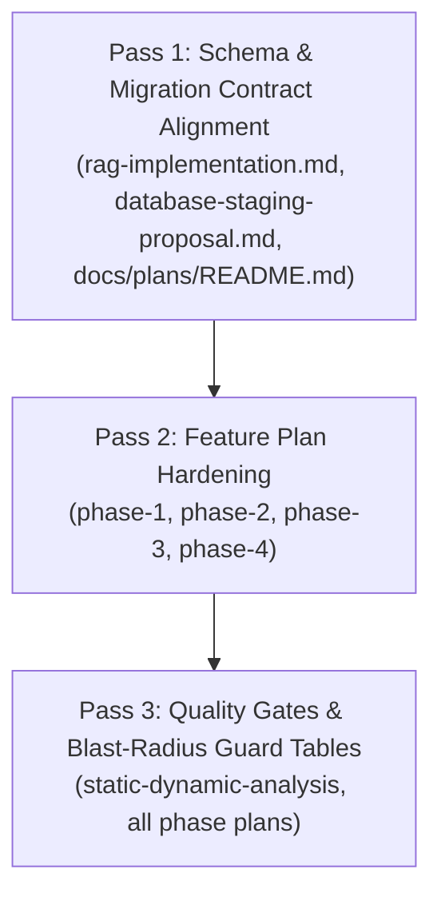

# Plan Reconciliation & Roadmap Hardening

> **Status:** Implemented & Verified  
> **Scope:** Audit, reconcile, and harden all pending roadmap and phase plans (`docs/plans/Pending/`) against [`database-schema-proposal.md`](../Pending/database-schema-proposal.md), [`database-staging-proposal.md`](../Pending/database-staging-proposal.md), [`architectural_decisions.md`](../../architecture/architectural_decisions.md), and [`.agent/rules/project_guardrails.md`](../../../.agent/rules/project_guardrails.md).  
> **Author:** Antigravity (Architect & Reviewer) · **Reviewer:** Human Engineer / Gemini  
> **Related Contracts:** [`AGENTS.md`](../../../AGENTS.md) · [`database-schema-proposal.md`](../Pending/database-schema-proposal.md) · [`database-staging-proposal.md`](../Pending/database-staging-proposal.md) · [`architectural_decisions.md`](../../architecture/architectural_decisions.md) · [`.agent/rules/project_guardrails.md`](../../../.agent/rules/project_guardrails.md)

---

## 0. Revision History

| Rev | Date | Author | Description |
| :--- | :--- | :--- | :--- |
| 1 | 2026-11-09 | Antigravity (Architect) | Initial specification: Reconciles 8 cross-plan inconsistencies across Phase 1–4, RAG, and SDLC plans; aligns migration sequencing (`007` -> `009`); standardizes schema column definitions; specifies auth middleware and seed dependencies; establishes blast-radius guard tables. |
| 2 | 2026-11-11 | Antigravity (Architect) | **Executed & Verified:** Completed all 8 plan hardening work items in place across `docs/plans/Pending/`. All 5 verification gates passed: zero duplicate migration numbers, schema column uniformity (`notifications`, `ai_quality_reports`), self-contained seed author, blast-radius tables, and zero changes to production code. Moved to `docs/plans/Implemented/`. |

---

## 1. Objectives & Architectural Reasoning

A rigorous benchmark against industry-grade software engineering standards (RFC/Google Design Doc discipline, zero-downtime database evolution, OWASP ASVS, and contract-first type generation) revealed that while Idep's foundational contracts (`project_guardrails.md`, `architectural_decisions.md`, `database-schema-proposal.md`, `stage-0-identity-and-rbac.md`) are gold-standard, the downstream roadmap plans (`Phase 1` through `Phase 4`, `RAG`, and `SDLC`) suffered from **cross-plan drift, migration numbering collisions, schema column mismatches, and missing boundary guardrails**.

If left uncorrected, an autonomous builder agent (Claude Code via `delegate-to-claude`) executing these plans in sequence would encounter catastrophic compilation and runtime failures:
1. **Migration Sequence Failure:** Two separate plans defined `007_*.sql`, which causes Goose to fail on duplicate version IDs.
2. **Schema Invariant Drift:** Handlers in Phase 2 and Phase 4 would attempt to query columns (`is_read`, `report_type`) that do not exist in the authoritative PostgreSQL schema contract.
3. **Foreign Key Deadlocks in Seed Data:** Phase 1 would attempt to seed initial curriculum chapters referencing a non-existent author UUID, failing database migrations in CI.
4. **Latency Budget Violations:** The RAG pipeline chained three sequential LLM and embedding calls on the user request path, blowing past the 15-second hard timeout ceiling.
5. **Accidental Regressions:** Downstream plans lacked explicit `"must NOT change"` guard tables, creating high risk that agents would overwrite `guardrails_test.go` or prior migration stages.

This reconciliation plan hardens all plan markdown files **in place** before implementation begins.

---

## 2. Detailed Work Items

### Item 1: RAG Migration Renumbering & CI `pgvector` Support
- **Target File:** [`docs/plans/Pending/rag-implementation.md`](../Pending/rag-implementation.md) and [`docs/plans/Pending/database-staging-proposal.md`](../Pending/database-staging-proposal.md)
- **Changes:**
  1. Rename migration reference from `007_rag_knowledge_pipeline.sql` to `009_rag_knowledge_pipeline.sql` across all text, headers, and code blocks.
  2. Update §2 of `database-staging-proposal.md` to add Stage 5 (Post-Phase 4: `009_rag_knowledge_pipeline.sql`).
  3. Specify that the CI PostgreSQL service container in GitHub Actions must be upgraded from `postgres:16-alpine` to `pgvector/pgvector:pg16` when Stage 5 is executed, enabling `CREATE EXTENSION IF NOT EXISTS vector;`.
  4. Specify `apps/api/sqlc.yaml` mapping for PostgreSQL `vector` type.

### Item 2: Align Schema Columns in Phase 2 & Phase 4 Plans
- **Target Files:** [`docs/plans/Pending/phase-2-maker-checker-editorial-loop.md`](../Pending/phase-2-maker-checker-editorial-loop.md) and [`docs/plans/Pending/phase-4-editorial-upgrades-and-fast-follow.md`](../Pending/phase-4-editorial-upgrades-and-fast-follow.md)
- **Changes:**
  1. In `phase-2-maker-checker-editorial-loop.md` §4.1.2:
     - Replace the ad-hoc `notifications` schema with the exact definition from `database-schema-proposal.md` §3.4 Table 21:
       `id UUID PRIMARY KEY`, `recipient_user_id UUID NOT NULL`, `event_type TEXT NOT NULL CHECK (...)`, `title TEXT NOT NULL`, `body TEXT NOT NULL`, `link_path TEXT NOT NULL`, `metadata_json JSONB NOT NULL DEFAULT '{}'::jsonb`, `read_at TIMESTAMPTZ`, `email_sent_at TIMESTAMPTZ`, `created_at TIMESTAMPTZ`.
     - Align queries in `notifications.sql` to use `recipient_user_id`, `event_type`, `link_path`, and `read_at`.
  2. In `phase-4-editorial-upgrades-and-fast-follow.md` §4.1.2:
     - Replace the ad-hoc `ai_quality_reports` schema with the exact definition from `database-schema-proposal.md` §3.4 Table 20:
       `id UUID PRIMARY KEY`, `user_id UUID`, `highlight_id UUID NOT NULL`, `explanation_id UUID NOT NULL`, `reexplanation_attempt_id UUID`, `reason_category TEXT NOT NULL CHECK (reason_category IN ('inaccurate_science_or_fact', 'confusing_work_analogy', 'unfair_reexplanation_grading', 'broken_prerequisite_or_term_link', 'other'))`, `reason_details TEXT NOT NULL`, `passage_snapshot TEXT NOT NULL`, `ai_output_snapshot JSONB NOT NULL`, `status TEXT NOT NULL DEFAULT 'open'`, `created_at TIMESTAMPTZ`.
     - Align queries in `learner_history_and_reports.sql` accordingly.

### Item 3: Phase 1 Auth Middleware, Deterministic Seed Author, & Chapter Routing
- **Target File:** [`docs/plans/Pending/phase-1-curriculum-reader-and-guest-metering.md`](../Pending/phase-1-curriculum-reader-and-guest-metering.md)
- **Changes:**
  1. **Auth Middleware Scope:** Explicitly specify the creation of `apps/api/internal/middleware/auth.go` that:
     - Extracts and validates Supabase Bearer JWTs (or HMAC guest cookie).
     - Resolves active roles (`revoked_at IS NULL`) from `user_roles`.
     - Injects authenticated `userID` and roles into `context.Context`.
     - Auto-provisions the base `users` + `user_roles ('user')` row on first authenticated request if not already present.
  2. **Deterministic Seed Author:** In `003_curriculum_and_guests.sql`, before seeding initial chapters and `chapter_versions`, seed a deterministic system author user:
     - `id = '00000000-0000-0000-0000-000000000001'`
     - `email = 'curriculum-seed@idep.local'`
     - `display_name = 'Idep Editorial Team'`
     This satisfies `chapter_versions.author_id NOT NULL REFERENCES users(id)` without violating foreign key constraints on an empty database.
  3. **Chapter URL Resolution:** Clarify route parameter hierarchy:
     - Use `/api/v1/subjects/{subject_slug}/chapters/{chapter_slug}` for hierarchical lookups (honoring `UNIQUE (subject_id, slug)`).
     - Support `/api/v1/chapters/{id}` for direct UUID lookups.

### Item 4: Consolidate Phase 3 Specifications & Archive `grounded-ai-analogies.md`
- **Target Files:** [`docs/plans/Pending/phase-3-ai-study-sidebar-and-active-recall.md`](../Pending/phase-3-ai-study-sidebar-and-active-recall.md), [`docs/plans/Archived/grounded-ai-analogies.md`](../Archived/grounded-ai-analogies.md), and [`docs/plans/README.md`](../README.md)
- **Changes:**
  1. Restore critical production engineering guardrails from `grounded-ai-analogies.md` into `phase-3-ai-study-sidebar-and-active-recall.md`:
     - Add prompt security specification: Wrap community feedback inside `<untrusted_community_feedback>` XML delimiters and sanitize input (strip `<`, `>`, control characters, cap at 500 characters).
     - Include `selected_job_field_code` in `AnalogyResponseSchema` so the LLM returns the chosen trade.
     - Specify rate-limit formula: 24-hour quota covers `ai_explanations` and `ai_elaborations`, while exempting `reexplanation_attempts` from the 30-call ceiling to avoid penalizing active recall practice.
     - Mandate zero-dependency component testing: Use `react-dom/server` `renderToStaticMarkup` in `apps/web` unit tests (no new testing libraries).
  2. Move or archive `grounded-ai-analogies.md` (e.g. update its status to explicitly note it is fully merged into `phase-3-ai-study-sidebar-and-active-recall.md` and clean up references in `docs/plans/README.md`).

### Item 5: Clarify `U-02` Scope Boundary Between Phase 1 and Phase 4
- **Target File:** [`docs/plans/Pending/phase-4-editorial-upgrades-and-fast-follow.md`](../Pending/phase-4-editorial-upgrades-and-fast-follow.md)
- **Changes:**
  1. Clearly document that Phase 1 implements the backend persistence (`002_work_experience.sql`) and onboarding API (`PUT /api/v1/me/work-experience`).
  2. Scope Phase 4's `U-02` work to:
     - The dedicated `/settings/profile` management UI in `apps/web`.
     - Regression test proving that updating or deleting trade preferences never mutates historical `ai_explanations` (`role_title_snapshot` and `job_field_code` immutability).

### Item 6: Enforce Sub-Timeouts and Fallback in RAG Pipeline
- **Target File:** [`docs/plans/Pending/rag-implementation.md`](../Pending/rag-implementation.md)
- **Changes:**
  1. Break down the 15-second hard context timeout budget into explicit sub-budgets:
     - HyDE Query Decomposition: `2.5s` timeout.
     - OpenAI Vector Embedding: `1.5s` timeout.
     - Database Hybrid Retrieval (HNSW + BM25): `200ms` timeout.
     - Main Structured Analogy Generation: `10.0s` timeout.
  2. Implement fail-safe degradation: If HyDE or Vector embedding exceeds its budget or returns an error, the pipeline immediately falls back to BM25 keyword retrieval + zero-shot generation within the remaining window rather than returning an HTTP 503 error to the learner.

### Item 7: Reconcile SDLC Plan with CI and Ponytail Constraints
- **Target File:** [`docs/plans/Pending/static-dynamic-analysis-and-sdlc-integration.md`](../Pending/static-dynamic-analysis-and-sdlc-integration.md)
- **Changes:**
  1. Update §D1 CI workflow snippet so it does **not** drop the `cmd/migrate` build or the `postgres:16-alpine` service container introduced in Stage 0.
  2. Explicitly label proposed new devDependencies (`@eslint-community/eslint-plugin-security`, `@playwright/test`) as subject to explicit stakeholder confirmation per `AGENTS.md` §4 (Ponytail Discipline).

### Item 8: Add Standard "Files Touched & Blast Radius Guard" Tables to All Plans
- **Target Files:**
  - `phase-1-curriculum-reader-and-guest-metering.md`
  - `phase-2-maker-checker-editorial-loop.md`
  - `phase-3-ai-study-sidebar-and-active-recall.md`
  - `phase-4-editorial-upgrades-and-fast-follow.md`
  - `rag-implementation.md`
  - `static-dynamic-analysis-and-sdlc-integration.md`
- **Changes:**
  Add a dedicated `## Files Touched & Blast-Radius Guard` section to each plan with:
  1. Table of exact `new`, `edit`, and `delete` file paths.
  2. Explicit `must NOT change` list (protecting `guardrails_test.go`, prior migration stages, `go.mod` unless authorized, and unrelated monorepo files).

---

## 3. Execution Sequence & Dependency Order

The implementation of these plan updates proceeds in three focused passes:

1. **Pass 1:** Resolve migration sequencing (`007` -> `009`) and schema contracts across `rag-implementation.md`, `database-staging-proposal.md`, and `docs/plans/README.md`.
2. **Pass 2:** Update Phase 1, Phase 2, Phase 3, and Phase 4 plans with exact schema tables, auth middleware, seed handling, and guardrail details.
3. **Pass 3:** Update SDLC plan, add blast-radius guard tables across all 6 plans, and finalize the index.

---

## 4. Acceptance Criteria & Verification Gates

1. **Zero Duplicate Migration Numbers:**
   - `grep -rn "007_" docs/plans/` references only `007_educator_verification.sql`.
   - `008_` references only `008_citations_comments_and_reports.sql`.
   - `009_` references only `009_rag_knowledge_pipeline.sql`.
2. **Schema Column Uniformity:**
   - `notifications` columns in Phase 2 match `database-schema-proposal.md` §3.4 Table 21.
   - `ai_quality_reports` columns in Phase 4 match `database-schema-proposal.md` §3.4 Table 20.
3. **Self-Contained Seed Execution:**
   - Phase 1 documentation guarantees that initial migrations apply and seed without foreign key errors.
4. **Guard Tables Present:**
   - Every plan in `docs/plans/Pending/` contains a `Files Touched & Blast-Radius Guard` section with an explicit `must NOT change` list.
5. **Clean Git State:**
   - No code or database files outside `docs/plans/` are modified during this plan hardening.

