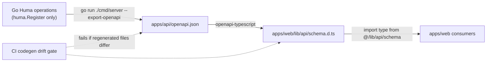

# Stage 0 — Baseline Cleanup (Bootstrap Conformance & Huma Single Source of Truth)

> **Status:** Pending — decisions resolved, ready for delegation (Revision 3)
> **Bootstrap reference:** `turbo-next-go-template` as defined in [`AGENTS.md` §6](file:///home/xiscohonggono/projects/Idep/AGENTS.md#L49-L76) (bootstrap commit `670f30d`).
> **Builder:** Claude Code via `delegate-to-claude`. **Reviewer:** Gemini/Architect → `docs/reviews/stage-0-baseline-cleanup-review.md`.

---

## 0. Revision History

| Rev | Change |
| :--- | :--- |
| 1 | Initial draft. Introduced a new `001_identity_and_rbac.sql` (UUID `users`, `user_roles`, `audit_events`) and renamed the project away from the bootstrap. |
| 2 | **Removed all database design decisions** (no schema, query, PK-type, or table changes). **Removed bootstrap renames.** Moved the database proposals into `docs/plans/Pending/` so nothing DB-related is presented as accepted. Added the Huma single-source-of-truth (SSOT) enforcement (codegen drift gate, deterministic export, no hand-written DTOs). Corrected factual errors from Rev 1 (see §6). |
| 3 | Stakeholder decisions applied (§7): `go.mod` (`go 1.26.8`) is the Go source of truth (§2.5); install Tailwind CSS v4 in `apps/web` (§2.6); Supabase left untouched until auth is decided. |
| 4 | Stakeholder decision Q4 (Option A): Align `typescript` in `apps/web/package.json` and `packages/ui/package.json` to `"^5.7.0"` (matching root `package.json` `"overrides": { "typescript": "^5.7.0" }`) so `openapi-typescript` has the TS 5 AST factory API (`ts.factory`) required for `pnpm codegen`; revert any `packageExtensions` changes to `pnpm-workspace.yaml`. |

---

## 1. Objective

Bring the repository back into conformance with its bootstrap contract (`AGENTS.md` §6) **without making any database decisions**, and make the Huma (OpenAPI 3.1) contract the only source of API types across the stack:



### Guiding rules for this plan
1. **No database decisions.** Do not create, edit, rename, or delete anything under `apps/api/sql/`, and do not change `sqlc.yaml` or the generated `apps/api/internal/repository/db/` package. The bootstrap `users (id TEXT, name, email, created_at)` stays exactly as-is until a separate database plan is approved.
2. **Match the bootstrap.** Keep bootstrap names (`turbo-next-go-template`, `api`, `web`), layout, and toolchain. Change only what contradicts `AGENTS.md` §6 or the guardrails.
3. **Huma is the SSOT.** Every HTTP route is a `huma.Register` operation; the web app consumes only generated types; CI fails on contract drift.

### Out of scope (explicitly deferred)
- Any schema, migration, table, index, PK-type, or query change → future plan `docs/plans/Pending/database-schema-proposal.md` (see §2.1).
- Migration runner choice, auth middleware/JWT, Supabase Auth adoption, LLM provider, object storage.
- Product features (all 33 stories).

---

## 2. Work Items

### 2.1 Documentation governance — demote database decisions to "Pending"

The database documents were committed under `docs/architecture/` with `Status: Accepted`, which contradicts the rule that such decisions are planned in `docs/plans/Pending/` first and moved to `docs/plans/Implemented/` only once done.

1. **Move (git mv) — content unchanged except the status header and links:**
   - `docs/architecture/database_schema.md` → `docs/plans/Pending/database-schema-proposal.md`
   - `docs/architecture/database_staging_plan.md` → `docs/plans/Pending/database-staging-proposal.md`
2. In both moved files, change the header line `**Status:** Accepted (...)` to `**Status:** Proposed — Pending approval (not implemented)` and fix their relative `Related Contracts` links.
3. **[`README.md`](file:///home/xiscohonggono/projects/Idep/README.md)** — update only the statements that present DB work as decided or existing:
   - Contract table rows (L17–L18): point to the new Pending paths; replace "Authoritative PostgreSQL DDL contract" / "Safe staged rollout plan" with "Proposed (pending approval) ...".
   - Execution Order step 2 (L34–L37): reword to "Propose the database schema in `docs/plans/Pending/database-schema-proposal.md`; once approved and implemented, add migrations/queries under `apps/api/sql/` and run `pnpm codegen`." Keep the Huma/codegen bullet but state the chain explicitly: *Huma operations in `apps/api` → `apps/api/openapi.json` → `apps/web/lib/api/schema.d.ts` (generated, never hand-edited).*
   - Execution Order step 3 (L39): point to the new staging proposal path.
   - Repository tree (L218–L219, L227–L229): replace `# Staged PostgreSQL DDL migrations (001..008)` with `# PostgreSQL DDL consumed by sqlc (bootstrap: 001_users.sql)`; remove the two DB docs from `docs/architecture/` in the tree and list them under `docs/plans/Pending/`.
   - Onboarding step 3 (L246): point to the new Pending paths.
4. **[`docs/architecture/architectural_decisions.md`](file:///home/xiscohonggono/projects/Idep/docs/architecture/architectural_decisions.md#L5)** and **[`.agent/rules/project_guardrails.md`](file:///home/xiscohonggono/projects/Idep/.agent/rules/project_guardrails.md#L5)** — update the `Related Contracts` links to the new paths. Do not change any other content in these files in this plan.
5. **[`.agent/rules/project_guardrails.md` §5](file:///home/xiscohonggono/projects/Idep/.agent/rules/project_guardrails.md#L86-L98)** — update to reflect reality after this plan:
   - Items 1 and 2 (mock fallback, uncontracted Chi route): mark **Resolved by `stage-0-baseline-cleanup`**.
   - Item 3 is factually wrong: `apps/api/internal/users.sql` is an **empty, untracked directory**, not a duplicate SQL file. Replace with: "Empty untracked directories `apps/api/internal/users.sql/`, `internal/handlers/`, `internal/config/` — removed locally by `stage-0-baseline-cleanup`."
6. [`docs/plans/README.md`](file:///home/xiscohonggono/projects/Idep/docs/plans/README.md): **no change** — the "CRM implementation" wording was already removed by the user (uncommitted edit; must be preserved).

### 2.2 Backend — Huma SSOT and fail-closed behavior (no schema change)

Files: `apps/api/cmd/server/main.go`, `apps/api/internal/{domain,repository,service,handler}/*.go`.

1. **Deterministic OpenAPI export.** In `main.go`, construct the router + Huma API and register all operations **before** any database initialization, and handle `--export-openapi` immediately after registration. Export must not require `DATABASE_URL` or a reachable database. (Huma operations must therefore be registered against a service whose repository can be nil-safe.)
2. **Fail-closed pool init.** Replace `pool, _ = pgxpool.NewWithConfig(...)` and the silently ignored `ParseConfig` error:
   - `DATABASE_URL` unset → log a warning and run with no pool (DB-backed operations return `503`).
   - `DATABASE_URL` set but invalid/unparseable or pool creation fails → `log.Fatalf`.
3. **Remove the mock fallback** in `user_repo.go` (L41–L46). Add sentinel errors in `internal/domain/user.go`: `ErrUserNotFound`, `ErrDatabaseUnavailable`. Repository behavior:
   - `r.queries == nil` → `ErrDatabaseUnavailable`.
   - `pgx.ErrNoRows` → `ErrUserNotFound`.
   - any other error → wrap and return (handler maps to `503`).
   - Propagate `context.Context` (`GetByID(ctx, id)` on `domain.UserRepository`, `PostgresUserRepository`, and `GetUserProfile(ctx, id)` on `service.UserService`), and apply a `5s` query timeout per [guardrails §4](file:///home/xiscohonggono/projects/Idep/.agent/rules/project_guardrails.md#L75). The `id` remains `string` (bootstrap schema `id TEXT`).
4. **Replace the raw Chi mount with a Huma operation.** Delete `ServeHTTP` from `internal/handler/user_handler.go`; add `func RegisterUserRoutes(api huma.API, svc *service.UserService)` that registers:
   - `OperationID: "get-user"`, `GET /api/v1/users/{id}`, `Tags: ["users"]`.
   - Input: `struct { ID string \`path:"id" minLength:"1" maxLength:"128"\` }`.
   - Output: `type GetUserOutput struct { Body domain.User }` (existing fields `id`, `email`, `name`) — Huma names the schema `User`.
   - Error mapping: `ErrUserNotFound` → `huma.Error404NotFound`; `ErrDatabaseUnavailable`/other → `huma.Error503ServiceUnavailable`. Never return fabricated data.
   - Remove `router.Mount("/api/v1/users", userHandler)` from `main.go`.
5. Leave the Huma config title (`"Turbo Next Go API"`) unchanged (bootstrap name).
6. **Tests** (`go test ./...`): add `internal/handler/user_handler_test.go` using `humatest` with a fake `domain.UserRepository`:
   - nil/unavailable repository → `503` (proves the mock is gone);
   - not found → `404`;
   - found → `200` with `{id,email,name}`;
   - test that the exported OpenAPI document contains **both** `/health` and `/api/v1/users/{id}`.
7. Remove empty untracked local directories with `rmdir` (fails safely if non-empty): `apps/api/internal/users.sql`, `apps/api/internal/handlers`, `apps/api/internal/config`.

### 2.3 Frontend — consume only generated types

Files: `apps/web/tsconfig.json`, `apps/web/lib/api/*`, `apps/web/app/page.tsx`, `apps/web/__tests__/`.

1. **Path alias** required by `AGENTS.md` §6 rule 1: add `"baseUrl": "."` and `"paths": { "@/*": ["./*"] }` to `apps/web/tsconfig.json` `compilerOptions`.
2. **Delete hand-written DTOs and the bypass data path:**
   - `apps/web/lib/api/types.ts` (hand-written `UserProfile` — violates guardrail "Type Contracts").
   - `apps/web/lib/api/supabase.ts` (fabricated user data; bypasses `apps/api` — violates ADR-001/guardrail "Service & Data Boundaries").
   - The `NEXT_PUBLIC_BACKEND_PROVIDER` switch in `lib/api/index.ts` and `app/page.tsx`.
3. **Typed client without new dependencies** — `apps/web/lib/api/go.ts`:
   ```ts
   import type { paths } from '@/lib/api/schema';
   export type User =
     paths['/api/v1/users/{id}']['get']['responses'][200]['content']['application/json'];
   ```
   `getUser(id)` fetches `${process.env.NEXT_PUBLIC_API_URL ?? 'http://localhost:8080'}/api/v1/users/${encodeURIComponent(id)}` with `cache: 'no-store'` and throws on non-2xx. `lib/api/index.ts` re-exports from `go.ts` only.
4. **Env var alignment:** use `NEXT_PUBLIC_API_URL` everywhere (already in [`apps/web/.env.example`](file:///home/xiscohonggono/projects/Idep/apps/web/.env.example#L3)); remove all `NEXT_PUBLIC_GO_API_URL` / `NEXT_PUBLIC_BACKEND_PROVIDER` references. Do not read or modify `apps/web/.env.local`.
5. **`app/page.tsx`:** keep it a minimal bootstrap demo that calls `getUser('101')` inside `try/catch` and renders either the user JSON or the API error message (e.g., `503` when no DB). `next build` must succeed with the API offline.
6. **Untouched (deferred decision):** `apps/web/lib/supabase.ts` and the `@supabase/*` dependencies (auth client from the bootstrap). See §2.7.
7. **Tests:** replace the `1+1` smoke test with Vitest tests for `getUser` using a stubbed `fetch`: correct URL built from `NEXT_PUBLIC_API_URL`, returns body on `200`, throws on `404`/`503`.

### 2.4 Scripts & CI — make the bootstrap commands true and enforce the SSOT

1. **`apps/api/package.json`** — add `"lint": "go vet ./..."` and `"test": "go test ./..."` so `pnpm lint` / `pnpm test` cover Go as `AGENTS.md` §6 states.
2. **`turbo.json`** — no change required (`lint`, `test`, `check-types` tasks already exist).
3. **`.github/workflows/ci.yml`:**
   - `test-api`: use `go-version-file: apps/api/go.mod` instead of hard-coded `'1.24'` (see §2.5).
   - `test-web`: add `pnpm --filter web lint` and `pnpm --filter web check-types` (the job name already claims lint).
   - **New job `codegen-drift`** (Huma SSOT gate): setup Go (`go-version-file`), Node 22, pnpm, `sqlc-dev/setup-sqlc@v3` pinned to `sqlc-version: '1.31.1'` (matches generated headers); run `pnpm install --no-frozen-lockfile && pnpm codegen`; then `git diff --exit-code -- apps/api/openapi.json apps/web/lib/api/schema.d.ts apps/api/internal/repository/db`. Fails the PR if any generated contract file was hand-edited or not regenerated.
4. **`.github/workflows/security.yml`** — OSV scanner currently scans only `apps/api/go.sum`; add `--lockfile=pnpm-lock.yaml` so the web dependency tree is covered (as `AGENTS.md` §6 rule 3 implies).
5. **`apps/api/.env.example`** (new) — `DATABASE_URL=` (empty placeholder, no credentials) to satisfy `AGENTS.md` §6 rule 4. This documents an existing bootstrap variable; it is not a database decision.

### 2.5 Go version — `go.mod` is the source of truth (Decision Q1)

`apps/api/go.mod` declares `go 1.26.8` (unchanged). Align every other reference to it:

| File | Change |
| :--- | :--- |
| `.github/workflows/ci.yml` (L22) | `go-version: '1.24'` → `go-version-file: apps/api/go.mod` (also used by the new `codegen-drift` job) |
| `apps/api/Dockerfile` (L2) | `golang:1.24-alpine` → `golang:1.26-alpine` |
| `AGENTS.md` (L51, L75) | "Go 1.24" → "Go 1.26" |
| `README.md` (L204, L214) | "Go 1.24" → "Go 1.26" |
| `docs/architecture/architectural_decisions.md` (L44, L64) | "Go 1.24" → "Go 1.26" (text-only; no other ADR content changes) |

Do **not** edit `go.mod`/`go.sum`.

### 2.6 Tailwind CSS v4 in `apps/web` (Decision Q2)

`AGENTS.md` §6 states `apps/web` uses Tailwind CSS; install it to match (setup verified against current Tailwind v4 docs via Context7):

1. `pnpm --filter web add -D tailwindcss @tailwindcss/postcss postcss` (commit the updated `pnpm-lock.yaml`).
2. New `apps/web/postcss.config.mjs`:
   ```js
   export default {
     plugins: {
       "@tailwindcss/postcss": {},
     },
   };
   ```
3. Add `@import "tailwindcss";` as the **first line** of `apps/web/app/globals.css`; keep the existing rules below it.
4. Use Tailwind utility classes in the rewritten `app/page.tsx` (§2.3 step 5) instead of inline `style={...}` so the integration is exercised by `pnpm build`.
5. No `tailwind.config.*` file (v4 is zero-config). No other styling refactors.

### 2.7 Supabase (Decision Q3)

Leave `apps/web/lib/supabase.ts`, `@supabase/ssr`, `@supabase/supabase-js`, and the `NEXT_PUBLIC_SUPABASE_*` entries in `apps/web/.env.example` **untouched** until the auth decision is planned. Only the Supabase *data mock* (`apps/web/lib/api/supabase.ts`) is removed (§2.3), because it bypasses the Huma contract.

### 2.8 TypeScript Version Alignment for `openapi-typescript` (Decision Q4 — Option A)

Root `package.json` already specifies `"typescript": "^5.7.0"` and `"overrides": { "typescript": "^5.7.0" }`, whereas `apps/web/package.json` and `packages/ui/package.json` had `"typescript": "7.0.2"`, causing `openapi-typescript@7.13.0` to crash on missing `ts.factory.createKeywordTypeNode`.
1. Change `"typescript": "7.0.2"` to `"typescript": "^5.7.0"` in `apps/web/package.json` and `packages/ui/package.json`.
2. Revert `pnpm-workspace.yaml` to its original 3-line bootstrap state (no `packageExtensions`).
3. Run `pnpm install` so `openapi-typescript` resolves against TypeScript `^5.7.0`, then run `pnpm codegen`.

---

## 3. Files Touched

| Action | Path |
| :--- | :--- |
| git mv | `docs/architecture/database_schema.md` → `docs/plans/Pending/database-schema-proposal.md` |
| git mv | `docs/architecture/database_staging_plan.md` → `docs/plans/Pending/database-staging-proposal.md` |
| edit (links/status only) | `README.md`, `docs/architecture/architectural_decisions.md`, `.agent/rules/project_guardrails.md` |
| edit | `apps/api/cmd/server/main.go`, `apps/api/internal/domain/user.go`, `apps/api/internal/repository/user_repo.go`, `apps/api/internal/service/user_service.go`, `apps/api/internal/handler/user_handler.go`, `apps/api/package.json` |
| new | `apps/api/internal/handler/user_handler_test.go`, `apps/api/.env.example` |
| regenerated (via `pnpm codegen` only) | `apps/api/openapi.json`, `apps/web/lib/api/schema.d.ts` |
| edit | `apps/web/tsconfig.json`, `apps/web/lib/api/go.ts`, `apps/web/lib/api/index.ts`, `apps/web/app/page.tsx`, `apps/web/__tests__/smoke.test.ts` |
| delete | `apps/web/lib/api/types.ts`, `apps/web/lib/api/supabase.ts` |
| edit | `.github/workflows/ci.yml`, `.github/workflows/security.yml` |
| edit (Go 1.26 text) | `apps/api/Dockerfile`, `AGENTS.md`, `README.md`, `docs/architecture/architectural_decisions.md` |
| new / edit (Tailwind & TS 5.7) | `apps/web/postcss.config.mjs`, `apps/web/app/globals.css`, `apps/web/package.json`, `packages/ui/package.json`, `pnpm-lock.yaml` |
| rmdir (untracked, empty) | `apps/api/internal/users.sql/`, `apps/api/internal/handlers/`, `apps/api/internal/config/` |
| **must NOT change** | `apps/api/sql/**`, `apps/api/sqlc.yaml`, `apps/api/internal/repository/db/**` (must regenerate byte-identical), `apps/api/go.mod`, `apps/api/go.sum`, `apps/web/lib/supabase.ts`, `docs/plans/README.md`, `apps/web/.env.local` |

---

## 4. Acceptance Criteria (log output in `docs/verification/stage-0-baseline-cleanup.md`)

1. `pnpm codegen` exits `0` **with `DATABASE_URL` unset**; `apps/api/openapi.json` contains `/health` and `/api/v1/users/{id}`; `schema.d.ts` contains `get-user` and `User`.
2. `git diff --exit-code -- apps/api/internal/repository/db apps/api/sql apps/api/sqlc.yaml` → no changes (proves no DB decisions were made).
3. Running `pnpm codegen` a second time produces no diff (deterministic SSOT).
4. `grep -rn "interface\|type " apps/web/lib/api --include=*.ts | grep -v schema.d.ts` shows no hand-written API DTOs (only aliases derived from `paths`/`components`).
5. `grep -rn "Demo User\|Supabase Fast Track\|NEXT_PUBLIC_BACKEND_PROVIDER\|NEXT_PUBLIC_GO_API_URL\|router.Mount" apps/` → no matches.
6. `pnpm lint`, `pnpm --filter web check-types`, `pnpm test` (now including `go test ./...`), `pnpm build` all exit `0` with the API offline.
7. Manual: `go run ./cmd/server` without `DATABASE_URL` → `GET /api/v1/users/101` returns `503` problem+json, `GET /health` returns `200`.
8. `grep -rn "1\.24" --exclude-dir=node_modules --exclude-dir=.next --exclude-dir=.git --exclude-dir=.agents --exclude=*.sum --exclude=pnpm-lock.yaml .` → no Go-version matches outside this plan file.
9. `pnpm --filter web build` succeeds and the emitted CSS in `apps/web/.next/static/` (`chunks/*.css` or `css/*.css`) contains Tailwind utilities used by `page.tsx`.
10. `git diff --stat -- apps/web/lib/supabase.ts apps/api/go.mod apps/api/go.sum` → empty.

## 5. Rollback

All changes are code/docs only (no database state). Rollback = `git revert` of the implementation commit; the two moved DB documents return to `docs/architecture/` via the same revert.

---

## 6. Corrections to Earlier Findings

| Earlier claim | Correction |
| :--- | :--- |
| `apps/api/internal/users.sql` is a duplicate SQL file | It is an **empty untracked directory**. Guardrails §5 item 3 is updated accordingly. |
| `pnpm@11.25.0` does not exist | It is installed locally (`pnpm --version` → `11.25.0`). No change needed. |
| Go version mismatch is a code bug | `go.mod` declares `go 1.26.8` **in the bootstrap commit itself** and the local toolchain is `go1.26.8`; the bootstrap docs/CI/Dockerfile say `1.24`. The bootstrap is internally inconsistent → decision Q1. |

## 7. Stakeholder Decisions (resolved 2026-11-01)

| ID | Decision | Implemented in |
| :--- | :--- | :--- |
| **Q1** | `apps/api/go.mod` (`go 1.26.8`) is the source of truth; all "1.24" references are aligned to it. | §2.5 |
| **Q2** | Install Tailwind CSS (v4, `@tailwindcss/postcss`) in `apps/web`. | §2.6 |
| **Q3** | Supabase (`lib/supabase.ts`, `@supabase/*`, env entries) stays untouched until auth is decided. | §2.7 |
| **Q4** | Option A: Align `typescript` in `apps/web/package.json` and `packages/ui/package.json` to `"^5.7.0"` (matching root `package.json`) so `openapi-typescript` runs cleanly under `pnpm codegen`. | §2.8 |
