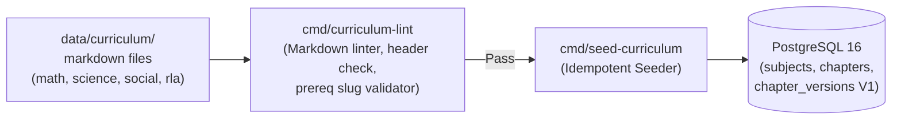

# Curriculum Content Bootstrapping & Baseline Seeding

> **Status:** Proposed — Ready for Review  
> **Scope:** Authoring, validating, and seeding the foundational GED curriculum corpus across all four official subjects (*Mathematical Reasoning*, *Science*, *Social Studies*, *Reasoning Through Language Arts*) into PostgreSQL 16 `chapters` and `chapter_versions`.  
> **Author:** Antigravity (Architect & Reviewer) · **Reviewer:** Human Engineer / Gemini  
> **Related Contracts:** [`phase-1-curriculum-reader-and-guest-metering.md`](phase-1-curriculum-reader-and-guest-metering.md) · [`database-schema-proposal.md`](database-schema-proposal.md) · [`architectural_decisions.md`](../../architecture/architectural_decisions.md)

---

## 0. Revision History

| Rev | Date | Author | Description |
| :--- | :--- | :--- | :--- |
| 1 | 2026-11-09 | Antigravity (Architect) | Initial specification: Defines the curriculum bootstrapping pipeline, Markdown validation schemas, prerequisite relationship graphs, and idempotent seeding CLI for initial launch content. |

---

## 1. Objectives & Rationale

While Phase 1 (`phase-1-curriculum-reader-and-guest-metering.md`) builds the Reader UI, search engine, and database schema, it only seeds minimal test stubs to keep automated tests fast.

To launch a viable product for adult learners, Idep requires an **authoritative, high-quality starter curriculum corpus**:
1. **Four Core GED Subjects:**
   - **Science:** Cell biology, photosynthesis, genetics, Newton's laws, earth systems.
   - **Mathematical Reasoning:** Linear equations, fractions/percentages, Pythagorean theorem, perimeter and area, basic statistics.
   - **Social Studies:** US Constitution, Bill of Rights, branches of government, supply and demand, civil rights movement.
   - **Reasoning Through Language Arts (RLA):** Central idea identification, rhetorical analysis, evaluating evidence, grammar and punctuation rules.
2. **Pedagogical Structure:** Each chapter must feature clear learning objectives, structured subsections, vocabulary terms, prerequisite links, and authentic workplace context.
3. **Immutability & Provenance:** Every seeded chapter must be anchored to the deterministic editorial user (`00000000-0000-0000-0000-000000000001`) with `version_number = 1`, establishing an immutable baseline for future community edits (`Phase 2`).

---

## 2. Curriculum Data Model & Ingestion Architecture



### 2.1 File Structure Convention
Curriculum source documents live in `apps/api/data/curriculum/`:
```text
apps/api/data/curriculum/
├── science/
│   ├── 01_photosynthesis.md
│   ├── 02_cellular_respiration.md
│   └── ...
├── mathematical_reasoning/
│   ├── 01_fractions_and_decimals.md
│   └── ...
├── social_studies/
│   ├── 01_us_constitution.md
│   └── ...
└── language_arts/
    ├── 01_identifying_central_idea.md
    └── ...
```

### 2.2 Chapter Frontmatter Specification
Each Markdown chapter begins with strict YAML frontmatter:
```markdown
---
subject_slug: "science"
slug: "photosynthesis-and-cellular-energy"
title: "Photosynthesis and Cellular Energy"
sequence_order: 1
reading_time_minutes: 8
prerequisite_slugs: []
summary: "How plant cells convert sunlight, water, and carbon dioxide into oxygen and glucose."
---

# Photosynthesis and Cellular Energy

## 1. Introduction & Real-World Relevance
...
```

---

## 3. Idempotent Seeder CLI (`cmd/seed-curriculum/main.go`)

The seeder runs in Go and executes within a serializable transaction:
1. Verifies that the deterministic editorial user `00000000-0000-0000-0000-000000000001` exists.
2. For each frontmatter file in `apps/api/data/curriculum/`:
   - Upserts `chapters (subject_id, slug)` with title, sequence order, and reading time.
   - If no `current_version_id` exists, inserts a new `chapter_versions` row (`version_number = 1`, `author_id = seed_user_id`, `checker_id = seed_user_id`, `is_published = true`) and updates `chapters.current_version_id`.
   - Resolves `prerequisite_slugs` against `chapters` table and inserts links into `chapter_prerequisites`.
3. If run repeatedly, the seeder is strictly idempotent: it does not create duplicate versions if content has not changed.

---

## 4. Verification Gates & Acceptance Criteria

Execution is complete only when all five gates pass:

1. **Curriculum Markdown Validation Gate:**
   - Running `go run ./cmd/curriculum-lint` validates 100% of curriculum files:
     - All frontmatter fields present and valid.
     - All `prerequisite_slugs` exist in the curriculum dataset (zero dead prerequisite links).
     - Headers follow strict single-H1 rule (`# Title`) with nested `##` and `###`.

2. **Seeding Idempotency Gate:**
   - Running `go run ./cmd/seed-curriculum` on an empty database populates at least 12 baseline chapters across the 4 subjects.
   - Running `go run ./cmd/seed-curriculum` a second time executes cleanly with 0 insertions and 0 duplicate rows in `chapter_versions`.

3. **Search Indexing Gate:**
   - Every seeded chapter automatically receives an updated PostgreSQL `tsvector` search document.
   - Querying `GET /api/v1/search?q=photosynthesis` or `GET /api/v1/search?q=constitution` returns the seeded chapters with non-empty highlight snippets.

4. **Codegen & Boundary Gate:**
   - Seeder uses compiled `sqlc` queries under `apps/api/sql/queries/curriculum.sql`. Zero inline hand-written SQL in `cmd/seed-curriculum`.

5. **CI Quality & Monorepo Test Gate:**
   - `pnpm lint`, `pnpm --filter web check-types`, and `pnpm test` pass with 0 errors and 0 warnings.

---

## 5. Files Touched & Blast-Radius Guard

| Action | File Path |
| :--- | :--- |
| **new** | `apps/api/cmd/curriculum-lint/main.go`, `apps/api/cmd/seed-curriculum/main.go` |
| **new** | `apps/api/data/curriculum/**/*.md` (starter curriculum corpus) |
| **edit** | `apps/api/sql/queries/curriculum.sql` (upsert & prerequisite queries if needed) |
| **regenerated** | `apps/api/internal/repository/db/*` |
| **must NOT change** | `apps/api/internal/guardrails_test.go`, `apps/api/sql/schema/001_*.sql` through `008_*.sql`, `apps/web/lib/supabase.ts`, `packages/eslint-config/**` |

