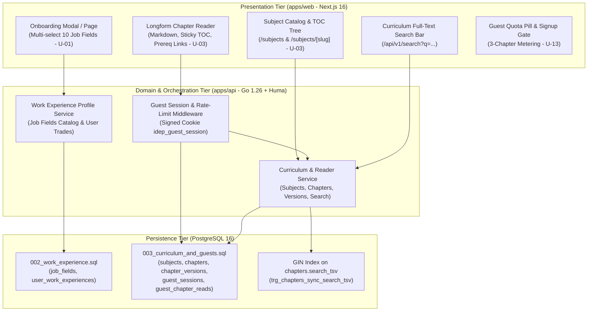

# Phase 1 MVP — Curriculum Reader, Work-Experience Onboarding & Guest Metering

> **Status:** Proposed (Pending Architectural Review & Delegation)  
> **Stories Covered:** `U-01` (Work Experience Onboarding), `U-03` (Subject & Chapter Reader + Full-Text Search), `U-13` (3-Free-Chapter Guest Metering & Gate)  
> **Migrations:** Stage 1 (`002_work_experience.sql`, `003_curriculum_and_guests.sql`)  
> **Builder:** Claude Code via `delegate-to-claude` · **Reviewer:** Gemini / Architect → `docs/reviews/phase-1-curriculum-reader-review.md`  
> **Related Contracts:** [`architectural_decisions.md`](file:///home/xiscohonggono/projects/Idep/docs/architecture/architectural_decisions.md) (ADR-001, ADR-002, ADR-003) · [`database-schema-proposal.md`](file:///home/xiscohonggono/projects/Idep/docs/plans/Pending/database-schema-proposal.md) · [`database-staging-proposal.md`](file:///home/xiscohonggono/projects/Idep/docs/plans/Pending/database-staging-proposal.md) · [`rag-implementation.md`](file:///home/xiscohonggono/projects/Idep/docs/plans/Pending/rag-implementation.md) · [`.agent/rules/project_guardrails.md`](file:///home/xiscohonggono/projects/Idep/.agent/rules/project_guardrails.md)

---

## 0. Revision History

| Rev | Date | Author | Description |
| :--- | :--- | :--- | :--- |
| 1 | 2026-11-09 | Antigravity (Architect) | Initial specification: Decouples Stage 1 migrations from downstream AI slices, specifies Reader & Guest Metering architecture, defines Huma OpenAPI contracts, guarantees strict compatibility with `rag-implementation.md` and `grounded-ai-analogies.md`. |

---

## 1. Objectives & Executive Summary

Idep is a community-curated GED study platform designed for working adults. While downstream AI features (`U-04`–`U-08`) deliver workplace analogies and RAG retrieval, they cannot function in a vacuum: they require a grounded, authoritative curriculum corpus to anchor against.

This plan establishes Idep’s **Core Reading Platform and Guest Conversion Engine**:
1. **Work-Experience Onboarding (`U-01`):** Allows registered learners to select their prior job fields from a 10-trade starter catalog (e.g. F&B, Retail, Logistics, Healthcare, Construction) with optional role titles, or fall back to everyday scenarios.
2. **GED Curriculum Reader & Full-Text Search (`U-03`):** Delivers clean, distraction-free reading across the 4 official GED subjects, hierarchical Table of Contents (TOC) navigation, prerequisite chapter linking, and sub-100ms PostgreSQL `tsvector` full-text search.
3. **3-Free-Chapter Guest Metering & Paywall Gate (`U-13`):** Gives unauthenticated visitors a high-value preview (3 distinct chapters for free with re-read idempotency and remaining-read status pill) while enforcing a hard sign-up gate on the 4th chapter to drive organic registration.

---

## 2. Compatibility & Alignment Review

Before execution, this specification has been audited against all pending architectural plans to guarantee zero schema drift, zero naming collisions, and clean modular boundaries:

| Existing Plan / Contract | Cross-Contract Touchpoint | Compatibility Verdict |
| :--- | :--- | :--- |
| **[`rag-implementation.md`](file:///home/xiscohonggono/projects/Idep/docs/plans/Pending/rag-implementation.md)** | `rag-implementation.md` requires foreign key `knowledge_sources.job_field_code REFERENCES job_fields(code)` and extracts internal knowledge from published `chapter_versions`. | **Direct Prerequisite (No Clash):** Phase 1 creates `job_fields` and `chapter_versions`. Without Phase 1, `rag-implementation.md` cannot execute its migration. Search uses separate indices (`chapters.search_tsv` for curriculum vs. `knowledge_chunks.text_search_tsv` for vector RAG). |
| **[`stage-0-identity-and-rbac.md`](file:///home/xiscohonggono/projects/Idep/docs/plans/Pending/stage-0-identity-and-rbac.md)** | Foreign keys `user_work_experiences.user_id` and `chapter_versions.author_id` reference `users(id UUID)`. | **Sequential Precedence (No Clash):** Phase 1 assumes Stage 0 is applied first. Uses `UUID` foreign keys throughout. |
| **[`grounded-ai-analogies.md`](file:///home/xiscohonggono/projects/Idep/docs/plans/Pending/grounded-ai-analogies.md)** | Grounded AI sidebar anchors to 1–3 paragraphs of published `chapter_versions` and reads `user_work_experiences`. | **Decoupling Benefit:** Removes migrations `002` and `003` from `grounded-ai-analogies.md`. AI slice can now strictly focus on prompt synthesis, OpenAI client, and the sidebar UI without owning the Reader. |
| **[`database-staging-proposal.md`](file:///home/xiscohonggono/projects/Idep/docs/plans/Pending/database-staging-proposal.md)** | Migration order: Stage 0 → Stage 1 (`002` + `003`). Rollback path must drop Stage 1 cleanly. | **100% Compliant:** Exact adherence to Stage 1 DDL and rollback script specifications in §3.2 of the staging proposal. |

---

## 3. Resolved Architectural Decisions (ADRs)

| ID | Decision | Rationale |
| :--- | :--- | :--- |
| **D1 (Guest Identity)** | Track guest quota via a cryptographically signed, HTTP-only cookie (`idep_guest_session`) containing an HMAC-SHA256 signature over a generated UUID session ID. | Prevents client-side quota tampering without forcing unauthenticated visitors into invasive fingerprinting or premature account creation (`ADR-002 §4.3`, `U-13`). |
| **D2 (Idempotent Metering)** | Reading an already opened chapter by the same guest session does **not** consume additional quota. Enforced by composite primary key `PRIMARY KEY (guest_session_id, chapter_id)`. | Explicitly mandated by `U-13`: learners reviewing previously opened notes must not be penalized. |
| **D3 (Search Architecture)** | Implement curriculum search via PostgreSQL English `tsvector` with generated column and GIN index on `chapters(search_tsv)`, synchronized via trigger `trg_chapters_sync_search_tsv`. | Eliminates external search engine dependencies (Elasticsearch/Algolia), delivers <50ms query latency across the curriculum, and maintains transactional consistency on version publication (`ADR-001`, `U-03`). |
| **D4 (Content Formatting)** | Store chapter bodies as standard CommonMark Markdown in `chapter_versions.content_markdown`. Precompute hierarchical headings as `toc_json` during publication. | Ensures clean separation between storage and presentation tier. Next.js renders Markdown via safe AST parser while TOC is instantly available without client-side DOM parsing. |
| **D5 (Seed Data)** | Seed the 10 starter job fields (`job_fields`) and 4 official GED subjects (`subjects`) directly in the migration files via `INSERT ... ON CONFLICT DO NOTHING`. Include baseline curriculum chapters for each subject. | Gives developers, CI environments, and end-users an immediately functional platform without manual seed scripts. |

---

## 4. Work Items & Implementation Details

### 4.1 Database Migrations (`apps/api/sql/schema/`)

#### 1. `apps/api/sql/schema/002_work_experience.sql`
- Creates table `job_fields` with the 10-trade catalog (`fnb`, `retail`, `logistics`, `healthcare`, `construction`, `hospitality`, `manufacturing`, `office_admin`, `automotive`, `childcare_education`).
- Creates table `user_work_experiences` with composite uniqueness `(user_id, job_field_code)` and index `idx_user_work_experiences_user_priority`.
- Includes Goose `-- +goose Up` / `-- +goose Down` and lock timeout guards (`SET lock_timeout = '3s'; SET statement_timeout = '30s';`).

#### 2. `apps/api/sql/schema/003_curriculum_and_guests.sql`
- Creates table `subjects` seeded with the 4 GED subjects (`mathematical-reasoning`, `reasoning-through-language-arts`, `science`, `social-studies`).
- Creates table `chapters` with `search_tsv` and `current_version_id`.
- Creates table `chapter_versions` with immutability trigger `trg_chapter_versions_immutable` and constraint `chk_version_provenance`.
- Creates table `chapter_prerequisites` linking version to required chapters.
- Creates table `guest_sessions` and `guest_chapter_reads` with FK to `chapters(id)`.
- Adds trigger `trg_chapters_sync_search_tsv` and function `sync_chapter_search_tsv()`.
- Reversible `-- +goose Down` drops all triggers, functions, and tables in reverse dependency order.

---

### 4.2 Backend Implementation (`apps/api`)

#### 1. Database Queries (`apps/api/sql/queries/`)
- **`job_fields.sql`:**
  - `ListActiveJobFields`: Retrieves all active job fields ordered by `display_order ASC`.
  - `GetUserWorkExperiences`: Retrieves a user's configured job fields and roles ordered by `priority_order ASC`.
  - `UpsertUserWorkExperience`: Inserts or updates a user's work experience trade and role.
  - `DeleteUserWorkExperiences`: Clears existing work experiences for replacement.
- **`curriculum.sql`:**
  - `ListSubjects`: Retrieves the 4 GED subjects with ordered chapter counts.
  - `GetSubjectBySlug`: Retrieves a subject and its ordered published chapters (`id, slug, title, display_order`).
  - `GetChapterBySlug`: Retrieves chapter metadata, live version content (`content_markdown`, `toc_json`, `citations_json`, `version_number`), and author/checker attribution.
  - `GetChapterPrerequisites`: Retrieves prerequisite chapters for a given version.
  - `SearchCurriculum`: Executes `plainto_tsquery('english', $1)` against `chapters.search_tsv` with `ts_rank_cd` scoring and headline snippets.
- **`guests.sql`:**
  - `GetOrCreateGuestSession`: Upserts a guest session by fingerprint/token.
  - `GetGuestReadCount`: Counts distinct chapters read by session ID.
  - `HasGuestReadChapter`: Checks if session has already accessed a specific chapter.
  - `RecordGuestChapterRead`: Records first and last read timestamp for `(session_id, chapter_id)`.

#### 2. Huma OpenAPI 3.1 Operations (`apps/api/internal/handler/`)
- **`GET /api/v1/job-fields` (Public):**
  - Returns list of available job categories with example roles for onboarding.
- **`GET /api/v1/me/work-experience` (Auth required):**
  - Returns the authenticated user's saved work experience profile.
- **`PUT /api/v1/me/work-experience` (Auth required):**
  - Updates the authenticated user's selected job fields and custom role titles in priority order.
- **`GET /api/v1/subjects` (Public):**
  - Returns the 4 GED subjects with summaries and chapter counts.
- **`GET /api/v1/subjects/{slug}` (Public):**
  - Returns subject details with full ordered TOC of published chapters.
- **`GET /api/v1/chapters/{slug}` (Metered / Auth optional):**
  - Middleware checks `Authorization: Bearer <JWT>`:
    - If valid user: returns full chapter content (`is_guest = false`).
    - If unauthenticated guest: evaluates `idep_guest_session` cookie. If read count < 3 or chapter already read, records read and returns content with header `X-Guest-Remaining: N`. If unique read count >= 3 on an unread chapter, returns `HTTP 403 Forbidden` (`GUEST_QUOTA_EXHAUSTED`).
- **`GET /api/v1/search?q={query}` (Public):**
  - Returns matching chapters, subject tags, and ranked contextual text snippets.

---

### 4.3 Frontend Implementation (`apps/web`)

1. **Design Tokens & Typography:**
   - Implement reading-optimized prose typography (line height 1.75, max reading measure `68ch`, high-contrast legible font).
   - Subject theme tokens:
     - Math: `#0284c7` (Sky Blue)
     - RLA: `#b45309` (Amber)
     - Science: `#059669` (Emerald)
     - Social Studies: `#7c3aed` (Violet)

2. **Work-Experience Onboarding Modal / Page (`/onboarding`):**
   - Clean, interactive cards for the 10 job categories with icon and example roles.
   - Allows multi-selection with drag-and-drop or click ordering for priority.
   - Prominent *"Skip for now (Use everyday analogies)"* action (`U-01`).

3. **Subject Catalog & Chapter Reader (`/subjects`, `/subjects/[subjectSlug]/[chapterSlug]`):**
   - **TOC Navigation:** Sticky desktop sidebar highlighting current reading section using `IntersectionObserver`.
   - **Prerequisite Banner:** Top callout linking to foundational chapters (`"Prerequisites to master first: [Chapter A]"`) (`U-08`).
   - **Text Selection Hook (`usePassageSelection`):** Listens for user text highlights (1–3 paragraphs) and exposes an *"Explain with AI"* action pill in preparation for Phase 3.

4. **Guest Metering UX & Sign-up Gate (`U-13`):**
   - **Sticky Quota Banner:** Subtle pill at the top of the reader: *"Free Preview: 2 of 3 free chapters remaining."*
   - **Paywall Dialog (4th Chapter):** When `GUEST_QUOTA_EXHAUSTED` (HTTP 403) is received, display an unobtrusive modal:
     - Title: *"You've completed your 3 free preview chapters"*
     - Explanation of benefits: Unlimited reading, AI workplace analogies, and active recall practice.
     - Direct CTA: *"Create Free Account"* (redirecting to auth with return URL).

---

## 5. Verification Gates & Acceptance Criteria

Execution is only considered complete when all five verification gates pass:

1. **Database Schema & Invariants Gate:**
   - Real PostgreSQL 16 migration run: `cmd/migrate up -> down -> up` exits `0`.
   - Seed assertions: `SELECT count(*) FROM job_fields` = 10; `SELECT count(*) FROM subjects` = 4.
   - Immutability check: `UPDATE chapter_versions` or `DELETE FROM chapter_versions` raises exception `Table chapter_versions is append-only`.
   - Provenance check: Inserting proposal-sourced version with `author_id = checker_id` fails `chk_version_provenance`.

2. **Guest Metering Gate (`U-13`):**
   - Guest reads Chapter 1 → Success, `reads_used` = 1, `remaining` = 2.
   - Guest re-reads Chapter 1 → Success, `reads_used` = 1, `remaining` = 2 (idempotent).
   - Guest reads Chapter 2 & 3 → Success, `remaining` = 0.
   - Guest attempts Chapter 4 → Returns `HTTP 403 Forbidden` (`GUEST_QUOTA_EXHAUSTED`).
   - Authenticated user reads Chapter 4 → Returns `HTTP 200 OK` (unlimited).

3. **Curriculum Search Gate (`U-03`):**
   - Querying `GET /api/v1/search?q=photosynthesis` returns relevant Science chapters with rank score > 0 and non-empty snippet within 50ms.

4. **Codegen Synchronization Gate:**
   - `pnpm codegen` runs cleanly with zero drift between Go Huma routes, `apps/api/openapi.json`, and `apps/web/lib/api/schema.d.ts`.

5. **CI Quality & Monorepo Test Gate:**
   - `pnpm lint`, `pnpm --filter web check-types`, and `pnpm test` pass with 0 errors and 0 warnings.

