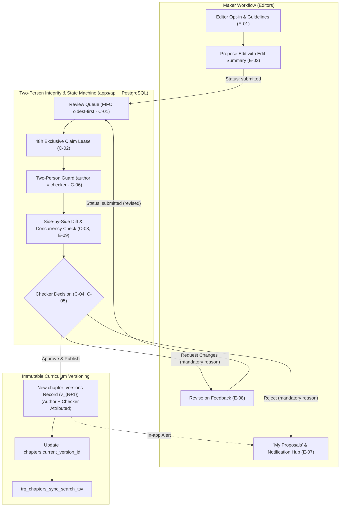

# Phase 2 MVP — Maker–Checker Editorial & Review Loop

> **Status:** Proposed (Pending Architectural Review & Delegation)  
> **Stories Covered:** `E-01` (Become Editor), `E-03` (Propose Edit), `E-07` (Track Proposals & Notifications), `E-08` (Revise Proposal), `C-01` (Review Queue), `C-02` (48h Claim Lease), `C-03` (Side-by-Side Diff), `C-04` (Approve & Publish), `C-05` (Request Changes / Reject with Reason), `C-06` (Self-Approval Guard), `C-09` (Apply to Become Checker), `C-10` (Checker Revocation & Claim Release)  
> **Migrations:** Stage 2 (`004_proposals_and_revisions.sql`, `005_checker_governance_and_notifications.sql`)  
> **Builder:** Claude Code via `delegate-to-claude` · **Reviewer:** Gemini / Architect → `docs/reviews/phase-2-maker-checker-review.md`  
> **Related Contracts:** [`architectural_decisions.md`](file:///home/xiscohonggono/projects/Idep/docs/architecture/architectural_decisions.md) (ADR-001, ADR-002, ADR-003) · [`database-schema-proposal.md`](file:///home/xiscohonggono/projects/Idep/docs/plans/Pending/database-schema-proposal.md) · [`database-staging-proposal.md`](file:///home/xiscohonggono/projects/Idep/docs/plans/Pending/database-staging-proposal.md) · [`phase-1-curriculum-reader-and-guest-metering.md`](file:///home/xiscohonggono/projects/Idep/docs/plans/Pending/phase-1-curriculum-reader-and-guest-metering.md) · [`.agent/rules/project_guardrails.md`](file:///home/xiscohonggono/projects/Idep/.agent/rules/project_guardrails.md)

---

## 0. Revision History

| Rev | Date | Author | Description |
| :--- | :--- | :--- | :--- |
| 1 | 2026-11-09 | Antigravity (Architect) | Initial specification: Specifies Maker-Checker state machine, two-person integrity database guards (`C-06`), 48h review lease lifecycle (`C-02`), side-by-side diff contracts (`C-03`), Huma endpoints, and Checker role governance. |
| 2 | 2026-11-09 | Antigravity (Architect) | **Roadmap Reconciliation & Schema Alignment:** 1. Aligned `notifications` DDL and SQL queries with authoritative `database-schema-proposal.md` §3.4 Table 21 (`recipient_user_id`, `event_type`, `link_path`, `read_at`, `email_sent_at`, `metadata_json`). 2. Added explicit Files Touched and Blast-Radius Guard table. |

---

## 1. Objectives & Executive Summary

Idep’s core trust differentiator is that curriculum notes are **community-curated under a rigorous Maker–Checker governance model**. No editor, checker, or administrator can directly overwrite live curriculum content in place. Every change must be proposed, reviewed against base version history, verified through dual-custody approval, and published as a forward immutable version snapshot (`ADR-003`).

This plan delivers the complete **Maker–Checker Editorial Loop**:
1. **The Maker Loop (Editors `E-01`, `E-03`, `E-07`, `E-08`):** Enables registered members to opt in as Editors, propose chapter revisions with mandatory edit summaries, track proposal lifecycles, and iterate through feedback revisions without losing previous snapshot history.
2. **The Checker Review Engine (`C-01`–`C-06`):** Provides approved Checkers with a FIFO queue ordered oldest-first, 48-hour claim leases (`C-02`), side-by-side diff inspection (`C-03`), mandatory decision rationales (`C-05`), and publication versioning attributing both Author and Checker (`C-04`).
3. **Hard Two-Person Integrity Enforced at the DB Layer (`C-06`):** Database triggers and Huma middleware unconditionally reject any attempt by an Author or Co-Author to claim, review, or approve their own proposal.
4. **Checker Role Governance (`C-09`, `C-10`):** An application and admin review pipeline for community Checkers, with immediate claim release back to the queue upon role revocation.

---

## 2. Compatibility & Alignment Review

| Existing Plan / Contract | Cross-Contract Touchpoint | Compatibility Verdict |
| :--- | :--- | :--- |
| **[`phase-1-curriculum-reader-and-guest-metering.md`](file:///home/xiscohonggono/projects/Idep/docs/plans/Pending/phase-1-curriculum-reader-and-guest-metering.md)** | Foreign keys `proposals.chapter_id` and `proposals.base_version_id` reference `chapters(id)` and `chapter_versions(id)`. | **Direct Successor:** Phase 2 assumes Phase 1 (Stage 1 migrations) has created `subjects`, `chapters`, and `chapter_versions`. Phase 2 adds constraint `fk_chapter_versions_proposal` linking `chapter_versions.source_proposal_id -> proposals.id`. |
| **[`rag-implementation.md`](file:///home/xiscohonggono/projects/Idep/docs/plans/Pending/rag-implementation.md)** | RAG pipeline consumes published curriculum chapters from `chapter_versions`. | **Synergistic:** When Phase 2 publishes new chapter versions via `C-04`, the updated content automatically enters the curriculum catalog for downstream RAG ingestion. Zero schema conflict. |
| **[`grounded-ai-analogies.md`](file:///home/xiscohonggono/projects/Idep/docs/plans/Pending/grounded-ai-analogies.md)** | AI analogies anchor to `chapter_versions.id`. | **Independent & Safe:** Phase 2 produces new immutable `chapter_versions` rows. Existing highlights remain anchored to their original version snapshots. |
| **[`database-staging-proposal.md`](file:///home/xiscohonggono/projects/Idep/docs/plans/Pending/database-staging-proposal.md)** | Stage 2 rollout rules: `004_proposals_and_revisions.sql` and `005_checker_governance_and_notifications.sql`. | **100% Compliant:** Matches §3.3 of the staging proposal verbatim, including `NOT VALID` foreign key addition on `chapter_versions`. |

---

## 3. Resolved Architectural Decisions (ADRs)

| ID | Decision | Rationale |
| :--- | :--- | :--- |
| **D1 (Claim Lease Lifetime)** | Review claims expire exactly **48 hours** after `claimed_at` (`C-02`). Enforced via dual evaluation: lazy check during queue read queries (`claim_expires_at < NOW()`) + background Go ticker (every 5 minutes) releasing expired claims back to `submitted`. | Prevents a single Checker from hoarding or abandoning review proposals, avoiding editorial bottlenecks (`ADR-003 §5.2`). |
| **D2 (Database-Enforced Separation)** | Enforce two-person integrity via PostgreSQL `CHECK (claimed_by <> author_id)` AND PL/pgSQL trigger `enforce_proposal_coauthor_separation()` covering `proposals`, `proposal_contributors`, and `chapter_versions` (`C-06`). | Application-level checks can be accidentally bypassed; database constraints guarantee mathematical impossibility of self-approval under all circumstances (`ADR-003 §5.1`). |
| **D3 (Optimistic Concurrency & Base Versions)** | Proposals record `base_version_id`. If `chapters.current_version_id` advances before publication, approve fails closed with `HTTP 409 Conflict` (`CHAPTER_VERSION_CONFLICT`), requiring a rebase/revision (`E-09`). | Guarantees Checkers never approve a diff calculated against an obsolete version of the chapter (`ADR-003 §5.4`). |
| **D4 (Mandatory Decision Reasons)** | `status IN ('changes_requested', 'rejected')` strictly requires a non-empty `review_decision_reason` (enforced via DB constraint `chk_decision_reason`). | Protects Editors from unhelpful rejections and establishes clear educational feedback loops (`C-05`). |
| **D5 (Immutable Revision History)** | Each time an Editor resubmits an edit proposal, a new row is appended to `proposal_revisions`. Proposals table tracks the current pointer. | Preserves complete audit trails for both Editors and Checkers (`E-08`, `C-07`). |

---

## 4. Work Items & Implementation Details

### 4.1 Database Migrations (`apps/api/sql/schema/`)

#### 1. `apps/api/sql/schema/004_proposals_and_revisions.sql`
- Creates table `proposals`:
  - Columns: `id UUID`, `proposal_type ('edit_chapter', 'new_chapter')`, `subject_id`, `chapter_id`, `base_version_id`, `proposed_title`, `proposed_slug`, `proposed_display_order`, `proposed_content_markdown`, `proposed_prerequisite_chapter_ids`, `edit_summary`, `author_id`, `status`, `claimed_by`, `claimed_at`, `claim_expires_at`, `reviewed_by`, `reviewed_at`, `review_decision_reason`, `submitted_at`, `published_version_id`, timestamps.
  - Constraints: `chk_proposal_target`, `chk_submitted_summary`, `chk_no_self_claim`, `chk_no_self_review`, `chk_in_review_claim`, `chk_published_provenance`, `chk_decision_reason`.
  - Indexes: `idx_proposals_review_queue`, `idx_proposals_review_queue_subject`, `idx_proposals_expired_claims`, `idx_proposals_author_status`.
- Creates table `proposal_contributors` (`proposal_id`, `user_id`, `added_at`).
- Creates table `proposal_revisions` (`id`, `proposal_id`, `revision_number`, `base_version_id`, `title`, `content_markdown`, `citations_json`, `prerequisite_chapter_ids`, `edit_summary`, `created_by`, `created_at`).
- Creates function `enforce_proposal_coauthor_separation()` and triggers:
  - `trg_proposals_coauthor_guard` ON `proposals`
  - `trg_proposal_contributors_coauthor_guard` ON `proposal_contributors`
  - `trg_chapter_versions_coauthor_guard` ON `chapter_versions`
- Goose `-- +goose Down` drops triggers, functions, and tables in reverse order.

#### 2. `apps/api/sql/schema/005_checker_governance_and_notifications.sql`
- Creates table `checker_applications` (`id UUID PRIMARY KEY`, `user_id UUID NOT NULL REFERENCES users(id) ON DELETE CASCADE`, `target_subject_slugs TEXT[] NOT NULL`, `background_statement TEXT NOT NULL`, `status TEXT NOT NULL DEFAULT 'pending'`, `reviewed_by UUID REFERENCES users(id)`, `reviewed_at TIMESTAMPTZ`, `decision_reason TEXT`, `created_at TIMESTAMPTZ NOT NULL DEFAULT NOW()`) with constraints `chk_checker_app_reason` and `chk_checker_app_self_review`.
- Creates table `notifications` (verbatim from `database-schema-proposal.md` §3.4 Table 21):
  - `id UUID PRIMARY KEY DEFAULT gen_random_uuid()`
  - `recipient_user_id UUID NOT NULL REFERENCES users(id) ON DELETE CASCADE`
  - `event_type TEXT NOT NULL CHECK (event_type IN ('proposal.submitted', 'proposal.in_review', 'proposal.changes_requested', 'proposal.published', 'proposal.rejected', 'chapter.rolled_back', 'educator_verification.decided', 'checker_application.decided', 'checker_role.revoked'))`
  - `title TEXT NOT NULL`, `body TEXT NOT NULL`, `link_path TEXT NOT NULL`
  - `metadata_json JSONB NOT NULL DEFAULT '{}'::jsonb`
  - `read_at TIMESTAMPTZ`, `email_sent_at TIMESTAMPTZ`, `created_at TIMESTAMPTZ NOT NULL DEFAULT NOW()`
  - Index: `idx_notifications_recipient_unread ON notifications (recipient_user_id, created_at DESC) WHERE read_at IS NULL;`
- Adds foreign key `fk_chapter_versions_proposal` on `chapter_versions(source_proposal_id) REFERENCES proposals(id)` using `NOT VALID` followed by `VALIDATE CONSTRAINT`.
- Goose `-- +goose Down` drops `fk_chapter_versions_proposal`, `notifications`, and `checker_applications`.

---

### 4.2 Backend Implementation (`apps/api`)

#### 1. SQL Queries (`apps/api/sql/queries/`)
- **`proposals.sql`:**
  - `CreateProposal`: Inserts a new proposal (`draft` or `submitted`).
  - `InsertProposalRevision`: Appends a revision snapshot.
  - `GetProposalByID`: Fetches proposal details, author metadata, and current revision content.
  - `ListMyProposals`: Keyset-paginated list of proposals for an author (`E-07`).
  - `ListReviewQueue`: Oldest-first FIFO review queue filtered by subject and proposal type (`C-01`).
  - `ClaimProposal`: Sets `claimed_by = $1, claimed_at = NOW(), claim_expires_at = NOW() + INTERVAL '48 hours', status = 'in_review'` (`C-02`).
  - `ReleaseClaim`: Resets claim fields and sets `status = 'submitted'`.
  - `SweepExpiredClaims`: Transitions expired `in_review` rows back to `submitted`.
  - `ApproveAndPublishProposal`: Atomic transaction:
    1. Validates `base_version_id == chapters.current_version_id`.
    2. Inserts new row into `chapter_versions` (`version_number = V_{current} + 1`, `author_id = proposal.author_id`, `checker_id = claim.checker_id`, `source_proposal_id = proposal.id`).
    3. Updates `chapters.current_version_id = new_version.id`.
    4. Updates proposal `status = 'published', published_version_id = new_version.id, reviewed_by = checker_id, reviewed_at = NOW()`.
  - `RequestProposalChanges`: Updates proposal to `changes_requested` with `review_decision_reason`.
  - `RejectProposal`: Updates proposal to `rejected` with `review_decision_reason`.
- **`checker_governance.sql`:**
  - `CreateCheckerApplication`: Submits a new application.
  - `ListPendingCheckerApplications`: For Admin review.
  - `ReviewCheckerApplication`: Updates application status with reason, conditionally grants `checker` role.
  - `RevokeCheckerRole`: Revokes role, records audit event, and atomically releases any active claims held by that user.
- **`notifications.sql`:**
  - `CreateNotification`: Queues in-app alert inserting into `notifications` with `recipient_user_id`, `event_type`, `link_path`, and `metadata_json`.
  - `ListMyNotifications`: Fetches unread alerts for `recipient_user_id` ordered by `created_at DESC`.
  - `MarkNotificationRead`: Updates `read_at = NOW()` for `id = $1 AND recipient_user_id = $2`.

#### 2. Huma API Endpoints (`apps/api/internal/handler/`)
- **`POST /api/v1/editor/opt-in` (Auth required):**
  - Accepts editing guidelines, assigns `editor` role to user (`E-01`).
- **`POST /api/v1/proposals` (Editor role):**
  - Creates proposal with base version check and mandatory edit summary (`E-03`).
- **`GET /api/v1/me/proposals` (Editor role):**
  - Returns paginated list of author's proposals with live statuses (`E-07`).
- **`GET /api/v1/proposals/{id}` (Auth required):**
  - Returns proposal details, current proposed markdown, base version content, and review reasons.
- **`POST /api/v1/proposals/{id}/revisions` (Author only):**
  - Submits revision after `changes_requested`, creating a `proposal_revisions` record (`E-08`).
- **`GET /api/v1/checker/queue` (Checker role):**
  - Returns FIFO review queue ordered oldest-first with subject/chapter filters (`C-01`).
- **`POST /api/v1/proposals/{id}/claim` (Checker role):**
  - Claims proposal for 48h lease (`C-02`). Blocks author/co-author (`C-06`).
- **`POST /api/v1/proposals/{id}/release` (Claimant or Admin):**
  - Releases proposal claim back to queue.
- **`GET /api/v1/proposals/{id}/diff` (Checker role):**
  - Returns structured line-by-line diff between base version and proposed content (`C-03`).
- **`POST /api/v1/proposals/{id}/approve` (Claimant only):**
  - Publishes proposal to live chapter (`C-04`). Enforces `author != checker` (`C-06`).
- **`POST /api/v1/proposals/{id}/request-changes` (Claimant only):**
  - Requests changes with mandatory reason (`C-05`).
- **`POST /api/v1/proposals/{id}/reject` (Claimant only):**
  - Rejects proposal with mandatory reason (`C-05`).
- **`POST /api/v1/checker/apply` (Auth required):**
  - Submits application to become a Checker (`C-09`).
- **`POST /api/v1/admin/checker-applications/{id}/decision` (Admin role):**
  - Approves or rejects checker application with reason.
- **`POST /api/v1/admin/checkers/{userId}/revoke` (Admin role):**
  - Revokes checker status with reason and releases claims (`C-10`).

---

### 4.3 Frontend Implementation (`apps/web`)

1. **Editor Experience:**
   - **Editor Opt-In Dialog (`/editor/guidelines`):** Summary of community editorial standards and one-click opt-in (`E-01`).
   - **Chapter Editor Interface (`/subjects/[subject]/[chapter]/edit`):**
     - Side-by-side or tabbed Markdown editor with live preview.
     - Edit Summary input field (`"Summarize what you changed and why"`).
     - Prerequisite selector for linking related chapters (`U-08`).
   - **Author Proposal Dashboard (`/dashboard/proposals`):**
     - Status tracker cards with state pills (`Submitted`, `In Review`, `Changes Requested`, `Published`, `Rejected`).
     - Review feedback banner displaying Checker decision rationale.
     - One-click `"Revise Proposal"` action loading previous content into editor.

2. **Checker Review Workspace:**
   - **Review Queue Dashboard (`/checker/queue`):**
     - Filter tabs for the 4 GED subjects.
     - Queue cards displaying submission age (`"Submitted 3 days ago"`), editor name, Verified Educator badge, and edit summary.
     - Claim button with live countdown timer (`"Claimed by you - 47h 12m remaining"`).
     - Visual self-proposal badge (`"Your proposal - another Checker must review"`) with disabled claim/approve buttons (`C-06`).
   - **Side-by-Side Diff Viewer (`/checker/proposals/[id]/review`):**
     - Dual-pane layout: Left pane displays live published chapter, right pane displays proposed revision.
     - Line-level diff highlights (green background for additions, red for deletions).
     - Review Action Bar:
       - **Approve & Publish:** Green button with confirmation modal showing version increment (`v1 -> v2`).
       - **Request Changes:** Yellow button prompting for required feedback textarea.
       - **Reject:** Red button prompting for mandatory rejection rationale.

3. **In-App Notification Center:**
   - Real-time dropdown and badge showing review status updates (`"Your proposal on Photosynthesis was published!"` or `"Changes requested on Linear Equations"`).

---

## 5. Verification Gates & Acceptance Criteria

Execution is complete only when all seven gates pass:

1. **Database Schema & Two-Person Guard Gate:**
   - Goose migration `cmd/migrate up -> down -> up` executes cleanly on PostgreSQL 16.
   - Assert `INSERT INTO proposals` where `claimed_by = author_id` raises `chk_no_self_claim`.
   - Assert `UPDATE proposals SET status = 'in_review', claimed_by = NULL` raises `chk_in_review_claim`.
   - Assert `UPDATE proposals SET status = 'rejected', review_decision_reason = ''` raises `chk_decision_reason`.
   - Assert co-author attempting to approve via `chapter_versions` raises `trg_chapter_versions_coauthor_guard` (`C-06`).

2. **48-Hour Claim Lease & Sweeper Gate (`C-02`):**
   - Proposal claimed at $T_0$ has `claim_expires_at = T_0 + 48\text{h}`.
   - Dual-enforcement test:
     1. *Lazy Expiry:* Queue query `GET /api/v1/checker/proposals` treats proposals where `status = 'in_review' AND claim_expires_at < NOW()` as available for other Checkers to claim.
     2. *Background Sweeper:* Background sweeper task resets expired claims to `submitted` and clears `claimed_by`.

3. **Notification Event Dispatch Gate (`E-07`):**
   - When a Checker approves and publishes a proposal (`C-04`), a notification row is inserted in `notifications` for the proposal's author with `event_type = 'proposal.published'`, valid `link_path`, and `read_at IS NULL`.
   - When a Checker requests changes or rejects a proposal (`C-05`), a notification row is inserted for the author with `event_type = 'proposal.changes_requested'` or `'proposal.rejected'` and decision reason in `metadata_json`.

4. **Optimistic Concurrency Conflict Gate (`E-09`):**
   - Editor A drafts against $V_1$.
   - Editor B publishes $V_2$ before Editor A submits.
   - Attempting to approve Editor A's proposal returns `HTTP 409 Conflict` (`CHAPTER_VERSION_CONFLICT`).

5. **Checker Role Revocation Gate (`C-10`):**
   - Revoking Checker role via admin endpoint immediately releases all active claims held by that user back to the review queue.
   - Previously published versions attributed to that Checker retain immutable historical attribution.

6. **Codegen Synchronization Gate:**
   - `pnpm codegen` completes with zero drift across `sqlc`, `apps/api/openapi.json`, and `apps/web/lib/api/schema.d.ts`.

7. **CI Quality & Monorepo Test Gate:**
   - `pnpm lint`, `pnpm --filter web check-types`, and `pnpm test` pass with 0 errors and 0 warnings.

---

## 6. Files Touched & Blast-Radius Guard

| Action | File Path |
| :--- | :--- |
| **new** | `apps/api/sql/schema/004_proposals_and_revisions.sql`, `apps/api/sql/schema/005_checker_governance_and_notifications.sql` |
| **new** | `apps/api/sql/queries/proposals.sql`, `apps/api/sql/queries/checker_governance.sql`, `apps/api/sql/queries/notifications.sql` |
| **new** | `apps/api/internal/domain/proposal.go`, `apps/api/internal/domain/checker.go`, `apps/api/internal/domain/notification.go` |
| **new** | `apps/api/internal/repository/proposal_repo.go`, `apps/api/internal/repository/checker_repo.go`, `apps/api/internal/repository/notification_repo.go` |
| **new** | `apps/api/internal/service/proposal_service.go`, `apps/api/internal/service/checker_service.go`, `apps/api/internal/service/notification_service.go` |
| **new** | `apps/api/internal/handler/proposal_handler.go`, `apps/api/internal/handler/checker_handler.go`, `apps/api/internal/handler/notification_handler.go` |
| **new** | `apps/web/app/checker/queue/page.tsx`, `apps/web/app/checker/proposals/[id]/review/page.tsx`, `apps/web/app/dashboard/proposals/page.tsx`, `apps/web/app/editor/guidelines/page.tsx`, `apps/web/app/subjects/[subject]/[chapter]/edit/page.tsx` |
| **edit** | `apps/api/cmd/server/main.go`, `apps/api/cmd/server/main_test.go`, `apps/web/lib/api/go.ts`, `apps/web/lib/api/index.ts` |
| **regenerated** | `apps/api/internal/repository/db/*`, `apps/api/openapi.json`, `apps/web/lib/api/schema.d.ts` |
| **must NOT change** | `apps/api/internal/guardrails_test.go`, `apps/api/sql/schema/001_*.sql` through `003_*.sql`, `apps/web/lib/supabase.ts`, `packages/eslint-config/**` |

