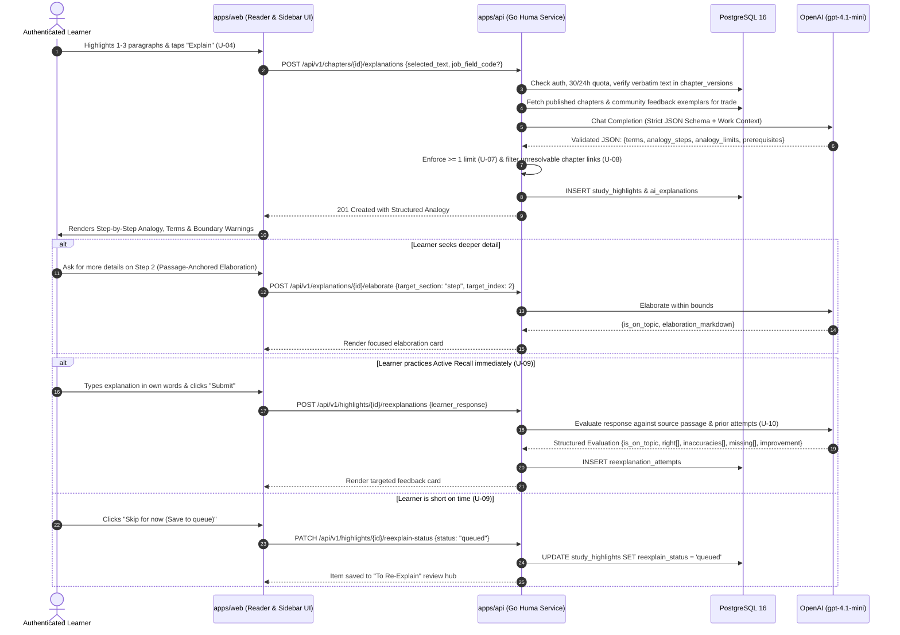

# Phase 3 MVP — AI Study Sidebar & Active Recall Loop

> **Status:** Proposed (Consolidated Specification — Unifies and supersedes `grounded-ai-analogies.md`)  
> **Stories Covered:** `U-04` (Highlight Passage), `U-05` (Term Definitions), `U-06` (Workplace Analogy), `U-07` (Analogy Breakdown Limits), `U-08` (Prerequisite Topics), `U-09` (Active Recall & "To Re-Explain" Queue), `U-10` (Targeted Formative Evaluation & Retry Comparison)  
> **Migrations:** Stage 3 (`006_study_highlights_and_ai.sql`)  
> **Builder:** Claude Code via `delegate-to-claude` · **Reviewer:** Gemini / Architect → `docs/reviews/phase-3-ai-study-sidebar-review.md`  
> **Related Contracts:** [`architectural_decisions.md`](file:///home/xiscohonggono/projects/Idep/docs/architecture/architectural_decisions.md) (ADR-001, ADR-004) · [`database-schema-proposal.md`](file:///home/xiscohonggono/projects/Idep/docs/plans/Pending/database-schema-proposal.md) · [`database-staging-proposal.md`](file:///home/xiscohonggono/projects/Idep/docs/plans/Pending/database-staging-proposal.md) · [`phase-1-curriculum-reader-and-guest-metering.md`](file:///home/xiscohonggono/projects/Idep/docs/plans/Pending/phase-1-curriculum-reader-and-guest-metering.md) · [`.agent/rules/project_guardrails.md`](file:///home/xiscohonggono/projects/Idep/.agent/rules/project_guardrails.md)

---

## 0. Revision History

| Rev | Date | Author | Description |
| :--- | :--- | :--- | :--- |
| 1 | 2026-11-09 | Antigravity (Architect) | Consolidated Option B specification: Merges explanation generation (`U-04`–`U-08`) and the formative active recall loop (`U-09`, `U-10`) into a unified Phase 3 plan. Decouples Stage 1 migration dependencies (now owned by Phase 1 plan) and specifies OpenAI strict structured outputs, feedback flywheel, and non-punitive formative evaluation. |
| 2 | 2026-11-09 | Antigravity (Architect) | **Roadmap Reconciliation & Security Hardening:** 1. Restored prompt-injection defense (`<untrusted_community_feedback>` XML delimiters and input sanitization). 2. Restored `selected_job_field_code` to `AnalogyResponseSchema` for multi-trade resolution. 3. Specified 24h rate-limit formula and active recall attempt exclusion. 4. Mandated zero-dependency component testing via `react-dom/server` `renderToStaticMarkup`. 5. Added explicit Files Touched and Blast-Radius Guard table. |

---

## 1. Objectives & Executive Summary

Idep’s signature educational innovation is turning working adults' prior job experience into an unfair learning advantage. Highlighting abstract GED concepts (such as cellular respiration or algebraic systems) translates them into familiar, step-by-step workplace workflows (e.g. restaurant kitchen ticket flow or warehouse cross-docking).

However, learning cannot be passive. To ensure learners do not carry intuitive misconceptions into the official GED exam, Idep enforces a **dual-engine learning loop**:
1. **The Grounded Explanation Engine (`U-04`–`U-08`):** Anchors strictly to 1–3 highlighted paragraphs of a published chapter to generate plain-language terms (`U-05`), best-fit trade analogies with profession switching (`U-06`), mandatory analogy failure boundaries (`U-07`), and closed-world prerequisite links (`U-08`).
2. **The Active Recall & Formative Evaluation Engine (`U-09`, `U-10`):** Prompts learners to re-explain the concept in their own words (or save to a *"To re-explain"* queue when short on time), delivering targeted formative feedback (what was right, specific corrections, missing points, and non-graded hints if off-topic) without demoralizing numerical scores.

---

## 2. Compatibility & Alignment Review

| Existing Plan / Contract | Cross-Contract Touchpoint | Compatibility Verdict |
| :--- | :--- | :--- |
| **[`phase-1-curriculum-reader-and-guest-metering.md`](file:///home/xiscohonggono/projects/Idep/docs/plans/Pending/phase-1-curriculum-reader-and-guest-metering.md)** | Foreign keys `study_highlights.chapter_id`, `study_highlights.chapter_version_id`, and `ai_explanations.job_field_code`. | **Clean Dependency:** Phase 1 establishes Stage 1 migrations (`job_fields`, `subjects`, `chapters`, `chapter_versions`). Phase 3 cleanly references them without schema duplication. |
| **[`phase-2-maker-checker-editorial-loop.md`](file:///home/xiscohonggono/projects/Idep/docs/plans/Pending/phase-2-maker-checker-editorial-loop.md)** | Chapter versioning lifecycle. | **Zero Conflict:** Explanations snapshot the specific `chapter_version_id` at highlight time. When Phase 2 publishes new versions, existing study highlights maintain referential integrity with their historical version. |
| **[`rag-implementation.md`](file:///home/xiscohonggono/projects/Idep/docs/plans/Pending/rag-implementation.md)** | Future vocational grounding upgrade (`ADR-007`). | **Forward Compatible:** Phase 3 builds the base structured analogy and active recall pipeline using OpenAI structured outputs. When RAG is implemented later (post-Phase 4), it hooks into `internal/service/analogy_service.go` as a retrieval pre-step without altering database schemas or frontend API contracts. |
| **[`database-staging-proposal.md`](file:///home/xiscohonggono/projects/Idep/docs/plans/Pending/database-staging-proposal.md)** | Stage 3 migration rules (`006_study_highlights_and_ai.sql`). | **100% Compliant:** Matches §3.4 of the staging proposal verbatim. |

---

## 3. Resolved Architectural Decisions (ADRs)

| ID | Decision | Rationale |
| :--- | :--- | :--- |
| **D1 (LLM Client & Quota)** | Standardize on **OpenAI (`gpt-4.1-mini`)** using `github.com/openai/openai-go/v3` with Strict JSON Schema Structured Outputs (`Strict: true`), a hard `15s` timeout, $\le 1$ repair retry, and a **30 AI calls / 24h per-user quota** (`HTTP 429`) (`ADR-004 §6.3`). | Guarantees 100% valid schema shapes, protects operating budget, and prevents automated scraping or abuse. |
| **D2 (Verbatim Text Guard)** | Enforce that `selected_text` must match a verbatim substring of the target `chapter_versions.content_markdown` and span 1–3 paragraphs (`15` to `3,000` chars). | Eliminates prompt-injection attacks through fabricated passage bodies (`U-04`). |
| **D3 (Mandatory Analogy Boundaries)** | Enforce at the PostgreSQL schema level that `analogy_limits_json` has `minItems: 1` (`U-07`). Reject and repair any generation that omits the accurate scientific explanation of where the comparison fails. | Prevents adult learners from internalizing inaccurate analogies that would cause them to fail the official GED exam. |
| **D4 (Multi-Profession Best-Fit & Comparison)** | If `job_field_code` is omitted, the prompt passes all saved learner trades to OpenAI to select the best-matching trade for that specific passage. Passing an explicit `job_field_code` on the same highlight creates (or returns cached) a `1:N` comparison explanation. | Gives learners immediate best-fit analogies while allowing them to compare how different professions model the concept. |
| **D5 (Non-Punitive Formative Grading)** | Re-explanations (`U-10`) produce qualitative evaluations (strengths, corrections, missing details, retry comparison). Off-topic or blank inputs receive `is_graded = false` and a guiding hint without punitive scores. | Adult learners studying after work shifts need encouraging, formative guidance rather than anxiety-inducing test grades. |
| **D6 (Community Feedback Flywheel)** | Record `like`/`dislike` ratings with comments (`<= 500` chars). Condition new explanations for `(chapter_id, job_field_code)` on top 3 net-liked analogies and up to 5 dislike comments wrapped in untrusted XML delimiters. | Continuously improves generation quality over time through real learner feedback without leaking PII. |

---

## 4. Work Items & Implementation Details

### 4.1 Database Migration (`apps/api/sql/schema/006_study_highlights_and_ai.sql`)

1. **`study_highlights` (`U-04`, `U-09`):**
   - Columns: `id UUID`, `user_id`, `subject_id`, `chapter_id`, `chapter_version_id`, `selected_text`, `paragraph_count`, `start_offset`, `end_offset`, `reexplain_status ('pending', 'queued', 'completed')`, timestamps.
   - Constraints: `char_length(btrim(selected_text)) BETWEEN 15 AND 3000`, `paragraph_count BETWEEN 1 AND 3`.
   - Indexes: `idx_study_highlights_user_subject_history`, `idx_study_highlights_reexplain_queue`.
2. **`ai_explanations` (`U-05`–`U-08`):**
   - Columns: `id UUID`, `highlight_id`, `user_id`, `job_field_code`, `role_title_snapshot`, `is_everyday_fallback`, `terms_json`, `analogy_steps_json`, `analogy_limits_json`, `prerequisites_json`, `model_identifier`, `prompt_version`, `created_at`.
   - Constraints: `chk_work_field_or_fallback`, `jsonb_array_length(analogy_limits_json) >= 1`.
   - Indexes: `idx_ai_explanations_highlight`, `idx_ai_explanations_user_quota`.
3. **`ai_elaborations`:**
   - Columns: `id UUID`, `explanation_id`, `user_id`, `target_section ('step', 'term', 'limit', 'general')`, `target_index`, `user_prompt`, `is_on_topic`, `hint_text`, `elaboration_markdown`, `work_example`, `model_identifier`, `created_at`.
   - Constraints: `chk_elaboration_target_index`, `chk_elaboration_content_or_hint`.
4. **`ai_explanation_feedback`:**
   - Columns: `id UUID`, `explanation_id`, `user_id`, `chapter_id`, `job_field_code`, `rating ('like', 'dislike')`, `comment`, timestamps.
   - Constraints: `UNIQUE (explanation_id, user_id)`, `comment <= 500 chars`.
   - Index: `idx_ai_explanation_feedback_profession_flywheel`.
5. **`reexplanation_attempts` (`U-09`, `U-10`):**
   - Columns: `id UUID`, `highlight_id`, `explanation_id`, `user_id`, `attempt_number`, `learner_response`, `is_graded`, `hint_text`, `what_was_right_json`, `inaccuracies_json`, `missing_details_json`, `improvement_summary`, `model_identifier`, `created_at`.
   - Constraints: `UNIQUE (highlight_id, attempt_number)`, `chk_ungraded_hint`.
6. Goose `-- +goose Down` drops all 5 tables in reverse order.

---

### 4.2 Backend Implementation (`apps/api`)

#### 1. SQL Queries (`apps/api/sql/queries/`)
- **`study_highlights.sql`:**
  - `CreateStudyHighlight`: Inserts highlight with bounds and offsets.
  - `GetStudyHighlightByID`: Loads highlight with source chapter version text.
  - `UpdateReexplainStatus`: Sets `reexplain_status` to `'queued'` or `'completed'`.
  - `ListReexplainQueue`: Paginated list of items where `reexplain_status = 'queued'`.
- **`ai_explanations.sql`:**
  - `InsertAIExplanation`: Persists generated explanation snapshot.
  - `GetExplanationByID`: Loads explanation by ID.
  - `ListExplanationsByHighlightID`: Fetches all generated analogies for a highlight (`1:N` trade comparison).
  - `CountUserAIUsage24h`: Counts user generations in rolling 24-hour window.
  - `InsertAIElaboration`: Persists focused elaboration.
  - `UpsertAIFeedback`: Saves or updates like/dislike rating and comment.
  - `GetTopLikedExemplarsForTrade`: Retrieves top 3 net-liked analogies for `(chapter_id, job_field_code)`.
  - `GetRecentDislikeCommentsForTrade`: Retrieves last 5 negative feedback comments for pitfalls guidance.
- **`reexplanations.sql`:**
  - `InsertReexplanationAttempt`: Records learner answer and structured evaluation.
  - `GetLatestReexplanationAttempt`: Fetches previous attempt for retry improvement diff.
  - `ListReexplanationsByHighlight`: Loads complete attempt history for a highlight.

#### 2. OpenAI Service (`apps/api/internal/llm/openai.go`)
- Integrates `github.com/openai/openai-go/v3` with structured output schemas:
  - `AnalogyResponseSchema`: Strict JSON schema with required `selected_job_field_code`, `terms`, `analogy_steps`, `analogy_limits` (min 1), and `prerequisites`.
  - `ElaborationResponseSchema`: Strict schema enforcing `{ is_on_topic, hint_text?, elaboration_markdown?, work_example? }`.
  - `EvaluationResponseSchema`: Strict schema enforcing `{ is_on_topic, hint_text?, what_was_right[], inaccuracies[], missing_details[], improvement_summary? }`.
- Sets 15s timeout with context cancellation (`project_guardrails.md` §4).
- **Prompt Security & Delimiter Isolation:** Community liked exemplars and dislike comments are sanitized (strip `<`, `>`, control characters, capped at 500 characters) and wrapped in strict `<untrusted_community_feedback>` XML tags with system instructions to treat them purely as untrusted data (`ADR-004 §6.3.7`).
- **Quota & Rate-Limiting Calculation:** The 30 calls / 24 hours per-user limit counts the sum of `ai_explanations` and `ai_elaborations`. `reexplanation_attempts` are explicitly exempted from this quota so learners are never blocked from practicing active recall.
- Fallback repair mechanism: if schema validation fails once, triggers 1 repair prompt before failing closed (`503 AI_GENERATION_UNAVAILABLE`).

#### 3. Huma API Endpoints (`apps/api/internal/handler/`)
- **`POST /api/v1/chapters/{id}/explanations` (Auth required):**
  - Highlighting passage generation (`U-04`–`U-08`).
- **`GET /api/v1/highlights/{id}/explanations` (Auth required):**
  - Retrieves existing/cached explanations for that highlight across professions.
- **`POST /api/v1/explanations/{id}/elaborate` (Auth required):**
  - Deep-dive elaboration on a specific term, step, or limit.
- **`PUT /api/v1/explanations/{id}/feedback` (Auth required):**
  - Like/dislike feedback with untrusted comment sanitization.
- **`POST /api/v1/highlights/{id}/reexplanations` (Auth required):**
  - Formative evaluation on learner's re-explanation in own words (`U-09`, `U-10`).
- **`GET /api/v1/me/reexplain-queue` (Auth required):**
  - Returns the learner's saved review queue (`U-09`).
- **`PATCH /api/v1/highlights/{id}/reexplain-status` (Auth required):**
  - Updates status to `queued` or `completed`.

---

### 4.3 Frontend Implementation (`apps/web`)

1. **Text Highlighting Hook (`usePassageSelection.ts`):**
   - Listens to mouse/touch selection events within the reader body.
   - Validates that selection spans 1–3 paragraphs (`15` to `3,000` chars).
   - Positions floating `"Explain with Analogy"` action pill directly above selected text.

2. **AI Study Sidebar Component (`AnalogyStudySidebar.tsx`):**
   - **Trade Switcher Tabs:** Allows the learner to toggle between their saved trades or tap *"Try another trade"* (`U-06`).
   - **Term Chips:** Horizontal scroll of technical terms with click-to-expand definitions and link pills to related chapters (`U-05`).
   - **Step-by-Step Analogy Cards:** Ordered cards mapping the GED concept to the selected job workflow with clear science/workplace labels (`U-06`).
   - **Analogy Breakdown Warning Card:** High-contrast amber card titled *"Where this comparison falls short"*, explicitly highlighting the physical divergence and accurate explanation (`U-07`).
   - **Prerequisite Badges:** Blue chips under *"Master these first"* linking to foundational chapters (`U-08`).
   - **Inline Elaboration Drawer:** Learners can click on any card to ask for more details without losing sidebar state.
   - **Feedback Buttons:** Thumbs up / thumbs down with optional comment dialog.

3. **Active Recall Module (`ActiveRecallPrompt.tsx`):**
   - Displays prominent prompt: *"Explain this concept back in your own words"* (`U-09`).
   - Textarea with character counter and two primary actions:
     - **"Submit My Explanation":** Evaluates response in real time.
     - **"Save to Queue for Later":** Defers to review hub with instant toast confirmation.
   - **Formative Feedback Card (`U-10`):**
     - Green checkmarks: *"What you understood accurately"*.
     - Amber callouts: *"Inaccuracies to adjust"*, with side-by-side plain-language corrections.
     - Blue notes: *"Key details you missed"*.
     - Retry Tracker: On attempt #2+, displays an *"Improvement Summary"* highlighting progress across attempts.
     - Off-Topic Hint: If learner writes off-topic or empty text, displays a gentle guiding prompt without grading.

4. **"To Re-Explain" Review Hub (`/dashboard/recall-queue`):**
   - Dedicated page listing all queued highlights grouped by subject.
   - One-click launch to open the chapter reader scrolled directly to the highlighted passage.

5. **Zero-Dependency Component Testing (`apps/web/__tests__/analogy-sidebar.test.tsx`):**
   - Render `AnalogyStudySidebar` and `ActiveRecallPrompt` components using `react-dom/server` (`renderToStaticMarkup`) and test API client functions using `vi.stubGlobal('fetch', ...)` matching `smoke.test.ts`. **Do not add `@testing-library/react` or other new npm packages to `apps/web/package.json`** (`AGENTS.md` §4 Ponytail Discipline).

---

## 5. Verification Gates & Acceptance Criteria

Execution is complete only when all eight gates pass:

1. **Database Schema & Invariants Gate:**
   - Real PostgreSQL 16 migration `cmd/migrate up -> down -> up` exits `0`.
   - Verifies `ai_explanations_analogy_limits_json_check` rejects empty `[]` limits.
   - Verifies `chk_ungraded_hint` rejects ungraded re-explanations with NULL hint.

2. **Verbatim Text & Selection Gate (`U-04`):**
   - Attempting to pass `selected_text` not present in `chapter_versions` returns `HTTP 422 Unprocessable Entity` (`PASSAGE_TEXT_MISMATCH`).
   - Selecting 4 paragraphs returns `HTTP 422` (`SELECTION_TOO_LONG`).

3. **Multi-Trade Best-Fit & Idempotency Gate (`U-06`):**
   - Omitted `job_field_code` picks the best-matching trade from `user_work_experiences`.
   - Repeated requests for the same `(highlight_id, job_field_code)` return the cached explanation without burning OpenAI tokens.

4. **Elaboration & Off-Topic Guard Gate:**
   - On-topic elaboration returns grounded markdown.
   - Off-topic prompt returns `is_on_topic = false` with non-empty `hint_text` and zero open-ended conversation.

5. **Formative Evaluation & Non-Punitive Gate (`U-10`):**
   - Submitting a valid explanation produces populated `what_was_right`, `inaccuracies`, and `missing_details`.
   - Submitting empty or off-topic text sets `is_graded = false` and returns an encouraging hint.
   - Retrying produces non-empty `improvement_summary` comparing against attempt #1.

6. **Prompt Security & Feedback Sanitization Gate:**
   - Feedback comments submitted via `PUT /api/v1/explanations/{id}/feedback` are capped at 500 characters and stripped of `<script>`, HTML tags, and markdown prompt override patterns.
   - LLM generator prompt wraps community feedback exemplars inside `<untrusted_community_feedback>` XML delimiters, ensuring user-submitted comments cannot hijack the system instructions.

7. **Codegen Synchronization Gate:**
   - `pnpm codegen` completes with zero drift across `sqlc`, `apps/api/openapi.json`, and `apps/web/lib/api/schema.d.ts`.

8. **CI Quality & Offline Test Gate:**
   - All automated unit/integration tests run offline using mocks without requiring `OPENAI_API_KEY`.
   - `pnpm lint`, `pnpm --filter web check-types`, and `pnpm test` pass with 0 errors and 0 warnings.

---

## 6. Files Touched & Blast-Radius Guard

| Action | File Path |
| :--- | :--- |
| **new** | `apps/api/sql/schema/006_study_highlights_and_ai.sql` |
| **new** | `apps/api/sql/queries/study_highlights.sql`, `apps/api/sql/queries/ai_explanations.sql`, `apps/api/sql/queries/reexplanations.sql` |
| **new** | `apps/api/internal/domain/analogy.go`, `apps/api/internal/domain/reexplanation.go` |
| **new** | `apps/api/internal/repository/analogy_repo.go`, `apps/api/internal/repository/reexplanation_repo.go` |
| **new** | `apps/api/internal/service/analogy_service.go`, `apps/api/internal/service/reexplanation_service.go` |
| **new** | `apps/api/internal/llm/openai.go`, `apps/api/internal/llm/openai_test.go` |
| **new** | `apps/api/internal/handler/analogy_handler.go`, `apps/api/internal/handler/reexplanation_handler.go` |
| **new** | `apps/web/components/AnalogyStudySidebar.tsx`, `apps/web/components/ActiveRecallPrompt.tsx`, `apps/web/hooks/usePassageSelection.ts`, `apps/web/app/dashboard/recall-queue/page.tsx`, `apps/web/__tests__/analogy-sidebar.test.tsx` |
| **edit** | `apps/api/cmd/server/main.go`, `apps/api/cmd/server/main_test.go`, `apps/api/go.mod`, `apps/api/go.sum`, `apps/web/lib/api/go.ts`, `apps/web/lib/api/index.ts` |
| **regenerated** | `apps/api/internal/repository/db/*`, `apps/api/openapi.json`, `apps/web/lib/api/schema.d.ts` |
| **must NOT change** | `apps/api/internal/guardrails_test.go`, `apps/api/sql/schema/001_*.sql` through `005_*.sql`, `apps/web/package.json`, `apps/web/lib/supabase.ts`, `packages/eslint-config/**` |

