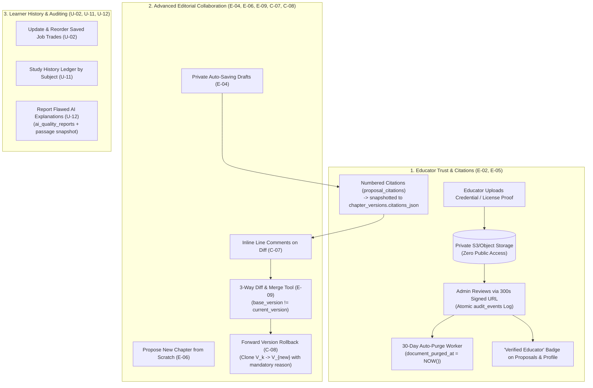

# Phase 4 — Editorial Upgrades, Educator Verification & Fast-Follow Enhancements

> **Status:** Proposed (Pending Architectural Review & Delegation)  
> **Stories Covered:**  
> • **Learner Enhancements:** `U-02` (Update Work Profile), `U-11` (Study History Ledger), `U-12` (Report Flawed AI Explanations)  
> • **Editorial Enhancements:** `E-02` (Licensed Educator Verification), `E-04` (Private Drafts), `E-05` (Source Citations), `E-06` (New Chapter Proposals), `E-09` (3-Way Merge Conflict Resolution), `E-10` (Public Contribution Profiles)  
> • **Checker Enhancements:** `C-07` (Inline Line Comments), `C-08` (Immutable Version Rollbacks)  
> **Migrations:** Stage 4 (`007_educator_verification.sql`, `008_citations_comments_and_reports.sql`)  
> **Builder:** Claude Code via `delegate-to-claude` · **Reviewer:** Gemini / Architect → `docs/reviews/phase-4-editorial-upgrades-review.md`  
> **Related Contracts:** [`architectural_decisions.md`](file:///home/xiscohonggono/projects/Idep/docs/architecture/architectural_decisions.md) (ADR-003, ADR-005, ADR-006) · [`database-schema-proposal.md`](file:///home/xiscohonggono/projects/Idep/docs/plans/Pending/database-schema-proposal.md) · [`database-staging-proposal.md`](file:///home/xiscohonggono/projects/Idep/docs/plans/Pending/database-staging-proposal.md) · [`rag-implementation.md`](file:///home/xiscohonggono/projects/Idep/docs/plans/Pending/rag-implementation.md) · [`.agent/rules/project_guardrails.md`](file:///home/xiscohonggono/projects/Idep/.agent/rules/project_guardrails.md)

---

## 0. Revision History

| Rev | Date | Author | Description |
| :--- | :--- | :--- | :--- |
| 1 | 2026-11-09 | Antigravity (Architect) | Initial specification: Defines complete Phase 4 fast-follow scope: licensed educator verification lifecycle with 300s signed URLs and 30-day purge (`ADR-005`), numbered source citations (`E-05`), inline line-level review comments (`C-07`), forward version rollbacks (`C-08`), 3-way merge conflict handling (`E-09`), study history (`U-11`), and AI quality reporting (`U-12`). |
| 2 | 2026-11-09 | Antigravity (Architect) | **Roadmap Reconciliation & Schema Alignment:** 1. Aligned `ai_quality_reports` DDL and SQL queries with authoritative `database-schema-proposal.md` §3.4 Table 20 (`reason_category`, `reason_details`, `passage_snapshot`, `ai_output_snapshot`, `status`). 2. Clarified `U-02` scope boundary: Phase 4 delivers the Settings Profile UI (`/settings/profile`) and regression verification of explanation snapshot immutability. 3. Added explicit Files Touched and Blast-Radius Guard table. |

---

## 1. Objectives & Executive Summary

While Phases 1–3 deliver Idep’s Core MVP (Reader, Maker–Checker foundation, and AI workplace analogies), Phase 4 elevates the platform into a **mature, professional-grade editorial and learning ecosystem**.

This plan delivers three core enhancement tracks:
1. **Trust & Pedagogy Verification (`E-02`, `E-05`):** Enables licensed secondary and higher educators to verify their professional teaching credentials under strict privacy controls (`ADR-005`), earning a *"Verified Educator"* badge on profiles and proposals, and integrates numbered source citations on added facts.
2. **Advanced Editorial Collaboration (`E-04`, `E-06`, `E-09`, `C-07`, `C-08`, `E-10`):** Adds private auto-saving drafts, authoring of entirely new chapters from scratch, line-by-line review commentary on proposals, 3-way merge conflict resolution when concurrent edits collide, forward version rollbacks, and public Editor contribution portfolios.
3. **Learner Empowerment & Quality Governance (`U-02`, `U-11`, `U-12`):** Empowers learners to manage their work-experience profiles, review their cumulative Study History ledger grouped by subject, and flag inaccurate AI outputs with mandatory contextual capture for platform quality audits.

---

## 2. Compatibility & Alignment Review

| Existing Plan / Contract | Cross-Contract Touchpoint | Compatibility Verdict |
| :--- | :--- | :--- |
| **[`phase-1-curriculum-reader-and-guest-metering.md`](phase-1-curriculum-reader-and-guest-metering.md)** | Foreign keys to `subjects(id)` and `chapters(id)`. Work profile persistence (`002_work_experience.sql`). | **Direct Successor:** Phase 1 implements backend persistence (`002_work_experience.sql`) and onboarding API (`PUT /api/v1/me/work-experience`). Phase 4 delivers the `/settings/profile` management UI and regression verification of explanation snapshot immutability (`U-02`). Extends chapters with new chapter proposals (`E-06`) and citations (`E-05`). |
| **[`phase-2-maker-checker-editorial-loop.md`](phase-2-maker-checker-editorial-loop.md)** | Foreign keys `proposal_citations.proposal_id` and `proposal_line_comments.proposal_id`. | **Direct Extension:** Builds directly on top of the Phase 2 proposal state machine (`proposals`, `proposal_revisions`). |
| **[`phase-3-ai-study-sidebar-and-active-recall.md`](phase-3-ai-study-sidebar-and-active-recall.md)** | Foreign keys `ai_quality_reports.highlight_id` and `ai_quality_reports.explanation_id`. | **Direct Extension:** Links quality flags (`U-12`) directly to the Phase 3 study highlight snapshots. |
| **[`rag-implementation.md`](rag-implementation.md)** | `rag-implementation.md` is scheduled **strictly after Phase 4**. | **Sequence Aligned:** Phase 4 completes all curriculum, citations, and versioning features before RAG vector indexes are introduced. |

---

## 3. Resolved Architectural Decisions (ADRs)

| ID | Decision | Rationale |
| :--- | :--- | :--- |
| **D1 (Sensitive Educator Credential Handling)** | Proof documents uploaded for `E-02` are stored under a private object storage prefix with zero public access. Viewing proofs requires `POST /api/v1/admin/educator-verifications/{id}/view-url` which logs an atomic `audit_events` row (`event_type = 'educator_proof.viewed'`) and issues a signed URL expiring in exactly **300 seconds (5 minutes)** with `Cache-Control: no-store` (`ADR-005 §7.1`). | Complies with GDPR/FERPA privacy-by-design standards for teacher credentials and prevents unauthorized scraping. |
| **D2 (Post-Decision Document Purge)** | Raw verification proof files are automatically scheduled for permanent deletion **30 days** after an admin approves or rejects the application. A daily Go background worker purges the object from storage, sets `document_storage_key = NULL`, and records `document_purged_at = NOW()` while preserving decision metadata (`ADR-005 §7.1`). | Enforces data minimization: verified credentials do not linger indefinitely in object storage. |
| **D3 (Rollbacks as Forward Versions)** | Reverting from version $V_5$ to $V_3$ does **not** mutate or delete $V_4$ or $V_5$. Instead, it creates $V_6$ whose content and citations clone $V_3$, recording `rollback_from_version_id = V_3.id` and requiring a non-empty `rollback_reason` (`C-08`, `ADR-003 §5.5`). | Maintains absolute version immutability and continuous auditability. |
| **D4 (Optimistic Concurrency & 3-Way Merge)** | When an Editor submits against base version $V_{base}$, but current version has advanced to $V_{live}$ ($V_{base} \neq V_{live}$), the API rejects with `HTTP 409 Conflict` and supplies $V_{base}$, $V_{live}$, and $V_{proposed}$. The frontend provides an interactive 3-way merge tool (`E-09`). | Prevents silent overwrites of intermediate published corrections. |
| **D5 (Citations Snapshot Immutability)** | Active proposals manage citations dynamically in `proposal_citations`. Upon publication (`C-04`), the backend compiles citations into a frozen JSON array stored in `chapter_versions.citations_json` (`E-05`). | Guarantees that future edits or deletions to proposal records never break historical citations on published versions. |

---

## 4. Work Items & Implementation Details

### 4.1 Database Migrations (`apps/api/sql/schema/`)

#### 1. `apps/api/sql/schema/007_educator_verification.sql`
- Creates table `educator_verifications`:
  - Columns: `id UUID`, `user_id`, `institution_name`, `subject_taught`, `credential_reference`, `document_storage_key`, `status ('pending', 'approved', 'rejected', 'withdrawn')`, `reviewed_by`, `reviewed_at`, `decision_reason`, `document_purged_at`, `created_at`.
  - Constraints: `chk_educator_rejection_reason` (mandatory reason on rejection), `chk_educator_self_review` (`reviewed_by <> user_id`).
  - Index: `idx_educator_verifications_pending` on `created_at` where `status = 'pending'`.
- Goose `-- +goose Down` drops `idx_educator_verifications_pending` and `educator_verifications`.

#### 2. `apps/api/sql/schema/008_citations_comments_and_reports.sql`
- Creates table `proposal_citations` (`id UUID PRIMARY KEY`, `proposal_id UUID NOT NULL REFERENCES proposals(id) ON DELETE CASCADE`, `citation_number SMALLINT NOT NULL CHECK (citation_number > 0)`, `source_title TEXT NOT NULL`, `source_url TEXT`, `source_locator TEXT`, `anchor_quote TEXT`, `created_at TIMESTAMPTZ NOT NULL DEFAULT NOW()`, `UNIQUE(proposal_id, citation_number)`).
- Creates table `proposal_line_comments` (`id UUID PRIMARY KEY`, `proposal_id UUID NOT NULL REFERENCES proposals(id) ON DELETE CASCADE`, `proposal_revision_id UUID NOT NULL REFERENCES proposal_revisions(id) ON DELETE CASCADE`, `author_id UUID NOT NULL REFERENCES users(id)`, `line_number INT NOT NULL CHECK (line_number > 0)`, `comment_body TEXT NOT NULL`, `resolved_at TIMESTAMPTZ`, `created_at TIMESTAMPTZ NOT NULL DEFAULT NOW()`, index `idx_proposal_line_comments_lookup`).
- Creates table `ai_quality_reports` (verbatim from `database-schema-proposal.md` §3.4 Table 20):
  - `id UUID PRIMARY KEY DEFAULT gen_random_uuid()`
  - `user_id UUID REFERENCES users(id) ON DELETE SET NULL`
  - `highlight_id UUID NOT NULL REFERENCES study_highlights(id) ON DELETE CASCADE`
  - `explanation_id UUID NOT NULL REFERENCES ai_explanations(id) ON DELETE CASCADE`
  - `reexplanation_attempt_id UUID REFERENCES reexplanation_attempts(id) ON DELETE SET NULL`
  - `reason_category TEXT NOT NULL CHECK (reason_category IN ('inaccurate_science_or_fact', 'confusing_work_analogy', 'unfair_reexplanation_grading', 'broken_prerequisite_or_term_link', 'other'))`
  - `reason_details TEXT NOT NULL CHECK (char_length(btrim(reason_details)) > 0)`
  - `passage_snapshot TEXT NOT NULL`
  - `ai_output_snapshot JSONB NOT NULL`
  - `status TEXT NOT NULL DEFAULT 'open' CHECK (status IN ('open', 'reviewed', 'resolved', 'dismissed'))`
  - `created_at TIMESTAMPTZ NOT NULL DEFAULT NOW()`
- Goose `-- +goose Down` drops `ai_quality_reports`, `proposal_line_comments`, and `proposal_citations`.

---

### 4.2 Backend Implementation (`apps/api`)

#### 1. SQL Queries (`apps/api/sql/queries/`)
- **`educator_verification.sql`:**
  - `CreateEducatorVerification`: Submits proof document metadata and sets status to `pending`.
  - `GetPendingEducatorVerifications`: Keyset-paginated list for Admin queue.
  - `ReviewEducatorVerification`: Atomically records decision reason, sets status (`approved` or `rejected`), and updates `users.is_verified_educator = TRUE` upon approval.
  - `GetVerificationsDueForPurge`: Finds verifications where `status IN ('approved', 'rejected') AND reviewed_at < NOW() - INTERVAL '30 days' AND document_storage_key IS NOT NULL`.
  - `MarkDocumentPurged`: Sets `document_storage_key = NULL` and `document_purged_at = NOW()`.
- **`citations_and_comments.sql`:**
  - `UpsertProposalCitation`: Inserts or edits a numbered citation on an active proposal.
  - `DeleteProposalCitation`: Removes citation and re-numbers subsequent citations.
  - `ListProposalCitations`: Retrieves all citations for a proposal.
  - `CreateLineComment`: Attaches a review comment to a specific line number on a proposal revision.
  - `ListLineCommentsByRevision`: Returns line comments for diff rendering.
  - `ResolveLineComment`: Sets `resolved_at = NOW()`.
- **`rollbacks_and_conflicts.sql`:**
  - `RollbackChapterVersion`: Atomically clones target version content and citations into a new forward version with mandatory `rollback_reason` and updates `chapters.current_version_id`.
  - `GetChapterVersionDiff`: Compares two versions for 3-way conflict resolution.
- **`learner_history_and_reports.sql`:**
  - `ListUserStudyHistory`: Keyset-paginated highlights, analogies, and re-explanations grouped by subject (`U-11`).
  - `CreateAIQualityReport`: Persists flawed explanation report inserting into `ai_quality_reports` with `reason_category`, `reason_details`, `passage_snapshot`, and `ai_output_snapshot` (`U-12`).
  - `ListAIQualityReports`: Admin endpoint to review open quality flags.

#### 2. Storage & Purge Service (`apps/api/internal/storage/`)
- Object storage client (S3-compatible / Supabase Storage private bucket) for educator proofs.
- Signed URL generator: generates pre-signed GET URLs with 300-second expiration.
- Daily background ticker (Go cron worker): sweeps `GetVerificationsDueForPurge`, deletes the physical object from storage, and calls `MarkDocumentPurged`.

#### 3. Huma API Endpoints (`apps/api/internal/handler/`)
- **`POST /api/v1/educator-verification` (Auth required):** Submits educator proof document (`E-02`).
- **`GET /api/v1/admin/educator-verifications` (Admin only):** Lists pending teacher verifications.
- **`POST /api/v1/admin/educator-verifications/{id}/view-url` (Admin only):** Audited endpoint returning 300s signed URL.
- **`POST /api/v1/admin/educator-verifications/{id}/decision` (Admin only):** Approves/rejects with reason.
- **`POST /api/v1/proposals/{id}/citations` (Author only):** Adds/updates numbered citation (`E-05`).
- **`POST /api/v1/proposals/{id}/comments` (Checker only):** Adds inline line comment (`C-07`).
- **`POST /api/v1/chapters/{id}/rollback` (Checker only):** Reverts chapter version forward (`C-08`).
- **`GET /api/v1/me/study-history` (Auth required):** Returns grouped study history (`U-11`).
- **`POST /api/v1/reports/ai-quality` (Auth required):** Submits flawed AI explanation report (`U-12`).
- **`GET /api/v1/users/{id}/contributions` (Public):** Returns published editorial portfolio (`E-10`).

---

### 4.3 Frontend Implementation (`apps/web`)

1. **Educator Verification Portal (`/educator/verify` & `/admin/educator-verifications`):**
   - Clean upload form for teaching licenses/staff IDs with institution name and subject taught (`E-02`).
   - Admin verification queue with one-click audited secure document viewer.
   - Gold *"Verified Educator"* badge component displayed next to author names on proposals and chapters.

2. **Citations & Line Comments UI:**
   - **Citation Manager:** Collapsible drawer in Chapter Editor allowing editors to insert bracketed citations `[^1]` that link to numbered source cards (`E-05`).
   - **Inline Diff Commenting:** Checkers can click on any line number in the side-by-side diff viewer to open a comment thread (`C-07`).

3. **3-Way Merge Conflict Resolution Modal (`E-09`):**
   - When a version conflict occurs, displays 3 panes: *Base Version*, *Current Published Version*, and *Your Proposed Edit*.
   - One-click actions: *"Accept Current"*, *"Keep Mine"*, or *"Manual Merge"*.

4. **Version History & Rollback Modal (`/subjects/[subject]/[chapter]/history`):**
   - Complete audit trail of past versions with author, checker, timestamps, and edit summaries.
   - Checkers can click *"Roll Back to This Version"*, prompting for a mandatory rollback reason (`C-08`).

5. **Study History Ledger (`/dashboard/study-history`):**
   - Filterable timeline grouped by subject (Math, Science, Social Studies, RLA) showing past highlighted quotes, AI analogy cards, learner re-explanations, and feedback scores (`U-11`).

6. **Flag AI Report Dialog (`FlagAIDialog.tsx`):**
   - Contextual modal accessible from any AI analogy card allowing learners to report errors (`"Inaccurate science"`, `"Broken analogy"`, `"Offensive content"`) with custom explanation (`U-12`).

7. **Work Profile Settings (`/settings/profile`) (`U-02`):**
   - Dedicated management interface in `apps/web` allowing learners to view, add, remove, and reorder their saved job trade preferences and custom role titles using Phase 1 backend endpoints (`GET /api/v1/me/work-experience`, `PUT /api/v1/me/work-experience`).

---

## 5. Verification Gates & Acceptance Criteria

Execution is complete only when all seven gates pass:

1. **Database Schema & Invariants Gate:**
   - Goose migration `007` and `008` apply cleanly on PostgreSQL 16.
   - Rejection check: `UPDATE educator_verifications SET status = 'rejected', decision_reason = ''` raises `chk_educator_rejection_reason`.
   - Self-review check: Admin cannot approve their own educator verification (`chk_educator_self_review`).
   - Citations check: Duplicate citation numbers on same proposal fail `UNIQUE(proposal_id, citation_number)`.

2. **Educator Credential Privacy, RBAC & Signed URL Gate (`ADR-005`):**
   - Non-Admin user attempting to call `/api/v1/admin/educator-verifications` or `/api/v1/admin/educator-verifications/{id}/view-url` receives `HTTP 403 Forbidden`.
   - Admin calling `/api/v1/admin/educator-verifications/{id}/view-url` generates an `audit_events` row with `event_type = 'educator_proof.viewed'` and `user_id = admin.id`.
   - Pre-signed URL contains valid expiration query parameters $\le 300\text{s}$.
   - Running the purge worker on verifications older than 30 days sets `document_storage_key = NULL` and verifies the physical object is deleted from storage.

3. **Version Rollback Immutability Gate (`C-08`):**
   - Rolling back chapter from $V_3$ to $V_1$ creates $V_4$ with content matching $V_1$.
   - Verifies $V_2$ and $V_3$ remain intact and unmodified in `chapter_versions`.
   - Attempting rollback with empty reason fails validation.

4. **3-Way Merge Conflict Gate (`E-09`):**
   - Proposing edit against obsolete base version triggers `HTTP 409 Conflict` returning three-way diff payloads.

5. **Study History, Work Profile & AI Reporting Gate (`U-02`, `U-11`, `U-12`):**
   - Study history returns highlights grouped by subject in `created_at DESC` order (`U-11`).
   - Reporting an AI explanation stores immutable snapshots of both the passage and the AI JSON output (`U-12`).
   - Profile management regression test: Updating or clearing trade preferences via `/settings/profile` updates `user_work_experiences` without mutating historical `ai_explanations` (`role_title_snapshot` and `job_field_code` immutability) (`U-02`).

6. **Codegen Synchronization Gate:**
   - `pnpm codegen` completes with zero drift across `sqlc`, `apps/api/openapi.json`, and `apps/web/lib/api/schema.d.ts`.

7. **CI Quality & Monorepo Test Gate:**
   - `pnpm lint`, `pnpm --filter web check-types`, and `pnpm test` pass with 0 errors and 0 warnings.

---

## 6. Files Touched & Blast-Radius Guard

| Action | File Path |
| :--- | :--- |
| **new** | `apps/api/sql/schema/007_educator_verification.sql`, `apps/api/sql/schema/008_citations_comments_and_reports.sql` |
| **new** | `apps/api/sql/queries/educator_verification.sql`, `apps/api/sql/queries/citations_and_comments.sql`, `apps/api/sql/queries/rollbacks_and_conflicts.sql`, `apps/api/sql/queries/learner_history_and_reports.sql` |
| **new** | `apps/api/internal/domain/educator_verification.go`, `apps/api/internal/domain/citation.go`, `apps/api/internal/domain/quality_report.go` |
| **new** | `apps/api/internal/repository/educator_verification_repo.go`, `apps/api/internal/repository/citation_repo.go`, `apps/api/internal/repository/quality_report_repo.go` |
| **new** | `apps/api/internal/service/educator_verification_service.go`, `apps/api/internal/service/citation_service.go`, `apps/api/internal/service/quality_report_service.go`, `apps/api/internal/storage/signed_urls.go` |
| **new** | `apps/api/internal/handler/educator_verification_handler.go`, `apps/api/internal/handler/citation_handler.go`, `apps/api/internal/handler/quality_report_handler.go` |
| **new** | `apps/web/app/educator/verify/page.tsx`, `apps/web/app/admin/educator-verifications/page.tsx`, `apps/web/app/settings/profile/page.tsx`, `apps/web/app/dashboard/study-history/page.tsx`, `apps/web/app/users/[id]/contributions/page.tsx`, `apps/web/components/FlagAIDialog.tsx` |
| **edit** | `apps/api/cmd/server/main.go`, `apps/api/cmd/server/main_test.go`, `apps/web/lib/api/go.ts`, `apps/web/lib/api/index.ts` |
| **regenerated** | `apps/api/internal/repository/db/*`, `apps/api/openapi.json`, `apps/web/lib/api/schema.d.ts` |
| **must NOT change** | `apps/api/internal/guardrails_test.go`, `apps/api/sql/schema/001_*.sql` through `006_*.sql`, `apps/web/package.json`, `apps/web/lib/supabase.ts`, `packages/eslint-config/**` |

