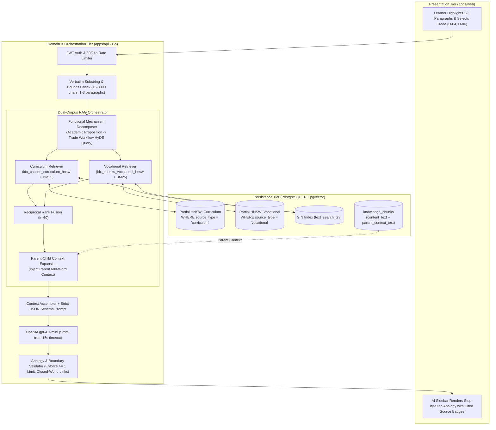

# RAG Implementation Plan: Dual-Corpus Curricular & Vocational Knowledge Pipeline

> **Status:** Proposed (Upgraded Architecture — Post-Phase 4 Initiative)  
> **Scope:** Architecture Decision Record extension (`ADR-007`), PostgreSQL `pgvector` migration (`009_rag_knowledge_pipeline.sql`), standardized Firecrawl offline ingestion pipeline, partial HNSW indexes, Parent-Child context expansion, cross-domain Functional Mechanism Mapping (HyDE), and grounded citation UI in `apps/web`.  
> **Author:** Antigravity (Architect) · **Builder:** Claude Code via `delegate-to-claude` · **Reviewer:** Gemini / Architect  
> **Execution Gate:** **Scheduled strictly after Phase 3 (AI Core MVP) and Phase 4 (Editorial Upgrades) are complete.**  
> **Related Contracts:** [`architectural_decisions.md`](file:///home/xiscohonggono/projects/Idep/docs/architecture/architectural_decisions.md) · [`database-schema-proposal.md`](file:///home/xiscohonggono/projects/Idep/docs/plans/Pending/database-schema-proposal.md) · [`database-staging-proposal.md`](file:///home/xiscohonggono/projects/Idep/docs/plans/Pending/database-staging-proposal.md) · [`phase-3-ai-study-sidebar-and-active-recall.md`](file:///home/xiscohonggono/projects/Idep/docs/plans/Pending/phase-3-ai-study-sidebar-and-active-recall.md) · [`.agent/rules/project_guardrails.md`](file:///home/xiscohonggono/projects/Idep/.agent/rules/project_guardrails.md)

---

## 0. Revision History

| Rev | Date | Author | Description |
| :--- | :--- | :--- | :--- |
| 1 | 2026-11-08 | Antigravity / Architect | Initial specification: Dual-Corpus RAG architecture, `pgvector` schema design, hybrid retrieval with RRF, and evaluation benchmarks. |
| 2 | 2026-11-09 | Antigravity / Architect | **Production Upgrades:**<br>1. **Cross-Domain Functional Mapping (HyDE):** Solves vocabulary gap between academic science text and trade SOPs.<br>2. **Denormalized Partial HNSW Indexes:** Replaces relational join filtering with dedicated partial vector indexes for curriculum vs. trade.<br>3. **Parent-Child Chunking:** Granular child chunks (150 words) for vector search accuracy + parent context windows (600 words) for prompt generation.<br>4. **Firecrawl Ingestion Pipeline:** Replaces custom PDF parsers with `firecrawl-parse` and `firecrawl-scrape` for offline batch extraction. |
| 3 | 2026-11-09 | Antigravity / Architect | **Roadmap Reconciliation & Budget Hardening:**<br>1. Renumbered migration to `009_rag_knowledge_pipeline.sql` to avoid collision with Phase 4's `007` and `008`.<br>2. Specified CI service upgrade to `pgvector/pgvector:pg16` and `sqlc.yaml` vector overrides.<br>3. Allocated strict latency sub-budgets with automatic fallback to BM25 to guarantee adherence to the 15s hard ceiling.<br>4. Added explicit Files Touched and Blast-Radius Guard table. |

---

## 1. Objectives & Executive Summary

Idep’s core value proposition is turning working adults' prior job experience into an unfair learning advantage by pairing community-curated GED study notes with an AI study sidebar that builds **workplace analogies (`U-06`)**, flags **analogy limitations (`U-07`)**, and resolves **prerequisite knowledge gaps (`U-08`)**.

In Phase 3, the AI sidebar uses grounded zero-shot generation bounded by the highlighted chapter text and user trade titles. This plan upgrades the system to a **production-grade Dual-Corpus Retrieval-Augmented Generation (RAG) system**:
1. **Curricular Grounding (GED Standards & Misconceptions):** Retrieves official high-school equivalency performance descriptors, prerequisite chapter excerpts, and documented student misconception inventories so the AI never produces misleading pedagogical analogies.
2. **Vocational Grounding (Real-World Workflows & SOPs):** Retrieves verified vocational tasks, tools, and Standard Operating Procedures (SOPs) based on the learner's chosen job field, ensuring analogies reflect authentic workplace realities rather than superficial stereotypes.
3. **Analogy Failure Grounding (`U-07`):** Explicitly retrieves the structural divergence between the scientific/mathematical mechanism and the workplace process, forcing high-fidelity identification of where the analogy breaks down.



---

## 2. Recommended Knowledge Sources & Ingestion Pipeline

To avoid hallucinations and stale data, sources are categorized into **Curricular (Target Knowledge)** and **Vocational (Source Metaphor Knowledge)**.

### 2.1 Ingestion Sources

| Source Name | Authoritative Origin & License | Content Focus & Utility in Idep | Ingestion Tooling |
| :--- | :--- | :--- | :--- |
| **GED Testing Service: Assessment Guide for Educators** | GEDTS / Pearson VUE (Public Guidance) | Official High School Equivalency targets, Webb's Depth of Knowledge descriptors, and formula sheet boundaries. | **`firecrawl-parse`** (PDF to Markdown) |
| **OpenStax High-School / College-Prep Textbooks** | Rice University (CC BY 4.0) | Authoritative reference texts for Science (Biology, Chemistry, Physics), Social Studies, and Math. | OpenStax Public API / JSON Export |
| **O\*NET 29.x Database** | U.S. Department of Labor (Public Domain) | Standard Occupational Classification (SOC) mappings for Idep’s 10 starter trades. 19,000+ verified task statements and tools. | Relational CSV Load into `cmd/ingest` |
| **OSHA General Industry Standards (29 CFR 1910)** | U.S. OSHA (Federal Public Domain) | Real-world safety rules: Lockout/Tagout, hazard communication, PPE, machine guarding for blue-collar trades. | **`firecrawl-scrape`** (Federal Register API) |
| **FDA Food Code & USDA HACCP Guidelines** | U.S. FDA & USDA (Public Domain) | Critical Control Points, temperature control, sanitization protocols for culinary and hospitality analogies. | **`firecrawl-parse`** (FDA PDF to Markdown) |
| **Idep Internal Published Chapters** | Idep Makers & Checkers (`chapter_versions`) | Platform chapter corpus for exact terminology and closed-world links (`U-05`, `U-08`). | Direct PostgreSQL event trigger |

---

## 3. Database Architecture & Schema (`apps/api/sql/schema/009_rag_knowledge_pipeline.sql`)

All embeddings remain strictly inside **PostgreSQL 16 via `pgvector`** (no third-party vector SaaS). When this stage is executed, the CI service image in `.github/workflows/ci.yml` must be configured with `image: pgvector/pgvector:pg16` so the vector extension compiles and runs in CI. Furthermore, `apps/api/sqlc.yaml` is extended with an override mapping PostgreSQL `vector` to `[]float32` or string representation for `sqlc generate`.

```sql
-- +goose Up
SET lock_timeout = '3s';
SET statement_timeout = '30s';

-- 1. Enable pgvector extension
CREATE EXTENSION IF NOT EXISTS vector;

-- 2. Knowledge Source Registry
CREATE TABLE knowledge_sources (
    id UUID PRIMARY KEY DEFAULT gen_random_uuid(),
    source_type TEXT NOT NULL CHECK (source_type IN ('curriculum', 'vocational', 'exemplar')),
    job_field_code TEXT REFERENCES job_fields(code) ON DELETE SET NULL, -- NULL for general curriculum
    name TEXT NOT NULL,
    authority_name TEXT NOT NULL,
    license_type TEXT NOT NULL,
    source_url TEXT,
    version_tag TEXT NOT NULL,
    is_active BOOLEAN NOT NULL DEFAULT TRUE,
    created_at TIMESTAMPTZ NOT NULL DEFAULT NOW(),
    updated_at TIMESTAMPTZ NOT NULL DEFAULT NOW()
);

-- 3. Knowledge Documents (Parent Documents)
CREATE TABLE knowledge_documents (
    id UUID PRIMARY KEY DEFAULT gen_random_uuid(),
    source_id UUID NOT NULL REFERENCES knowledge_sources(id) ON DELETE CASCADE,
    external_id TEXT, -- e.g. O*NET SOC code, OpenStax chapter ID
    title TEXT NOT NULL,
    section_hierarchy TEXT[] NOT NULL DEFAULT '{}',
    raw_content_markdown TEXT NOT NULL,
    metadata_json JSONB NOT NULL DEFAULT '{}'::jsonb,
    created_at TIMESTAMPTZ NOT NULL DEFAULT NOW()
);

-- 4. Granular Knowledge Chunks (Parent-Child Architecture)
CREATE TABLE knowledge_chunks (
    id UUID PRIMARY KEY DEFAULT gen_random_uuid(),
    document_id UUID NOT NULL REFERENCES knowledge_documents(id) ON DELETE CASCADE,
    source_id UUID NOT NULL REFERENCES knowledge_sources(id) ON DELETE CASCADE,
    
    -- Denormalized for high-speed partial indexing without relational join overhead
    source_type TEXT NOT NULL CHECK (source_type IN ('curriculum', 'vocational', 'exemplar')),
    job_field_code TEXT REFERENCES job_fields(code) ON DELETE SET NULL,
    
    chunk_index INTEGER NOT NULL,
    
    -- Child Chunk (Atomic 150-word search target)
    content_text TEXT NOT NULL CHECK (char_length(btrim(content_text)) BETWEEN 20 AND 2000),
    token_count INTEGER NOT NULL CHECK (token_count > 0),
    
    -- Parent Context Window (Enriched 600-word surrounding section passed to LLM)
    parent_context_text TEXT NOT NULL CHECK (char_length(btrim(parent_context_text)) >= char_length(btrim(content_text))),
    
    -- Dense Embedding (OpenAI text-embedding-3-small truncated to 512d)
    embedding vector(512) NOT NULL,
    
    -- Sparse BM25 Search Vector
    text_search_tsv tsvector GENERATED ALWAYS AS (to_tsvector('english', content_text)) STORED,
    
    metadata_json JSONB NOT NULL DEFAULT '{}'::jsonb,
    created_at TIMESTAMPTZ NOT NULL DEFAULT NOW(),
    
    CONSTRAINT uq_knowledge_chunks_doc_index UNIQUE (document_id, chunk_index)
);

-- 5. Dedicated Partial HNSW Indexes (Eliminates graph traversal dead-ends)
-- Partial HNSW for Curriculum Search
CREATE INDEX idx_knowledge_chunks_curriculum_hnsw 
ON knowledge_chunks USING hnsw (embedding vector_cosine_ops)
WITH (m = 16, ef_construction = 64)
WHERE source_type = 'curriculum';

-- Partial HNSW for Vocational Search
CREATE INDEX idx_knowledge_chunks_vocational_hnsw 
ON knowledge_chunks USING hnsw (embedding vector_cosine_ops)
WITH (m = 16, ef_construction = 64)
WHERE source_type = 'vocational';

-- GIN Index for sparse keyword search
CREATE INDEX idx_knowledge_chunks_tsv 
ON knowledge_chunks USING gin (text_search_tsv);

-- Filtering index for trade lookup
CREATE INDEX idx_knowledge_chunks_trade_lookup
ON knowledge_chunks (job_field_code, source_type)
WHERE job_field_code IS NOT NULL;

-- +goose Down
DROP INDEX IF EXISTS idx_knowledge_chunks_trade_lookup;
DROP INDEX IF EXISTS idx_knowledge_chunks_tsv;
DROP INDEX IF EXISTS idx_knowledge_chunks_vocational_hnsw;
DROP INDEX IF EXISTS idx_knowledge_chunks_curriculum_hnsw;
DROP TABLE IF EXISTS knowledge_chunks;
DROP TABLE IF EXISTS knowledge_documents;
DROP TABLE IF EXISTS knowledge_sources;
DROP EXTENSION IF EXISTS vector;
```

---

## 4. Hybrid Retrieval Pipeline (Go Implementation Contract)

### 4.1 Hybrid Search with Partial Index Routing

Compiled via `sqlc` in `apps/api/sql/queries/rag.sql`:

```sql
-- name: SearchCurriculumChunksHybrid :many
WITH dense_search AS (
    SELECT 
        c.id,
        c.content_text,
        c.parent_context_text,
        c.metadata_json,
        ROW_NUMBER() OVER (ORDER BY c.embedding <=> $1::vector) AS rank_dense
    FROM knowledge_chunks c
    WHERE c.source_type = 'curriculum'
    ORDER BY c.embedding <=> $1::vector
    LIMIT 20
),
sparse_search AS (
    SELECT 
        c.id,
        c.content_text,
        c.parent_context_text,
        c.metadata_json,
        ROW_NUMBER() OVER (ORDER BY ts_rank_cd(c.text_search_tsv, plainto_tsquery('english', $2)) DESC) AS rank_sparse
    FROM knowledge_chunks c
    WHERE c.source_type = 'curriculum'
      AND c.text_search_tsv @@ plainto_tsquery('english', $2)
    ORDER BY ts_rank_cd(c.text_search_tsv, plainto_tsquery('english', $2)) DESC
    LIMIT 20
)
SELECT 
    COALESCE(d.id, s.id) AS chunk_id,
    COALESCE(d.content_text, s.content_text) AS content_text,
    COALESCE(d.parent_context_text, s.parent_context_text) AS parent_context_text,
    COALESCE(d.metadata_json, s.metadata_json) AS metadata_json,
    (
        COALESCE(1.0 / (60 + d.rank_dense), 0.0) +
        COALESCE(1.0 / (60 + s.rank_sparse), 0.0)
    )::FLOAT8 AS rrf_score
FROM dense_search d
FULL OUTER JOIN sparse_search s ON d.id = s.id
ORDER BY rrf_score DESC
LIMIT $3;

-- name: SearchVocationalChunksHybrid :many
WITH dense_search AS (
    SELECT 
        c.id,
        c.content_text,
        c.parent_context_text,
        c.metadata_json,
        ROW_NUMBER() OVER (ORDER BY c.embedding <=> $1::vector) AS rank_dense
    FROM knowledge_chunks c
    WHERE c.source_type = 'vocational'
      AND (c.job_field_code = $2::text OR $2::text IS NULL)
    ORDER BY c.embedding <=> $1::vector
    LIMIT 20
),
sparse_search AS (
    SELECT 
        c.id,
        c.content_text,
        c.parent_context_text,
        c.metadata_json,
        ROW_NUMBER() OVER (ORDER BY ts_rank_cd(c.text_search_tsv, plainto_tsquery('english', $3)) DESC) AS rank_sparse
    FROM knowledge_chunks c
    WHERE c.source_type = 'vocational'
      AND (c.job_field_code = $2::text OR $2::text IS NULL)
      AND c.text_search_tsv @@ plainto_tsquery('english', $3)
    ORDER BY ts_rank_cd(c.text_search_tsv, plainto_tsquery('english', $3)) DESC
    LIMIT 20
)
SELECT 
    COALESCE(d.id, s.id) AS chunk_id,
    COALESCE(d.content_text, s.content_text) AS content_text,
    COALESCE(d.parent_context_text, s.parent_context_text) AS parent_context_text,
    COALESCE(d.metadata_json, s.metadata_json) AS metadata_json,
    (
        COALESCE(1.0 / (60 + d.rank_dense), 0.0) +
        COALESCE(1.0 / (60 + s.rank_sparse), 0.0)
    )::FLOAT8 AS rrf_score
FROM dense_search d
FULL OUTER JOIN sparse_search s ON d.id = s.id
ORDER BY rrf_score DESC
LIMIT $4;
```

---

### 4.2 Cross-Domain Query Decomposition (Functional Mechanism Mapping / HyDE) & Latency Sub-Budgets

To bridge the vocabulary mismatch between academic text and trade SOPs:
1. **Passage Deconstruction:** Extracts the academic proposition:
   - *Example:* *"Mitochondria produce ATP by oxidizing pyruvate and transferring electrons through the inner membrane."*
2. **Functional Mechanism Extraction (HyDE):**
   A fast prompt extracts the abstract operational mechanism and generates a synthetic trade search string:
   - *Functional Pattern:* *"Receiving raw fuel/inventory, breaking it down in stages, generating packaged energy/output, heat byproduct."*
   - *Synthesized F&B Search Query:* *"Commercial kitchen prep, food ingredients delivery, cooking station heat transformation, plated dishes output."*
3. **Targeted Vector Retrieval:**
   - Academic proposition queries `SearchCurriculumChunksHybrid`.
   - Synthesized trade search string queries `SearchVocationalChunksHybrid`.
4. **Parent Context Assembly:**
   - The top 3 ranked chunks from each corpus contribute their **`parent_context_text`** (600 words) to the system prompt, giving the LLM deep operational context without vector search noise.

#### Latency Budget Allocation & Fallback Degradation
To strictly guarantee compliance with `project_guardrails.md` §4 (hard 15-second LLM timeout ceiling) and the p95 6.5s latency target:
- **HyDE Decomposition Budget:** Allocated `2.5s` hard context timeout.
- **OpenAI Embedding Generation Budget:** Allocated `1.5s` hard timeout.
- **Database Hybrid Retrieval Budget:** Allocated `200ms` query timeout.
- **Main Structured Analogy Generation Budget:** Allocated remaining context window (`~10.0s`).
- **Fail-Safe Fallback:** If the HyDE call or vector embedding call times out or returns an error, the orchestrator immediately falls back to sparse BM25 retrieval over `knowledge_chunks` + zero-shot generation within the remaining deadline. Real-time learner requests **never fail with HTTP 503** due to upstream vector latency.

---

## 5. Benchmarks & Acceptance Criteria

### 5.1 Quality & Performance Benchmarks

| Metric | Target Gate | Evaluation Method |
| :--- | :--- | :--- |
| **Faithfulness (Groundedness)** | **$\ge 0.92$** | Ragas Faithfulness metric over 100 golden GED passages. |
| **Vocational Authenticity** | **$\ge 0.88$** | Verification that steps cite authentic tools/tasks from O\*NET. |
| **Analogy Breakdown Rigor (`U-07`)** | **$100\%$ valid ($\ge 1$ item)** | Enforced in Go domain validation and DB constraints. |
| **Retrieval Latency (p95)** | **$\le 120\text{ ms}$** | Direct partial HNSW index execution on PostgreSQL 16. |
| **End-to-End Latency (p95)** | **$\le 6.5\text{ s}$** | From highlight click to rendered analogy in sidebar UI. |

### 5.2 Verification Gates & Fail-Safe Invariants

Execution is complete only when all five gates pass:

1. **Database Schema & Vector Index Gate:**
   - Real PostgreSQL 16 with `pgvector` migration `009_rag_knowledge_pipeline.sql` applies cleanly (`cmd/migrate up -> down -> up` exits 0).
   - Partial HNSW vector indexes (`idx_chunks_embedding_vocational`, `idx_chunks_embedding_curricular`) build without errors on 512-dimension vectors.

2. **Sub-Timeout Budget & Fail-Safe Fallback Gate:**
   - When vector embedding or HyDE sub-calls time out or fail (injected network error), the pipeline immediately falls back to PostgreSQL `tsvector` BM25 keyword retrieval + zero-shot generation within the remaining window.
   - Learner requests **never fail with HTTP 503** due to upstream vector latency or embedding rate limits.

3. **Closed-World Link Validation Gate (`U-05`, `U-08`):**
   - Verified that any prerequisite chapter ID or term link generated by the RAG orchestrator that does not resolve to an active published chapter in PostgreSQL is stripped/unlinked before returning to the client.

4. **Codegen Synchronization Gate:**
   - `pnpm codegen` completes with zero drift across `sqlc`, `apps/api/openapi.json`, and `apps/web/lib/api/schema.d.ts`.

5. **CI Quality & Offline Test Gate:**
   - Unit tests for `rag_service.go` run completely offline with mocked embeddings and mocked vector store.
   - `pnpm lint`, `pnpm --filter web check-types`, and `pnpm test` pass with 0 errors and 0 warnings.

---

## 6. Firecrawl Ingestion Workflow (`scripts/ingest_rag_sources.sh`)

1. **Curricular Ingestion:**
   ```bash
   # Extract official GED Assessment Guide PDF into clean Markdown
   firecrawl parse "https://ged.com/wp-content/uploads/assessment_guide_for_educators.pdf" \
     -o apps/api/data/rag/curriculum/ged_assessment_guide.md
   ```
2. **Vocational Regulatory Ingestion:**
   ```bash
   # Extract FDA Food Code Chapter 3 (Food Operations)
   firecrawl scrape "https://www.fda.gov/food/fda-food-code/food-code-2022" \
     --format markdown -o apps/api/data/rag/vocational/fda_food_code_ch3.md
   ```
3. **Batch Loader Execution (`apps/api/cmd/ingest/main.go`):**
   - Parses the downloaded Markdown files and O\*NET 29.x CSV tables.
   - Splits into 150-word child chunks + 600-word parent windows.
   - Computes 512d embeddings with OpenAI `text-embedding-3-small`.
   - Inserts into `knowledge_sources`, `knowledge_documents`, and `knowledge_chunks`.

---

## 7. Guardrails & Execution Precedence

1. **Strict Execution Sequence:** This plan will be executed **only after Phase 3 (AI Core MVP) and Phase 4 (Editorial Upgrades) are complete and verified**.
2. **Zero External Vector SaaS:** All vectors remain inside PostgreSQL 16 via `pgvector`.
3. **No Request-Time Web Crawling:** Firecrawl is used exclusively in offline batch ingestion mode. Real-time learner requests query local PostgreSQL indexes only.

---

## 8. Files Touched & Blast-Radius Guard

| Action | File Path |
| :--- | :--- |
| **new** | `apps/api/sql/schema/009_rag_knowledge_pipeline.sql` |
| **new** | `apps/api/sql/queries/rag.sql` |
| **new** | `apps/api/cmd/ingest/main.go`, `scripts/ingest_rag_sources.sh` |
| **new** | `apps/api/internal/service/rag_service.go`, `apps/api/internal/service/rag_service_test.go` |
| **edit** | `apps/api/sqlc.yaml`, `apps/api/internal/service/analogy_service.go`, `.github/workflows/ci.yml` (service container image) |
| **regenerated** | `apps/api/internal/repository/db/*`, `apps/api/openapi.json`, `apps/web/lib/api/schema.d.ts` |
| **must NOT change** | `apps/api/internal/guardrails_test.go`, `apps/api/sql/schema/001_*.sql` through `008_*.sql`, `apps/web/lib/supabase.ts`, `packages/eslint-config/**` |

