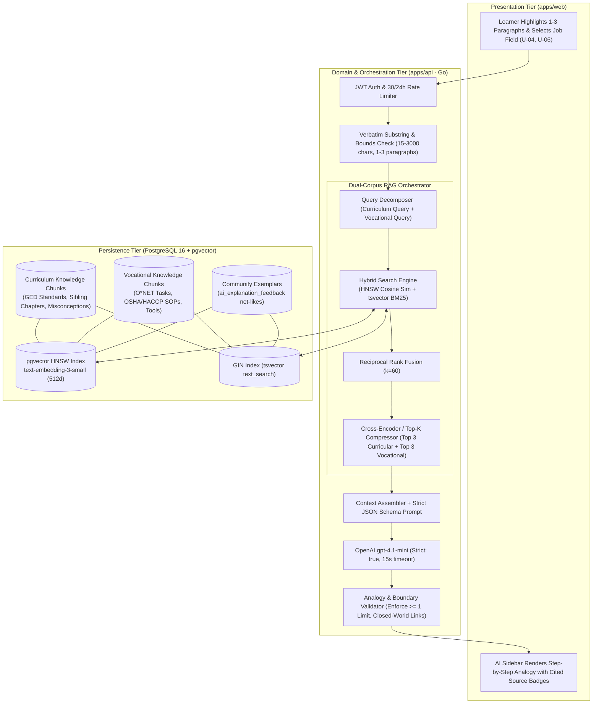

# RAG Implementation Plan: Dual-Corpus Curricular & Vocational Knowledge Pipeline

> **Status:** Proposed (Pending Architectural Approval)  
> **Scope:** Architecture Decision Record extension (`ADR-007`), PostgreSQL `pgvector` migration (`007_rag_knowledge_pipeline.sql`), knowledge source ingestion & chunking pipeline, hybrid search (HNSW dense vector + `tsvector` sparse BM25 with Reciprocal Rank Fusion), Go retrieval service in `apps/api`, Huma OpenAPI 3.1 endpoints, and grounded sidebar citation UI in `apps/web`.  
> **Author:** Antigravity (Architect) · **Builder:** Claude Code via `delegate-to-claude` · **Reviewer:** Gemini/Architect  
> **Related Contracts:** [`architectural_decisions.md`](file:///home/xiscohonggono/projects/Idep/docs/architecture/architectural_decisions.md) · [`database-schema-proposal.md`](file:///home/xiscohonggono/projects/Idep/docs/plans/Pending/database-schema-proposal.md) · [`database-staging-proposal.md`](file:///home/xiscohonggono/projects/Idep/docs/plans/Pending/database-staging-proposal.md) · [`.agent/rules/project_guardrails.md`](file:///home/xiscohonggono/projects/Idep/.agent/rules/project_guardrails.md)

---

## 0. Revision History

| Rev | Date | Author | Description |
| :--- | :--- | :--- | :--- |
| 1 | 2026-11-08 | Antigravity / Architect | Initial specification proposal: Recommended external sources, Dual-Corpus RAG architecture, `pgvector` schema design, hybrid retrieval with RRF, Go service contracts, and benchmark-driven verification criteria. |

---

## 1. Objectives & Executive Summary

Idep’s core value proposition is turning working adults' prior job experience into an unfair learning advantage by pairing community-curated GED study notes with an AI study sidebar that builds **workplace analogies (`U-06`)**, flags **analogy limitations (`U-07`)**, and resolves **prerequisite knowledge gaps (`U-08`)**.

Currently, the AI pipeline relies on prompt-level zero-shot generation bounded only by the highlighted 1–3 paragraphs and basic role titles. This plan upgrades the AI service into a **production-grade Dual-Corpus Retrieval-Augmented Generation (RAG) system**:
1. **Curricular Grounding (GEC / GED Standards):** Retrieves official high-school equivalency performance descriptors, prerequisite chapter excerpts, and documented student misconception inventories so the AI never produces misleading pedagogical analogies.
2. **Vocational Grounding (Real-World Workflows & SOPs):** Retrieves verified vocational tasks, tools, and standard operating procedures (SOPs) based on the learner's chosen job field, ensuring analogies reflect authentic workplace realities rather than superficial hallucinations.
3. **Analogy Failure Grounding (`U-07`):** Explicitly retrieves the structural divergence between the scientific/mathematical mechanism and the workplace process, forcing high-fidelity identification of where the analogy breaks down.



---

## 2. Recommended Knowledge Sources

To avoid hallucinations, legal friction, and stale data, sources are categorized into **Curricular (Target Knowledge)** and **Vocational (Source Metaphor Knowledge)** with explicit licensing, update frequency, and ingestion formats:

### 2.1 Curricular Knowledge Sources (GEC / GED Standards)

| Source Name | Authoritative Origin & License | Content Focus & Utility in Idep | Ingestion Format | Update Cadence |
| :--- | :--- | :--- | :--- | :--- |
| **GED Testing Service: Assessment Guide for Educators** | GEDTS / Pearson VUE (Public Guidance / Fair Use educational reference) | Official High School Equivalency targets, Webb's Depth of Knowledge (DOK 1–3) descriptors, assessment targets, and formula sheet boundaries across all 4 subjects. | PDF → Markdown via structural parser | Annual / per curriculum revision |
| **OpenStax High-School / College-Prep Textbooks** | Rice University (Creative Commons Attribution 4.0 International - CC BY 4.0) | Authoritative, peer-reviewed reference texts for Science (Concepts of Biology, Chemistry, Physics), Social Studies (U.S. History, American Government), and Math (Pre-algebra, Elementary Algebra). | Clean JSON/Markdown via OpenStax API/S3 | Semi-annual |
| **Physics & Math Education Research (PER/MER) Concept Inventories** | Academic open inventories (e.g., Force Concept Inventory, Math Diagnostic Inventories) | Documented lists of common adult learner conceptual fallacies, intuitive traps, and distractors. Injected into context to actively steer analogies away from misconceptions. | Curated structured JSON | Per release |
| **Idep Internal Published Chapter Corpus** | Idep Community Makers & Checkers (`chapter_versions` where status is published) | Sibling and prerequisite chapters within the platform. Allows retrieval of exact terminology definitions and closed-world chapter IDs (`U-05`, `U-08`). | Real-time trigger on Maker-Checker publication | Instantaneous on chapter publish |

### 2.2 Vocational Knowledge Sources (Professional Workplace Experience)

| Source Name | Authoritative Origin & License | Content Focus & Utility in Idep | Ingestion Format | Update Cadence |
| :--- | :--- | :--- | :--- | :--- |
| **O\*NET Database (Occupational Information Network)** | U.S. Department of Labor / Employment & Training Administration (Public Domain / CC BY 4.0) | Standard Occupational Classification (SOC) mappings for Idep’s 10 starter job fields. Contains 19,000+ verified Task Statements, Detailed Work Activities (DWAs), Tools & Technology, and Work Contexts. | Direct PostgreSQL relational load / CSV | Annual release (e.g., O*NET 29.x) |
| **OSHA General Industry & Construction Standards (29 CFR 1910 & 1926)** | U.S. Occupational Safety & Health Administration (U.S. Federal Government Public Domain) | Real-world safety rules: Lockout/Tagout (energy isolation), hazard communication (SDS sheets), PPE ratings, machine guarding, fall protection. Essential for blue-collar trades and warehouse analogies. | XML / Federal Register API | Quarterly check |
| **FDA Food Code & USDA HACCP Guidelines** | U.S. FDA & USDA Food Safety Inspection Service (Public Domain) | Critical Control Points (CCPs), time/temperature control for safety (TCS), sanitization protocols, cross-contamination barriers. Grounds culinary and hospitality analogies. | PDF / Text extracted to Markdown | Per publication cycle (2-4 years) |
| **Industry Open Standard Operating Procedures (SOPs)** | Open vocational training manuals (e.g., NRF Customer Service, ASE Automotive Tasks, CSCMP Logistics) | Standard step-by-step procedures: opening/closing cash drawers, POS terminal reconciliation, multi-point brake inspection, inventory cycle counts, FIFO storage. | Markdown task guides | Periodic curation |
| **Idep Community Exemplar Analogy Bank** | Idep Learner & Checker community (`ai_explanation_feedback` with net likes $\ge 3$) | High-performing historical analogies already validated by real learners and verified educators. Used for few-shot in-context learning. | Dynamic database view | Continuous / real-time |

---

## 3. Database Architecture & Schema (`apps/api/sql/schema/007_rag_knowledge_pipeline.sql`)

In accordance with [`.agent/rules/project_guardrails.md`](file:///home/xiscohonggono/projects/Idep/.agent/rules/project_guardrails.md), we do not add separate vector database services. We enable `pgvector` inside the existing PostgreSQL 16 instance.

### 3.1 Migration DDL

```sql
-- +goose Up
SET lock_timeout = '3s';
SET statement_timeout = '30s';

-- 1. Enable pgvector extension
CREATE EXTENSION IF NOT EXISTS vector;

-- 2. Knowledge Source Registry
CREATE TABLE knowledge_sources (
    id UUID PRIMARY KEY DEFAULT gen_random_uuid(),
    source_type TEXT NOT NULL CHECK (source_type IN ('curriculum', 'vocational', 'exemplar')),
    job_field_code TEXT REFERENCES job_fields(code) ON DELETE SET NULL, -- NULL for general curriculum
    name TEXT NOT NULL,
    authority_name TEXT NOT NULL,
    license_type TEXT NOT NULL,
    source_url TEXT,
    version_tag TEXT NOT NULL,
    is_active BOOLEAN NOT NULL DEFAULT TRUE,
    created_at TIMESTAMPTZ NOT NULL DEFAULT NOW(),
    updated_at TIMESTAMPTZ NOT NULL DEFAULT NOW()
);

-- 3. Knowledge Documents (Parent Documents)
CREATE TABLE knowledge_documents (
    id UUID PRIMARY KEY DEFAULT gen_random_uuid(),
    source_id UUID NOT NULL REFERENCES knowledge_sources(id) ON DELETE CASCADE,
    external_id TEXT, -- e.g. O*NET SOC code, OpenStax chapter ID
    title TEXT NOT NULL,
    section_hierarchy TEXT[] NOT NULL DEFAULT '{}', -- e.g. ['Biology', 'Cell Structure', 'Mitochondria']
    raw_content_markdown TEXT NOT NULL,
    metadata_json JSONB NOT NULL DEFAULT '{}'::jsonb,
    created_at TIMESTAMPTZ NOT NULL DEFAULT NOW()
);

-- 4. Granular Knowledge Chunks (Dense Vector + Full-Text Search)
CREATE TABLE knowledge_chunks (
    id UUID PRIMARY KEY DEFAULT gen_random_uuid(),
    document_id UUID NOT NULL REFERENCES knowledge_documents(id) ON DELETE CASCADE,
    source_id UUID NOT NULL REFERENCES knowledge_sources(id) ON DELETE CASCADE,
    chunk_index INTEGER NOT NULL,
    content_text TEXT NOT NULL CHECK (char_length(btrim(content_text)) BETWEEN 20 AND 4000),
    token_count INTEGER NOT NULL CHECK (token_count > 0),
    
    -- Dense Embedding (OpenAI text-embedding-3-small truncated to 512d)
    embedding vector(512) NOT NULL,
    
    -- Sparse BM25 Search Vector
    text_search_tsv tsvector GENERATED ALWAYS AS (to_tsvector('english', content_text)) STORED,
    
    metadata_json JSONB NOT NULL DEFAULT '{}'::jsonb,
    created_at TIMESTAMPTZ NOT NULL DEFAULT NOW(),
    
    CONSTRAINT uq_knowledge_chunks_doc_index UNIQUE (document_id, chunk_index)
);

-- 5. Indexes for Hybrid Retrieval
-- HNSW Cosine Index for dense vector search (m=16, ef_construction=64)
CREATE INDEX idx_knowledge_chunks_embedding_hnsw 
ON knowledge_chunks USING hnsw (embedding vector_cosine_ops)
WITH (m = 16, ef_construction = 64);

-- GIN Index for sparse keyword search
CREATE INDEX idx_knowledge_chunks_tsv 
ON knowledge_chunks USING gin (text_search_tsv);

-- Filtering indexes
CREATE INDEX idx_knowledge_sources_type_field 
ON knowledge_sources (source_type, job_field_code) 
WHERE is_active = TRUE;

CREATE INDEX idx_knowledge_chunks_source_id 
ON knowledge_chunks (source_id);

-- +goose Down
DROP INDEX IF EXISTS idx_knowledge_chunks_source_id;
DROP INDEX IF EXISTS idx_knowledge_sources_type_field;
DROP INDEX IF EXISTS idx_knowledge_chunks_tsv;
DROP INDEX IF EXISTS idx_knowledge_chunks_embedding_hnsw;
DROP TABLE IF EXISTS knowledge_chunks;
DROP TABLE IF EXISTS knowledge_documents;
DROP TABLE IF EXISTS knowledge_sources;
DROP EXTENSION IF EXISTS vector;
```

---

## 4. Hybrid Retrieval Pipeline (Go Implementation Contract)

### 4.1 Hybrid Search & Reciprocal Rank Fusion (RRF) SQL Query

Compiled via `sqlc` in `apps/api/sql/queries/rag.sql`:

```sql
-- name: SearchKnowledgeChunksHybrid :many
WITH dense_search AS (
    SELECT 
        c.id,
        c.content_text,
        c.metadata_json,
        s.source_type,
        s.name AS source_name,
        ROW_NUMBER() OVER (ORDER BY c.embedding <=> $1::vector) AS rank_dense
    FROM knowledge_chunks c
    JOIN knowledge_sources s ON c.source_id = s.id
    WHERE s.is_active = TRUE
      AND (s.source_type = $2::text OR $2::text IS NULL)
      AND (s.job_field_code = $3::text OR s.job_field_code IS NULL)
    ORDER BY c.embedding <=> $1::vector
    LIMIT 20
),
sparse_search AS (
    SELECT 
        c.id,
        c.content_text,
        c.metadata_json,
        s.source_type,
        s.name AS source_name,
        ROW_NUMBER() OVER (ORDER BY ts_rank_cd(c.text_search_tsv, plainto_tsquery('english', $4)) DESC) AS rank_sparse
    FROM knowledge_chunks c
    JOIN knowledge_sources s ON c.source_id = s.id
    WHERE s.is_active = TRUE
      AND (s.source_type = $2::text OR $2::text IS NULL)
      AND (s.job_field_code = $3::text OR s.job_field_code IS NULL)
      AND c.text_search_tsv @@ plainto_tsquery('english', $4)
    ORDER BY ts_rank_cd(c.text_search_tsv, plainto_tsquery('english', $4)) DESC
    LIMIT 20
)
SELECT 
    COALESCE(d.id, s.id) AS chunk_id,
    COALESCE(d.content_text, s.content_text) AS content_text,
    COALESCE(d.source_name, s.source_name) AS source_name,
    COALESCE(d.source_type, s.source_type) AS source_type,
    COALESCE(d.metadata_json, s.metadata_json) AS metadata_json,
    (
        COALESCE(1.0 / (60 + d.rank_dense), 0.0) +
        COALESCE(1.0 / (60 + s.rank_sparse), 0.0)
    )::FLOAT8 AS rrf_score
FROM dense_search d
FULL OUTER JOIN sparse_search s ON d.id = s.id
ORDER BY rrf_score DESC
LIMIT $5;
```

### 4.2 Query Decomposition & Context Assembly Rules

When a request arrives at `POST /api/v1/chapters/{id}/explanations`:
1. **Passage Deconstruction:** The backend extracts the key academic proposition from `selected_text` (e.g., *"mitochondria produce adenosine triphosphate through cellular respiration"*).
2. **Dual Query Execution:**
   - **Curriculum Retrieval:** Query against `source_type = 'curriculum'` for prerequisite targets, definition clarity, and known student pitfalls.
   - **Vocational Retrieval:** Query against `source_type = 'vocational'` and `job_field_code = $user_profession` for concrete tasks, SOP steps, and physical mechanisms.
3. **Citation & Boundary Packing:**
   Top chunks are formatted into bounded XML tags within the system prompt:
   ```xml
   <retrieved_curricular_standards>
     [Standard 1]: GED Science Sc.4.a - Chemical reactions in cellular systems.
     [Pitfall to avoid]: Confusing anaerobic glycolysis with aerobic respiration.
   </retrieved_curricular_standards>
   <retrieved_vocational_procedures job_field="warehousing_logistics">
     [Procedure 1]: Pallet breakdown & intermediate container distribution.
     [Physical boundary]: Pallet jacks require mechanical leverage; energy is stored in battery packs.
   </retrieved_vocational_procedures>
   ```
4. **Structured Schema Requirement:**
   Each generated step (`U-06`) must return a `vocational_task_citation` string matching one of the retrieved vocational procedures, and each limit (`U-07`) must cite where the physical metaphor diverges from the academic principle.

---

## 5. Professional-Grade Benchmarks & Acceptance Criteria

In compliance with modern evaluation rigor (Ragas & TruLens benchmarks), this RAG implementation must pass automated CI quality gates on an evaluation dataset of 100 golden GED passages paired with the 10 starter job fields (1,000 test pairs):

| Metric | Target Gate | Evaluation Method | Failure Impact |
| :--- | :--- | :--- | :--- |
| **Faithfulness (Groundedness)** | **$\ge 0.92$** | Ragas Faithfulness metric: ratio of atomic claims in generated analogy verifiable against source passage + retrieved chunks. | Rejects explanation; triggers 1 repair prompt before falling back. |
| **Vocational Authenticity** | **$\ge 0.88$** | Expert/LLM evaluation: Does the step-by-step analogy use accurate job terminology (e.g., correct tools, valid SOP sequences)? | Prevents superficial/condescending analogies. |
| **Analogy Breakdown Rigor (`U-07`)** | **$100\%$ valid ($\ge 1$ item)** | Invariant: Every response must identify at least one explicit failure point where the metaphor breaks down scientifically. | Database constraint & Go domain check (`ErrMissingAnalogyLimit`). |
| **Negative Rejection (Self-Awareness)** | **$\ge 0.95$** | When presented with an intentionally unworkable mapping, model safely falls back to everyday analogy (`is_everyday_fallback = true`). | Prevents forced, nonsensical analogies. |
| **Retrieval Latency (p95)** | **$\le 180\text{ ms}$** | Hybrid HNSW vector distance + BM25 tsvector search execution time on PostgreSQL 16. | Ensures overall endpoint responds within the 15s budget. |
| **End-to-End Generation Latency (p95)**| **$\le 6.5\text{ s}$** | Total time from highlight click to complete structured JSON delivery in sidebar UI. | Prevents learner drop-off during study sessions. |

---

## 6. Work Items & Phased Implementation Breakdown

### Phase 1: Storage & Ingestion Infrastructure
- [ ] Write Goose migration `007_rag_knowledge_pipeline.sql` (`pgvector`, `knowledge_sources`, `knowledge_documents`, `knowledge_chunks`).
- [ ] Add `pgvector` to local Docker development compose and CI test containers.
- [ ] Write CLI ingestion command `apps/api/cmd/ingest/main.go` supporting:
  - Ingestion of O*NET 29.x task and tools database for the 10 starter job fields.
  - Ingestion of OpenStax / GED educator guideline summaries.
- [ ] Implement embedding worker using OpenAI `text-embedding-3-small` with dimension reduction to 512d.

### Phase 2: Hybrid Retrieval Service in `apps/api`
- [ ] Add `apps/api/sql/queries/rag.sql` and run `pnpm codegen` to produce type-safe Go query methods.
- [ ] Implement `internal/rag/retriever.go` executing dual query generation and RRF ranking.
- [ ] Add unit and mock integration tests verifying RRF mathematical ranking and source filtering.

### Phase 3: AI Service Integration & Structured Output Upgrade
- [ ] Update `internal/service/analogy_service.go` to integrate the RAG pipeline prior to LLM prompt formatting.
- [ ] Update JSON Schema for `OpenAI` client to require explicit citation metadata for each analogy step and limit.
- [ ] Add fallback mechanism: if RAG yields low confidence score ($< 0.015$ RRF), gracefully proceed with base grounded prompt and set `is_rag_augmented = false`.

### Phase 4: Frontend UI Citation & Confidence Enhancements
- [ ] Update `apps/web/components/AnalogyStudySidebar.tsx` to display verified source badges (e.g. *"Grounded in O\*NET Logistics Standard Task 4.2"*).
- [ ] Add expandable *"Why this comparison works / where it differs"* drawer.
- [ ] Run end-to-end Vitest and smoke tests across the full monorepo.

---

## 7. Explicit Non-Goals & Invariant Guardrails

1. **No External Vector SaaS:** Under no circumstances will vectors be shipped to third-party vector databases (Pinecone, Weaviate, Qdrant). All embeddings remain strictly within PostgreSQL via `pgvector`.
2. **No Unanchored Web Crawling at Request Time:** The AI service must **never** execute live, synchronous web searches during a learner's HTTP request. All external sources must be pre-ingested, sanitized, and stored in the vetted `knowledge_sources` tables to prevent SSRF, latency spikes, and prompt-injection attacks.
3. **No Relaxation of Verbatim Selection Bounds:** Adding RAG does not bypass the core rule of `ADR-004`: `selected_text` must still be a 1–3 paragraph verbatim substring of a published chapter version.
4. **No Unbounded Cost:** Embeddings are generated once at ingestion time. User requests only generate a single 512d query embedding (costing $< \$0.00001$), fitting easily within Idep's operational budget.

